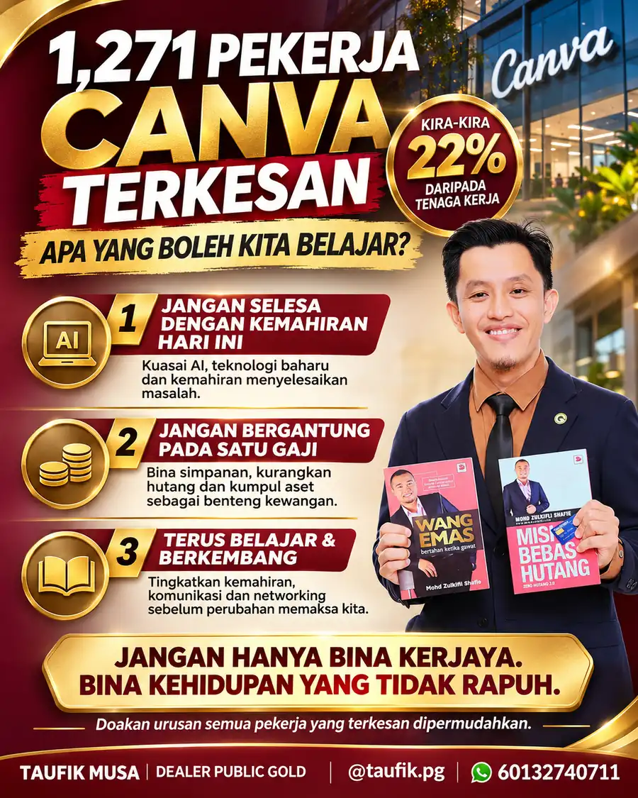

Matlamat Simpanan

# 1,271 Pekerja Canva Terkesan, Apa Yang Boleh Kita Belajar?

*"Jangan hanya bina kerjaya. Bina kehidupan yang tidak rapuh."*
{: .lead }

**Taufik Bin Musa** · 5 November 2026 · 5 min baca
{: .byline }

{ .step-img width="900" height="1125" }

Canva baru-baru ini mengumumkan penstrukturan semula organisasi yang bakal memberi kesan kepada 1,271 orang pekerjanya, bersamaan kira-kira 22% daripada keseluruhan tenaga kerja syarikat.

Di sebalik angka itu, ada 1,271 orang manusia.

Ada yang sudah bertahun-tahun membina kerjaya di sana. Ada yang mempunyai keluarga untuk ditanggung. Ada yang mungkin tidak pernah terfikir bahawa suatu hari nanti kedudukan mereka dalam syarikat akan berubah.

Bukan semuanya kehilangan pekerjaan. Ada yang akan bertukar peranan, ada yang diminta berpindah lokasi dan ada juga yang terpaksa meninggalkan syarikat.

Apa pun situasinya, kita doakan urusan mereka dipermudahkan.

Namun, ada satu perkara yang menarik untuk kita renungkan daripada peristiwa ini.

## Syarikat pencipta perubahan pun perlu berubah

Canva sendiri merupakan antara syarikat teknologi yang membantu mengubah cara manusia bekerja.

Daripada menghasilkan poster, presentation, video sehinggalah pelbagai bahan pemasaran, semuanya menjadi jauh lebih mudah dengan teknologi yang mereka bangunkan.

Tetapi hari ini, Canva sendiri perlu melakukan perubahan besar untuk menyesuaikan diri dengan realiti industri yang semakin mencabar.

Inilah realiti dunia pekerjaan hari ini.

> Syarikat yang pernah mencipta perubahan juga tidak terkecuali daripada perlu berubah untuk terus bertahan.

Ada tiga pengajaran besar yang boleh kita ambil.

## 1. Jangan terlalu selesa dengan kemahiran yang kita ada hari ini

Kemahiran yang menjadikan kita pekerja bernilai sepuluh tahun lalu mungkin bukan lagi kemahiran yang paling diperlukan hari ini.

Dahulu, menguasai sesuatu software mungkin sudah cukup untuk menjadikan kita pakar.

Hari ini, kita perlu tahu bagaimana menggunakan AI, menggabungkan pelbagai teknologi dan menyelesaikan masalah dengan lebih kreatif.

Bukan bermaksud pengalaman lama sudah tidak berguna.

Tetapi pengalaman perlu sentiasa berkembang bersama perubahan zaman.

Jangan sampai kita terlalu selesa dengan apa yang kita tahu sehingga terlupa untuk belajar perkara baharu.

## 2. Jangan bergantung kepada satu sumber pendapatan sahaja

Ramai antara kita membina seluruh kehidupan berdasarkan satu perkara.

Gaji bulanan.

Apabila gaji masuk, kita bayar komitmen. Apabila hujung bulan, kita tunggu gaji seterusnya.

Selagi pekerjaan masih ada, semuanya nampak terkawal.

Tetapi apabila pekerjaan terhenti, barulah kita sedar betapa pentingnya mempunyai simpanan dan aset yang boleh menjadi benteng kewangan keluarga.

Pesan guru saya, Tn Mohd Zulkifli Shafie:

> Kekayaan sebenar bukan diukur pada berapa besar gaji yang kita terima. Tetapi pada berapa banyak tabungan dan harta yang kita bina, serta berapa banyak hutang yang berjaya kita kurangkan.

Sebab itu, jangan hanya fikir bagaimana hendak meningkatkan pendapatan.

Fikir juga bagaimana hendak mengurus, menyimpan dan membina aset daripada pendapatan yang kita terima. Mulakan dengan [simpanan emas melalui GAP Public Gold](apa-itu-akaun-gap-gold-accumulation-program-public-gold.md) [serendah RM100](https://publicgold.com.my/index.php?route=account/register&intro_pgcode=PG00359605&is_dealer=1), dan baca juga [5 cara tukar side income jadi kekayaan jangka panjang](5-cara-tukar-side-income-jadi-kekayaan.md). Kalau nak saya bimbing, [PM saya di WhatsApp](https://api.whatsapp.com/send/?phone=60132740711&text=Boleh+guide+saya+simpan+emas+Public+Gold&type=phone_number&app_absent=0).

## 3. Jangan berhenti belajar apabila sudah mempunyai pekerjaan yang stabil

Sebenarnya, waktu terbaik untuk meningkatkan kemahiran bukan ketika kita sudah kehilangan pekerjaan.

Waktu terbaik ialah ketika kita masih mempunyai pendapatan, masa dan peluang untuk belajar.

Belajar teknologi baharu. Tingkatkan kemahiran komunikasi. Fahami AI. Bina networking. Cari peluang untuk mencipta nilai di luar skop kerja harian.

Jangan tunggu keadaan memaksa kita berubah.

Berubahlah sebelum kita terpaksa berubah.

## Akhir sekali

Ada satu perkara yang kita perlu faham.

Kita mungkin tidak mampu mengawal keputusan syarikat.

Kita juga tidak mampu menghentikan perkembangan teknologi.

Tetapi kita masih boleh mengawal bagaimana kita mempersiapkan diri untuk menghadapi perubahan.

Kerjaya boleh berubah.

Jawatan boleh hilang.

Syarikat boleh melakukan restructuring.

Tetapi ilmu, kemahiran, simpanan dan aset yang kita bina boleh menjadi bekalan untuk menghadapi fasa kehidupan seterusnya.

Jangan hanya sibuk membina kerjaya sehingga terlupa membina kehidupan.

Sebab akhirnya, matlamat kita bukan sekadar mempunyai pekerjaan yang baik.

Tetapi mempunyai kehidupan yang tidak terlalu rapuh apabila pekerjaan itu sudah tiada.

> Kalau esok kita kehilangan pekerjaan, sejauh mana persediaan kewangan dan kemahiran yang kita ada mampu membantu kita bertahan?

Moga perkongsian ini bermanfaat.

### Bina Benteng Kewangan Sebelum Perubahan Datang

Daftar percuma dan mula serendah RM100 ikut kemampuan, atau WhatsApp saya untuk bimbingan percuma.

[Daftar Percuma →](https://publicgold.com.my/index.php?route=account/register&intro_pgcode=PG00359605&is_dealer=1){ .md-button .btn-gold target="_blank" }
[💬 WhatsApp](https://api.whatsapp.com/send/?phone=60132740711&text=Boleh+guide+saya+simpan+emas+Public+Gold&type=phone_number&app_absent=0){ .md-button .btn-wa target="_blank" }
[✈️ Telegram](https://t.me/taufikpg_emas){ .md-button .btn-tg }
[📘 E-Book](https://pg2u.my/app/ebook/taufikmusa){ .md-button .btn-ebook }

<!-- baca-juga -->
## Baca juga

- [Lubang Yang Digali Ayah Untuk Anaknya, Sembilan Tahun Kemudian Jadi Taman Bunga Matahari](lubang-yang-digali-ayah-jadi-taman-bunga-matahari-xinlei.md)
- [Skateboarding Bermula Daripada Peluncur Ombak Yang Bosan Menunggu Ombak Laut](skateboarding-bermula-peluncur-ombak-bosan-tunggu-ombak.md)
- [5 Cara Bantu Keluarga Tanpa Mengorbankan Masa Depan Sendiri](5-cara-bantu-keluarga-tanpa-korbankan-masa-depan.md)

<!-- /baca-juga -->

#### Taufik Bin Musa
Dealer Public Gold · PG00359605 · G100 Network

Saya dealer dan committee di G100 Network, rangkaian dealer terbesar di Malaysia yang membimbing lebih 1.2 juta penyimpan emas. Saya bantu anda bina aset emas melalui Akaun GAP, terus dengan Public Gold.

`Mula RM100` `Tiada komitmen` `Boleh tukar emas fizikal` `Patuh syariah` `Tiada caj dealer`

Semua urus niaga dibuat terus bersama Public Gold, syarikat emas terbesar Malaysia sejak 2008. Tugas Dealer hanya menjadi pemudahcara urusniaga dan berkongsi ilmu emas yang praktikal, InsyaAllah.

[Jemput juga ke Website Rasmi Dealer G100 saya di pg2u.my/taufikmusa ↗](https://pg2u.my/taufikmusa){ target="_blank" }

{ width="640" height="959" loading="lazy" }

