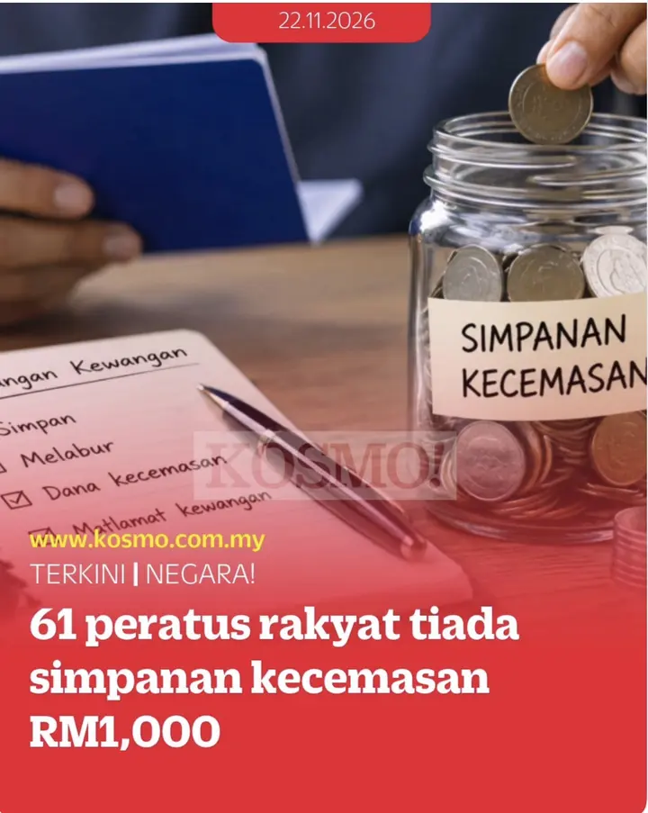

Matlamat Simpanan

# 61 Peratus Rakyat Tiada Simpanan Kecemasan RM1,000, Kita Pula Macam Mana?

*"Tak perlu tunggu kaya untuk menyimpan. Kita menyimpanlah supaya kewangan kita menjadi lebih kukuh."*
{: .lead }

**Taufik Bin Musa** · 22 November 2026 · 4 min baca
{: .byline }

{ .step-img width="720" height="903" }

Sumber: Kosmo!, 22 November 2026.

**61% rakyat Malaysia tiada simpanan kecemasan RM1,000. Kita pula macam mana?**

Sebanyak 61 peratus rakyat Malaysia dilaporkan tidak mempunyai simpanan sekurang-kurangnya RM1,000 untuk menghadapi kecemasan.

Bayangkan...

Kita sudah bekerja 5 tahun, 10 tahun, malah mungkin 20 tahun.

Setiap bulan gaji masuk.

Tetapi apabila kereta rosak, anak jatuh sakit atau tiba-tiba hilang pekerjaan, kita mula pening kepala mencari duit.

- Nak pinjam keluarga.
- Nak guna kad kredit.
- Nak keluarkan duit daripada simpanan yang sebenarnya sudah hampir habis.

Persoalannya, ke mana perginya duit hasil titik peluh kita selama ini?

Pesan guru emas saya, Tn Mohd Zulkifli Shafie:

> "Kalau dah kerja bertahun-tahun tapi simpanan RM1,000 pun tak ada, cubalah menabung emas dengan ilmu pulak. Tengoklah nanti keajaiban berlaku pada kewangan masing-masing. Insya-Allah."

Saya tertarik dengan pesanan ini.

Sebenarnya, masalah ramai orang bukan kerana mereka langsung tidak bekerja keras.

Tetapi mereka belum ada sistem yang membantu duit gaji kekal menjadi simpanan.

Cuba kita faham 5 perkara ini.

## 1. Jangan tunggu duit lebih baru nak menabung

Kalau tunggu duit lebih, sampai bila-bila pun mungkin tak ada.

Asingkan simpanan sebaik sahaja gaji masuk. Walaupun RM100 dahulu. Lihat [5 langkah matlamat simpan emas supaya gaji tak bocor](5-langkah-matlamat-simpan-emas-supaya-gaji-tak-bocor.md).

## 2. Jangan biarkan semua duit mudah dibelanjakan

Duit dalam akaun bank terlalu mudah digunakan.

Nampak baki banyak, rasa macam masih mampu berbelanja.

Sebab itu kita perlukan disiplin dan sistem simpanan yang betul.

## 3. Belajar menabung emas dengan ilmu

Emas boleh menjadi salah satu alat untuk membantu kita mendisiplinkan simpanan.

Apabila duit ditukarkan kepada emas, kita mula berfikir dua kali sebelum menjualnya untuk perkara yang tidak penting.

## 4. Mulakan dengan kemampuan sendiri

Tak perlu tunggu ada ribuan ringgit.

Melalui [Akaun Emas GAP Public Gold](https://publicgold.com.my/index.php?route=account/register&intro_pgcode=PG00359605&is_dealer=1){ target="_blank" }, kita boleh mula menabung emas [serendah RM100](https://publicgold.com.my/index.php?route=account/register&intro_pgcode=PG00359605&is_dealer=1){ target="_blank" }.

Beli sedikit demi sedikit mengikut kemampuan.

## 5. Konsisten lebih penting daripada jumlah yang besar

Jangan pandang rendah simpanan kecil.

Orang yang menyimpan RM100 setiap bulan sedang membina tabiat kewangan yang jauh lebih baik daripada orang yang hanya merancang untuk menyimpan tetapi tidak pernah bermula.

**Cuma satu perkara perlu kita ingat.** Dana kecemasan tunai masih penting untuk keperluan segera. Emas pula boleh menjadi sebahagian daripada simpanan jangka panjang.

## Kesimpulannya

Jangan sampai kita bekerja berpuluh-puluh tahun, tetapi hasil titik peluh kita semuanya habis untuk membayar komitmen dan perbelanjaan.

Biar gaji kita sederhana.

Asalkan setiap tahun tabungan bertambah, harta berkembang dan hutang semakin berkurangan.

Itulah antara ukuran sebenar kemajuan kewangan kita.

Kalau belum mula menyimpan, mulakan hari ini.

Tak perlu tunggu kaya untuk menyimpan. Kita menyimpanlah supaya kewangan kita menjadi lebih kukuh.

Kalau anda nak belajar bagaimana nak mula menyimpan emas melalui GAP Public Gold, [hubungi saya](https://api.whatsapp.com/send/?phone=60132740711&text=Boleh+guide+saya+simpan+emas+Public+Gold&type=phone_number&app_absent=0){ target="_blank" }. Saya bantu terangkan langkah demi langkah. Atau lihat [cara daftar akaun GAP](cara-daftar-public-gold-gap-2026.md).

Moga perkongsian ini bermanfaat.

**Dulu ragu, kini tahu. Jom simpan emas!**

### Mula Menabung Emas Serendah RM100

Daftar percuma dan mula serendah RM100 ikut kemampuan, atau WhatsApp saya untuk bimbingan percuma.

[Daftar Percuma →](https://publicgold.com.my/index.php?route=account/register&intro_pgcode=PG00359605&is_dealer=1){ .md-button .btn-gold target="_blank" }
[💬 WhatsApp](https://api.whatsapp.com/send/?phone=60132740711&text=Boleh+guide+saya+simpan+emas+Public+Gold&type=phone_number&app_absent=0){ .md-button .btn-wa target="_blank" }
[✈️ Telegram](https://t.me/taufikpg_emas){ .md-button .btn-tg }
[📘 E-Book](https://pg2u.my/app/ebook/taufikmusa){ .md-button .btn-ebook }

<!-- baca-juga -->
## Baca juga

- [RM4,000 Sama Dengan 1.88 Bilion Rial Iran, Tapi Kita Bukan Bilionair](rm4000-bersamaan-188-bilion-rial-iran-kuasa-beli-duit.md)
- [Hari Lelaki Antarabangsa: Tanggungjawab Yang Wajib Direnungkan](hari-lelaki-antarabangsa-tanggungjawab-wajib-direnungkan.md)
- [Pencen 5 Tahun Dari Sekarang? Mustahil Ke?](pencen-5-tahun-dari-sekarang-mustahil-ke.md)

<!-- /baca-juga -->

#### Taufik Bin Musa
Dealer Public Gold · PG00359605 · G100 Network

Saya dealer dan committee di G100 Network, rangkaian dealer terbesar di Malaysia yang membimbing lebih 1.2 juta penyimpan emas. Saya bantu anda bina aset emas melalui Akaun GAP, terus dengan Public Gold.

`Mula RM100` `Tiada komitmen` `Boleh tukar emas fizikal` `Patuh syariah` `Tiada caj dealer`

Semua urus niaga dibuat terus bersama Public Gold, syarikat emas terbesar Malaysia sejak 2008. Tugas Dealer hanya menjadi pemudahcara urusniaga dan berkongsi ilmu emas yang praktikal, InsyaAllah.

[Jemput juga ke Website Rasmi Dealer G100 saya di pg2u.my/taufikmusa ↗](https://pg2u.my/taufikmusa){ target="_blank" }

{ width="640" height="959" loading="lazy" }

