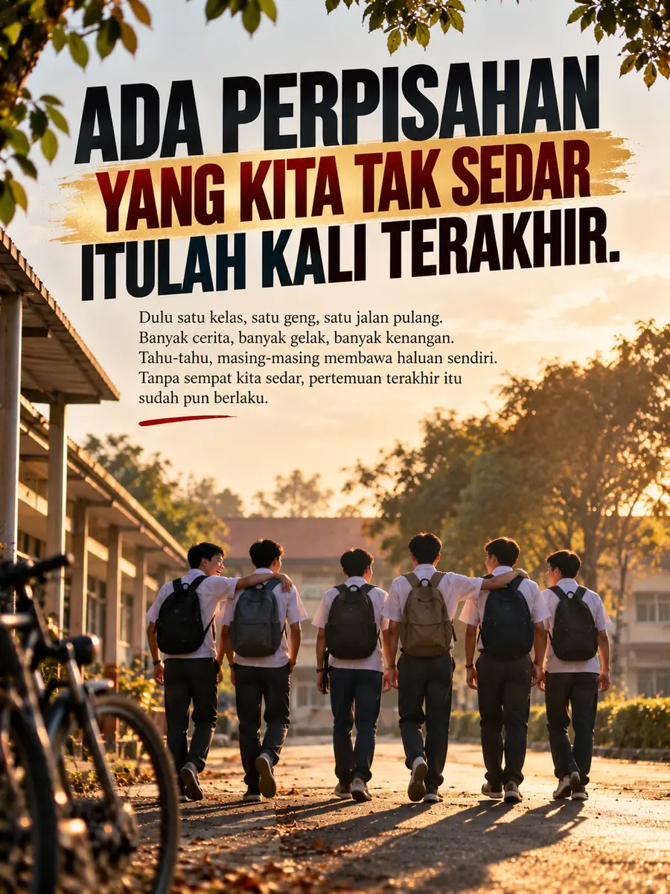

Kehidupan

# Ada Perpisahan Yang Kita Tak Sedar Itulah Kali Terakhir.

*"Pernah tak kita terfikir, mungkin ada seseorang yang pernah rapat dengan kita, yang suatu hari nanti kita takkan jumpa lagi?"*
{: .lead }

**Taufik Bin Musa** · 24 Oktober 2026 · 4 min baca
{: .byline }

{ .step-img width="900" height="1200" }

Bukan sebab bergaduh. Bukan juga sebab ada perkara besar yang berlaku.

Cuma, perlahan-lahan, masing-masing membawa haluan sendiri.

## The Last Meeting Theory

Ada satu idea yang dipanggil **The Last Meeting Theory**.

Teori ini membawa satu perspektif tentang pertemuan dan perpisahan. Bila seseorang itu sudah selesai memainkan peranannya dalam satu fasa kehidupan kita, mungkin selepas itu kita takkan bertemu dengannya lagi.

Walaupun tinggal tak jauh. Walaupun masih ada kawan yang sama. Walaupun masih follow satu sama lain di media sosial.

Anehnya, kita tetap tak berjumpa.

Dan yang paling menyedihkan, kadang-kadang kita tak tahu pun pertemuan terakhir itu sebenarnya sudah berlaku.

Masa bersalaman dulu, kita tak tahu itulah kali terakhir.

Masa berbual dan ketawa bersama, kita tak tahu selepas itu semuanya akan menjadi kenangan.

Tak ada ucapan selamat tinggal yang istimewa. Tak ada perbualan terakhir untuk menjelaskan semuanya.

Tahu-tahu, orang itu dah tak ada dalam rutin kehidupan kita.

## Tak semua orang ditakdirkan kekal

Bila difikirkan semula, mungkin memang begitulah kehidupan.

Ada orang hadir untuk menemani kita dalam satu fasa. Ada yang mengajar kita sesuatu tentang kehidupan. Ada juga yang kehadirannya membuatkan kita lebih mengenali diri sendiri.

Bukan semua orang yang pernah rapat dengan kita ditakdirkan untuk kekal bersama sampai ke penghujung perjalanan.

Dan tak semestinya seseorang itu perlu kekal dalam hidup kita untuk menjadikan kehadirannya bermakna.

Ada orang yang kita dah lama tak jumpa, tetapi nasihatnya masih kita ingat sampai hari ini.

Ada orang yang dah lama tak bercakap dengan kita, tetapi pengalaman bersamanya masih mengubah cara kita melihat kehidupan.

Mungkin kita tak lagi menjadi sebahagian daripada kehidupan mereka. Tapi ada sesuatu yang mereka tinggalkan dalam diri kita, yang kita bawa ke mana-mana.

## Hargailah waktu yang masih ada

Sebab itu, kalau hari ini masih ada orang yang kita sayang, masih ada peluang untuk bertanya khabar, masih ada masa untuk duduk berbual bersama, hargailah waktu itu.

> Kita tak pernah tahu bila sesuatu pertemuan akan menjadi kenangan terakhir.

Dan kalau ada seseorang yang sudah lama pergi daripada hidup kita, tak semestinya kita perlu mencari jawapan kenapa semuanya berakhir.

Kadang-kadang, kita boleh menghargai apa yang pernah berlaku tanpa perlu mengulanginya semula.

Tak semua orang yang pernah hadir dalam hidup kita ditakdirkan untuk kekal. Tapi itu tak bermakna kehadiran mereka sia-sia.

Mungkin kita sudah membawa haluan masing-masing.

Dan mungkin, itu pun sebahagian daripada perjalanan hidup yang perlu kita terima.

#### Taufik Bin Musa
Dealer Public Gold · PG00359605 · G100 Network

Saya dealer dan committee di G100 Network, rangkaian dealer terbesar di Malaysia yang membimbing lebih 1.2 juta penyimpan emas. Saya bantu anda bina aset emas melalui Akaun GAP, terus dengan Public Gold.

`Mula RM100` `Tiada komitmen` `Boleh tukar emas fizikal` `Patuh syariah` `Tiada caj dealer`

Semua urus niaga dibuat terus bersama Public Gold, syarikat emas terbesar Malaysia sejak 2008. Tugas Dealer hanya menjadi pemudahcara urusniaga dan berkongsi ilmu emas yang praktikal, InsyaAllah.

[Jemput juga ke Website Rasmi Dealer G100 saya di pg2u.my/taufikmusa ↗](https://pg2u.my/taufikmusa){ target="_blank" }

{ width="640" height="959" loading="lazy" }

