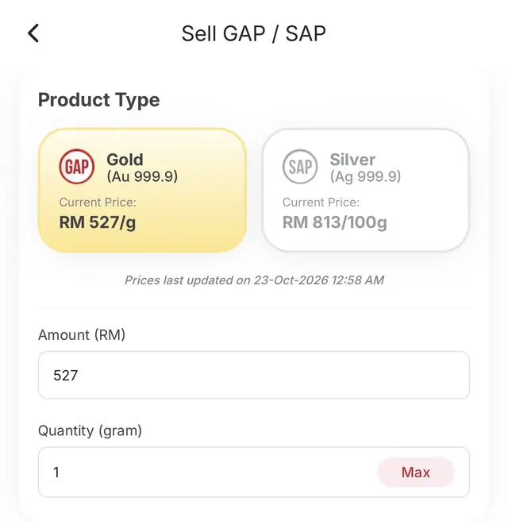

Asas GAP

# Apa Itu Akaun GAP (Gold Accumulation Program) Public Gold

*"Nak simpan emas, tapi takut hilang dan rasa duit belum cukup?"*
{: .lead }

**Taufik Bin Musa** · 23 Oktober 2026 · 6 min baca
{: .byline }

{ .step-img width="900" height="1125" }

Saya rasa ini antara sebab ramai orang masih belum mula menabung emas.

Ada yang takut nak simpan emas fizikal di rumah. Risau hilang, risau kena curi. Ada pula yang fikir nak mula simpan emas ni kena ada modal besar.

Akhirnya, hasrat nak menyimpan emas tinggal hasrat.

Tapi sebenarnya, kita tak semestinya perlu beli jongkong emas dan simpan sendiri di rumah untuk mula membina simpanan emas.

Pesan guru saya, Tn. Mohd Zulkifli Shafie, kekayaan bukan sekadar tentang berapa banyak duit yang ada dalam akaun bank, tetapi juga tentang aset yang berjaya kita kumpulkan.

Sebab tu saya nak kongsikan lima perkara tentang [akaun emas GAP](https://publicgold.com.my/index.php?route=account/register&intro_pgcode=PG00359605&is_dealer=1){ target="_blank" } (Gold Accumulation Program) Public Gold yang mungkin ramai belum tahu.

## ✅ 1. Mula serendah RM100

Tak perlu tunggu duit banyak baru nak mula. Kita boleh kumpul emas sedikit demi sedikit mengikut kemampuan, tanpa komitmen bulanan yang wajib.

Bila kita asingkan sebahagian duit untuk simpanan emas, sekurang-kurangnya ada usaha untuk mengelakkan duit itu habis dibelanjakan untuk perkara yang kurang penting.

Ini paparan dalam app Public Gold (swipe untuk lihat). Pada 23 Oktober 2026, [RM100](https://publicgold.com.my/index.php?route=account/register&intro_pgcode=PG00359605&is_dealer=1){ target="_blank" } bersamaan 0.1736 gram dan RM576 bersamaan 1 gram. Harga emas berubah dari semasa ke semasa.

<section class="gallery gallery-shot" data-autoplay="off" aria-label="Paparan app Public Gold: baki GAP dan beli GAP">

<figure class="gallery-slide"></figure>
<figure class="gallery-slide"></figure>
<figure class="gallery-slide"></figure>

<button class="gallery-nav prev" type="button" aria-label="Gambar sebelum">&#8249;</button>
<button class="gallery-nav next" type="button" aria-label="Gambar seterusnya">&#8250;</button>

</section>

## ✅ 2. Tak perlu simpan emas fizikal sendiri

Antara kelebihan GAP ialah simpanan emas kita disandarkan kepada emas fizikal. Program ini juga telah disahkan patuh syariah oleh Amanie Advisors.

Emas dalam akaun disimpan oleh Public Gold tanpa caj simpanan. Jadi, kita tak perlu risau tentang tempat nak menyimpan jongkong emas sendiri sejak hari pertama.

## ✅ 3. Boleh keluarkan emas fizikal

Apabila gram emas dah terkumpul dan memenuhi keperluan pengeluaran, kita boleh menebusnya dalam bentuk jongkong emas atau dinar, tertakluk kepada denominasi dan caj berkaitan.

Ini antara produk fizikal yang ada dalam app untuk pengeluaran GSAP (swipe untuk lihat).

<section class="gallery gallery-shot" data-autoplay="off" aria-label="Produk emas fizikal yang boleh ditebus melalui GSAP Withdrawal">

<figure class="gallery-slide"></figure>
<figure class="gallery-slide"></figure>
<figure class="gallery-slide"></figure>
<figure class="gallery-slide"></figure>
<figure class="gallery-slide"></figure>
<figure class="gallery-slide"></figure>
<figure class="gallery-slide"></figure>

<button class="gallery-nav prev" type="button" aria-label="Gambar sebelum">&#8249;</button>
<button class="gallery-nav next" type="button" aria-label="Gambar seterusnya">&#8250;</button>

</section>

Selain tebus daripada akaun, emas fizikal juga boleh dibeli terus melalui tab Outright Purchase.

<section class="gallery gallery-shot" data-autoplay="off" aria-label="Pembelian terus emas fizikal (Outright Purchase)">

<figure class="gallery-slide"></figure>
<figure class="gallery-slide"></figure>

<button class="gallery-nav prev" type="button" aria-label="Gambar sebelum">&#8249;</button>
<button class="gallery-nav next" type="button" aria-label="Gambar seterusnya">&#8250;</button>

</section>

Bagi saya, ada kepuasan tersendiri apabila dapat melihat hasil simpanan yang kita kumpul sedikit demi sedikit bertukar menjadi emas fizikal.

Lama-lama, kita akan lebih nampak tujuan sebenar kita menyimpan emas.

## ✅ 4. Boleh jual apabila perlukan tunai

Kita boleh menyemak baki dan menguruskan urus niaga melalui platform Public Gold.

Kalau berlaku kecemasan, emas dalam akaun juga boleh dijual semula kepada Public Gold, tertakluk kepada harga dan terma semasa. Harga jual dan harga beli tidak sama, jadi semak harga semasa dalam app sebelum membuat keputusan.

{ .step-img width="640" height="656" loading="lazy" }

Emas juga berpotensi digunakan sebagai cagaran di institusi Ar-Rahnu yang menerima emas berkenaan, tertakluk kepada penilaian dan syarat institusi tersebut.

Cuma, sebaiknya kita tetap sediakan dana kecemasan dalam bentuk tunai. Simpanan emas dan wang kecemasan ada peranan masing-masing.

## ✅ 5. Sesuai untuk bina simpanan jangka panjang

Melalui **GAP Junior**, simpanan emas juga boleh dimulakan untuk anak-anak yang memenuhi syarat pembukaan akaun.

Kita boleh kumpul sedikit demi sedikit untuk matlamat masa depan, sama ada pendidikan anak, persediaan haji atau keperluan keluarga. Nak tahu cara tetapkan matlamat? Baca [5 langkah matlamat simpan emas](5-langkah-matlamat-simpan-emas-supaya-gaji-tak-bocor.md).

Apabila tiba masa untuk mengeluarkan emas fizikal, kita boleh memilih kaedah yang disediakan oleh Public Gold, tertakluk kepada jenis produk, caj dan syarat semasa.

Bagi saya, perkara paling penting bukan berapa gram emas yang kita ada hari ini, tetapi bagaimana kita membina tabiat menyimpan secara konsisten.

Sebab akhirnya, kita bukan sekadar nak kumpul emas. Kita nak bina satu bentuk simpanan yang boleh membantu mencapai matlamat kewangan keluarga.

Jadi, kalau selama ini kita asyik tangguh sebab rasa modal belum cukup, mungkin dah tiba masa untuk ubah cara kita melihat simpanan emas.

Tak perlu tunggu sempurna. Mula ikut kemampuan dan fahami dahulu bagaimana sistemnya berfungsi.

Kalau nak tahu cara buka akaun GAP Public Gold dan mula menabung serendah RM100, [hubungi saya](https://api.whatsapp.com/send/?phone=60132740711&text=Boleh+guide+saya+simpan+emas+Public+Gold&type=phone_number&app_absent=0){ target="_blank" }. Saya bantu terangkan langkah demi langkah secara percuma. Atau baca dulu [cara daftar Public Gold GAP](cara-daftar-public-gold-gap-2026.md) dan [9 soalan lazim sebelum buka akaun](9-soalan-lazim-sebelum-buka-akaun-emas-gap.md).

Moga perkongsian ini bermanfaat.

### Mula Akaun GAP Anda Hari Ini

Daftar percuma dan mula dengan RM100, atau WhatsApp saya untuk bimbingan percuma.

[Daftar Percuma →](https://publicgold.com.my/index.php?route=account/register&intro_pgcode=PG00359605&is_dealer=1){ .md-button .btn-gold target="_blank" }
[💬 WhatsApp](https://api.whatsapp.com/send/?phone=60132740711&text=Boleh+guide+saya+simpan+emas+Public+Gold&type=phone_number&app_absent=0){ .md-button .btn-wa target="_blank" }
[✈️ Telegram](https://t.me/taufikpg_emas){ .md-button .btn-tg }
[📘 E-Book](https://pg2u.my/app/ebook/taufikmusa){ .md-button .btn-ebook }

#### Taufik Bin Musa
Dealer Public Gold · PG00359605 · G100 Network

Saya dealer dan committee di G100 Network, rangkaian dealer terbesar di Malaysia yang membimbing lebih 1.2 juta penyimpan emas. Saya bantu anda bina aset emas melalui Akaun GAP, terus dengan Public Gold.

`Mula RM100` `Tiada komitmen` `Boleh tukar emas fizikal` `Patuh syariah` `Tiada caj dealer`

Semua urus niaga dibuat terus bersama Public Gold, syarikat emas terbesar Malaysia sejak 2008. Tugas Dealer hanya menjadi pemudahcara urusniaga dan berkongsi ilmu emas yang praktikal, InsyaAllah.

[Jemput juga ke Website Rasmi Dealer G100 saya di pg2u.my/taufikmusa ↗](https://pg2u.my/taufikmusa){ target="_blank" }

{ width="640" height="959" loading="lazy" }

