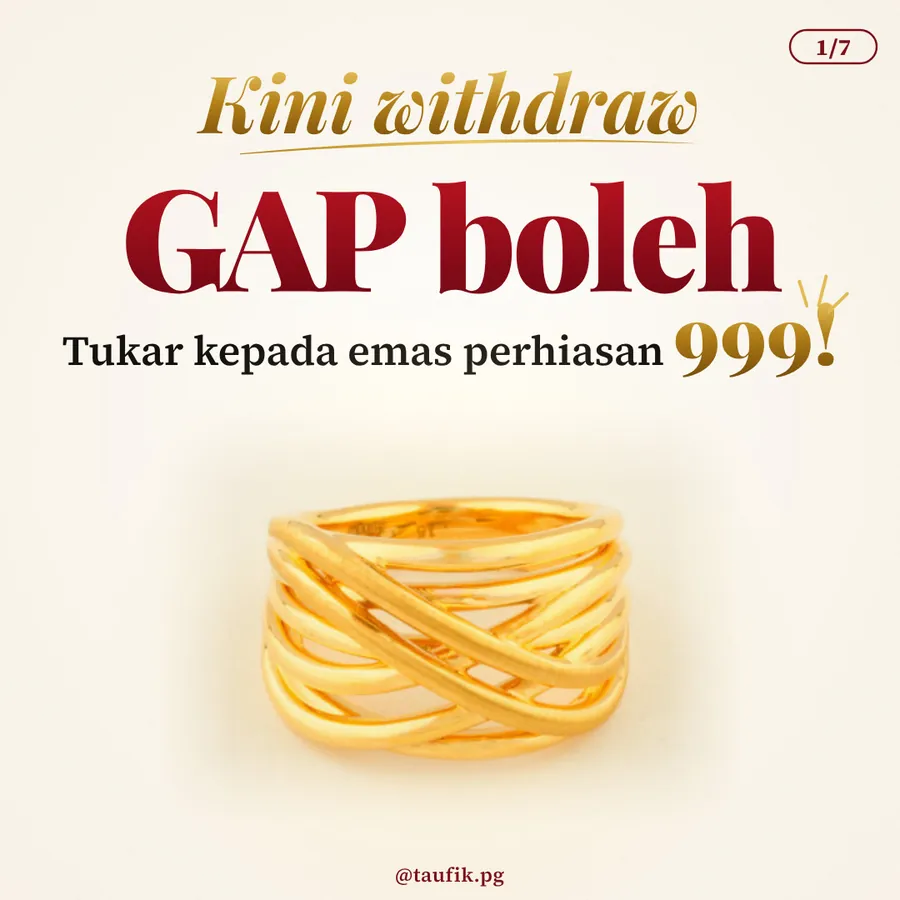
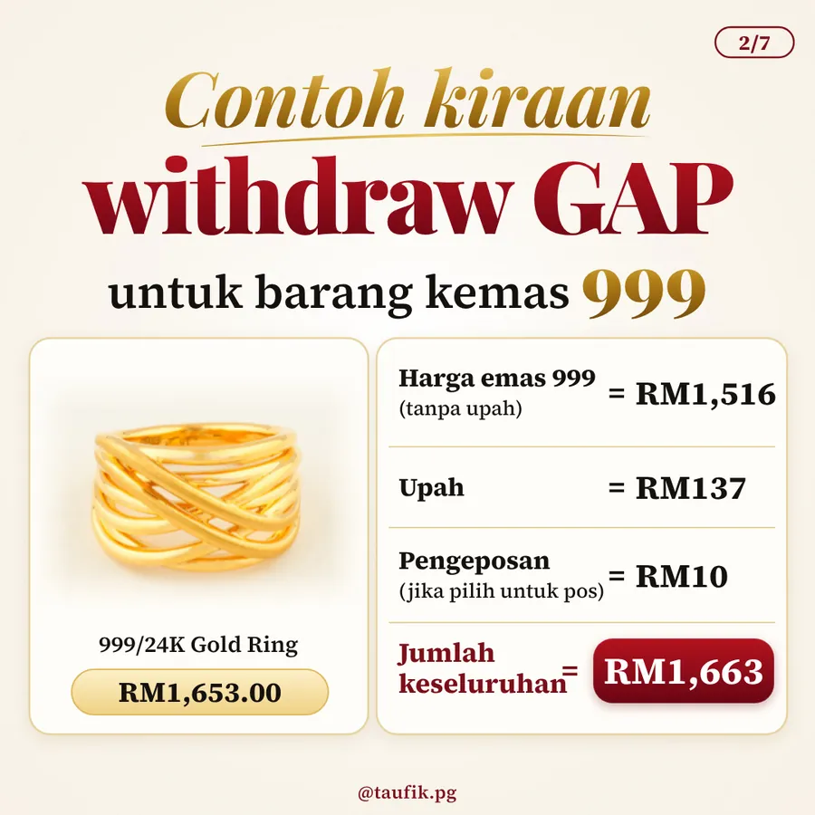
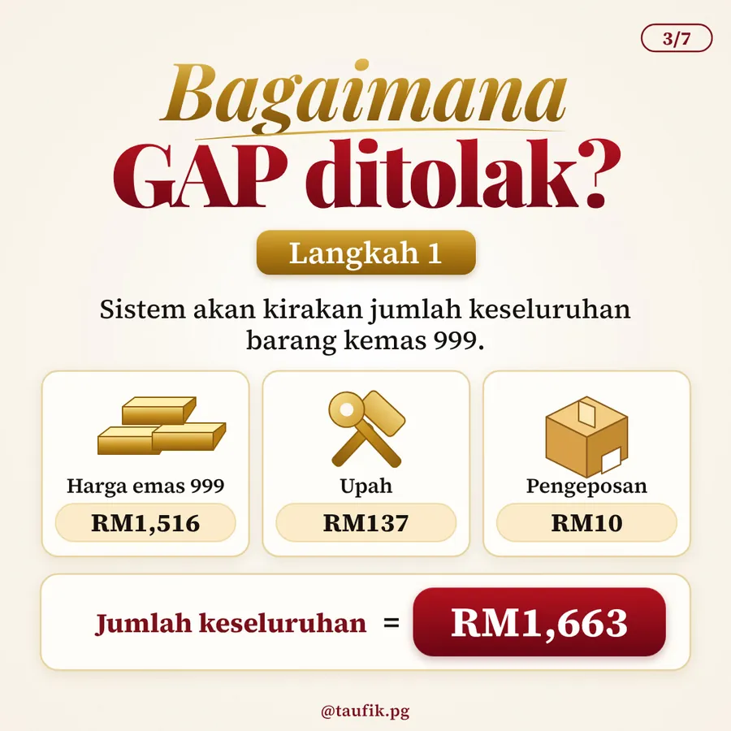
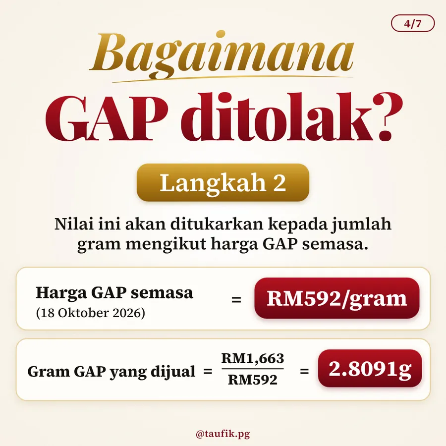
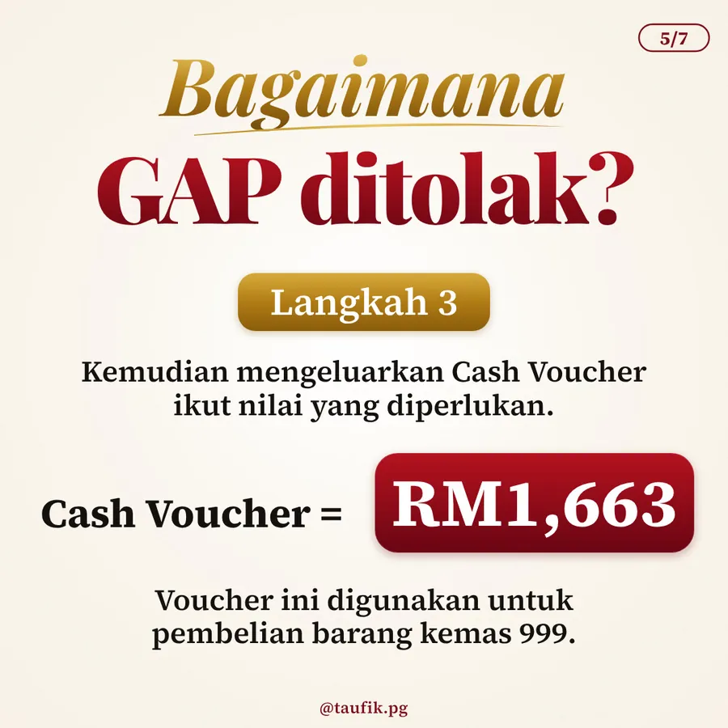
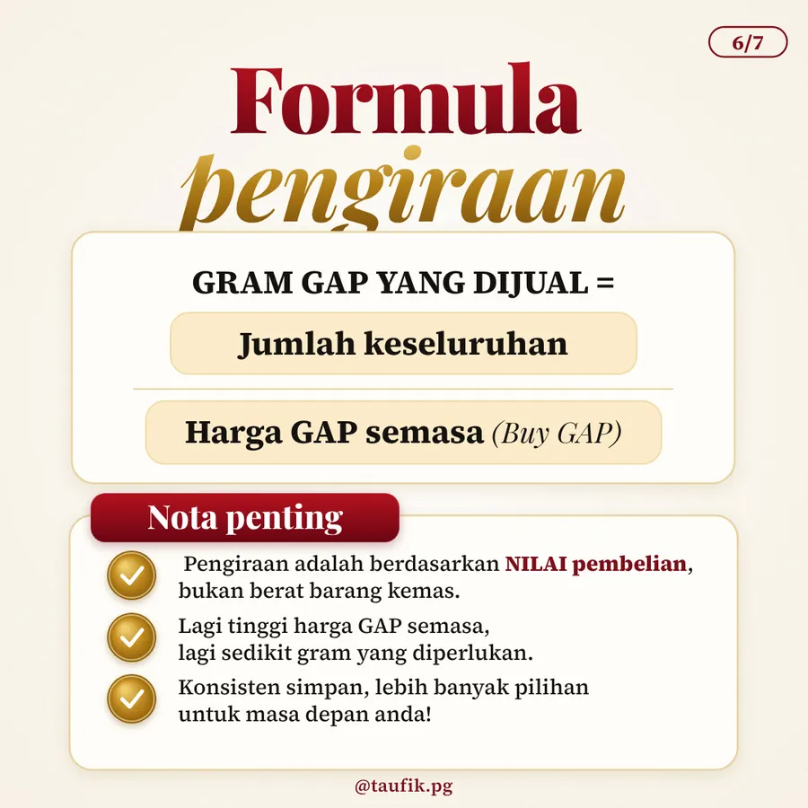
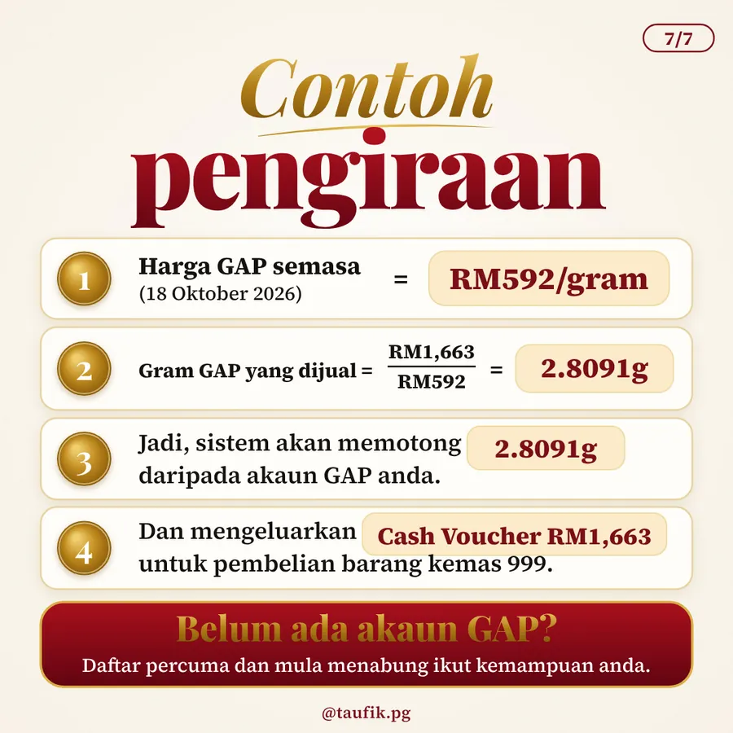

PG Jewel

# Cara Miliki Barang Kemas di PG Jewel Melalui Akaun GAP Public Gold

*"Ramai ingat Akaun Emas GAP terhad untuk gold bar atau dinar sahaja. Betul ke?"*
{: .lead }

**Taufik Bin Musa** · 18 Oktober 2026 · 3 min baca
{: .byline }

{ .step-img width="900" height="900" }

Ramai ingat Akaun Emas GAP (Gold Accumulation Program) terhad untuk pengeluaran gold bar atau dinar sahaja. Hakikatnya, kini anda boleh guna baki gram dalam akaun GAP untuk tebus barang kemas 999 idaman di PG Jewel, tanpa keluarkan duit poket tambahan.

Bagaimana kaedah tolakannya berfungsi? Jom kita teliti contoh kiraan sebenar.

## 💍 Contoh kiraan: tebus cincin emas 999

Ini contoh kiraan untuk tebus Cincin Emas 999 (999/24K Gold Ring) bernilai RM1,653 (harga emas ditambah upah):

| Butiran | Jumlah |
|---|---:|
| Harga emas 999 (tanpa upah) | RM1,516 |
| Upah | RM137 |
| Pengeposan (jika pilih untuk pos) | RM10 |
| Jumlah keseluruhan | RM1,663 |

{ .step-img width="900" height="900" loading="lazy" }

## ✅ 3 langkah sistem tolak gram GAP anda

**Langkah 1: sistem kira jumlah keseluruhan.** Sistem menjumlahkan harga emas 999, upah dan pengeposan untuk dapatkan jumlah keseluruhan barang kemas, iaitu **RM1,663**.

{ .step-img width="900" height="900" loading="lazy" }

**Langkah 2: nilai ditukar kepada gram ikut harga GAP semasa.** Jika harga GAP pada 18 Oktober 2026 ialah RM592/gram, sistem bahagikan RM1,663 dengan RM592, menjadikan gram GAP yang dijual berjumlah **2.8091g**.

{ .step-img width="900" height="900" loading="lazy" }

**Langkah 3: potong gram dan keluarkan Cash Voucher.** Sistem potong 2.8091g daripada akaun GAP anda dan keluarkan Cash Voucher bernilai RM1,663 untuk pembelian barang kemas tersebut.

{ .step-img width="900" height="900" loading="lazy" }

## 📐 Formula asas yang perlu anda tahu

Gram GAP yang dijual = Jumlah keseluruhan ÷ Harga GAP semasa (Buy GAP)

Sebagai semakan: RM1,663 ÷ RM592 = 2.8091g.

{ .step-img width="900" height="900" loading="lazy" }

## 📌 3 nota penting

1. Pengiraan adalah berdasarkan **nilai pembelian**, bukan berat barang kemas.
2. Lagi tinggi harga GAP semasa, lagi sedikit gram yang diperlukan.
3. Konsisten simpan, lebih banyak pilihan untuk masa depan anda!

{ .step-img width="900" height="900" loading="lazy" }

Belum ada akaun GAP? Pendaftaran adalah percuma. Mula menabung ikut kemampuan anda, dan bila gram sudah cukup, anda bebas pilih sama ada mahu simpan sebagai gold bar, dinar atau tukar kepada perhiasan.

!!! note "Pautan rujukan PG Jewel"
    - 💎 Lihat katalog rekaan terkini: [Koleksi PG Jewel](https://www.pgjewel.my/){ target="_blank" }
    - 📍 Lokasi outlet berhampiran: [Cawangan PG Jewel](https://simpanemasfizikal.com/jual-emas.html#pg-jewel){ target="_blank" }
    - 🪙 Mula menabung gram emas: [Cara Daftar Public Gold GAP](cara-daftar-public-gold-gap-2026.md)

!!! question "Anda lebih suka simpan gold bar atau kumpul gram untuk tebus barang kemas 999?"
    Cerita pada saya di WhatsApp. Mana tahu ia memberi semangat kepada orang lain juga! 👇

### Mula Simpan Emas Hari Ini

Klik "WhatsApp" di bawah untuk Taufik bantu mulakan langkah pertama anda.

[Daftar Percuma →](https://publicgold.com.my/index.php?route=account/register&intro_pgcode=PG00359605&is_dealer=1){ .md-button .btn-gold target="_blank" }
[💬 WhatsApp Taufik](https://api.whatsapp.com/send/?phone=60132740711&text=Boleh+guide+saya+simpan+emas+Public+Gold&type=phone_number&app_absent=0){ .md-button .btn-wa target="_blank" }
[✈️ Join Telegram](https://t.me/taufikpg_emas){ .md-button .btn-tg }
[📘 E-Book Percuma](https://pg2u.my/app/ebook/taufikmusa){ .md-button .btn-ebook }

#### Taufik Bin Musa
Dealer Public Gold · PG00359605 · G100 Network

Saya dealer dan committee di G100 Network, rangkaian dealer terbesar di Malaysia yang membimbing lebih 1.2 juta penyimpan emas. Saya bantu anda bina aset emas melalui Akaun GAP, terus dengan Public Gold.

`Mula RM100` `Tiada komitmen` `Boleh tukar emas fizikal` `Patuh syariah` `Tiada caj dealer`

Semua urus niaga dibuat terus bersama Public Gold, syarikat emas terbesar Malaysia sejak 2008. Tugas Dealer hanya menjadi pemudahcara urusniaga dan berkongsi ilmu emas yang praktikal, InsyaAllah.

[Jemput juga ke Website Rasmi Dealer G100 saya di pg2u.my/taufikmusa ↗](https://pg2u.my/taufikmusa){ target="_blank" }

{ width="640" height="959" loading="lazy" }

