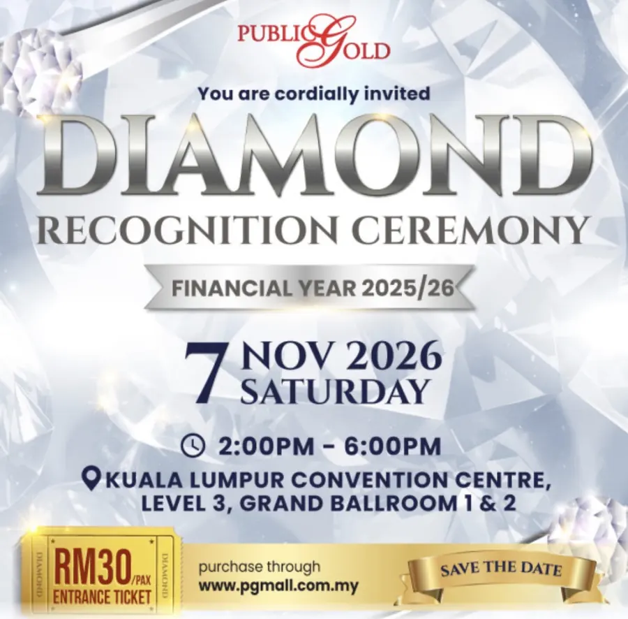
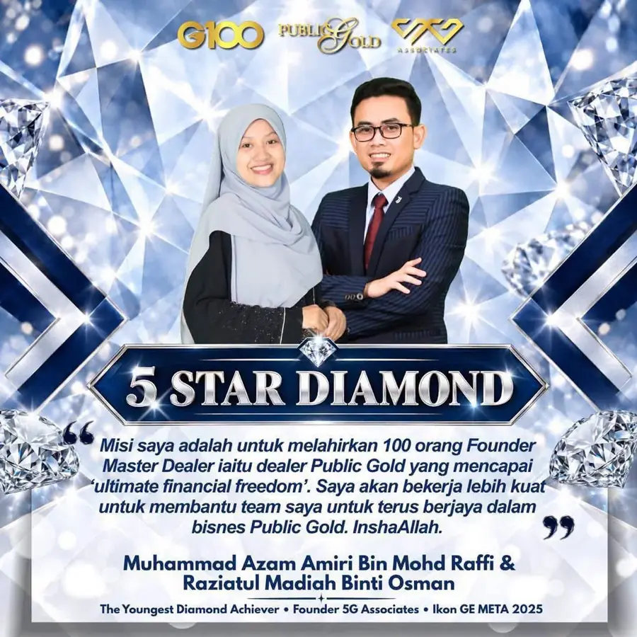
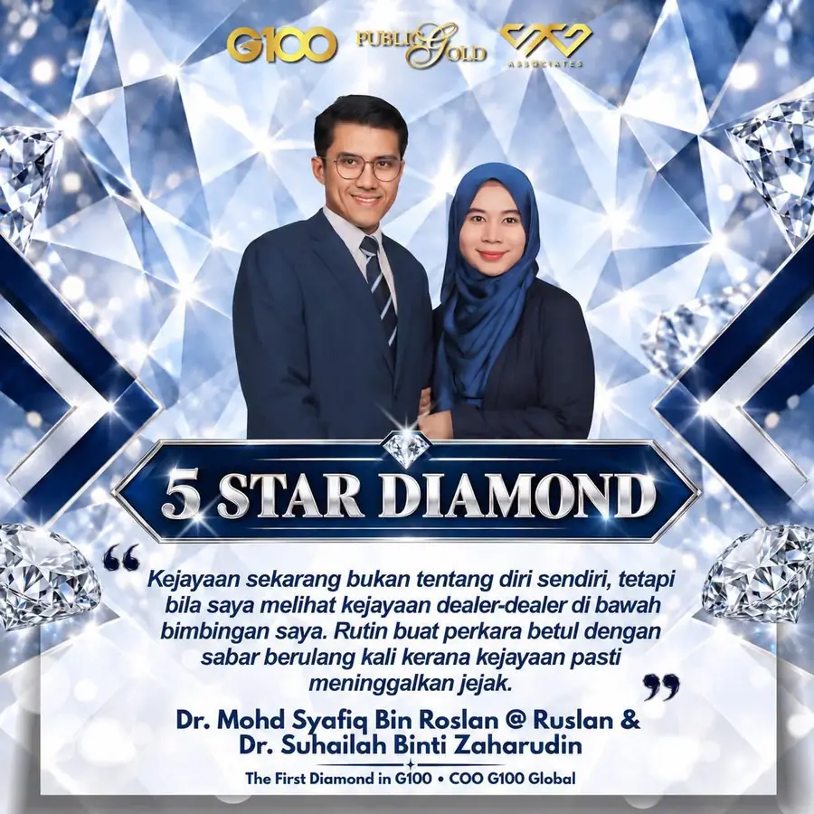
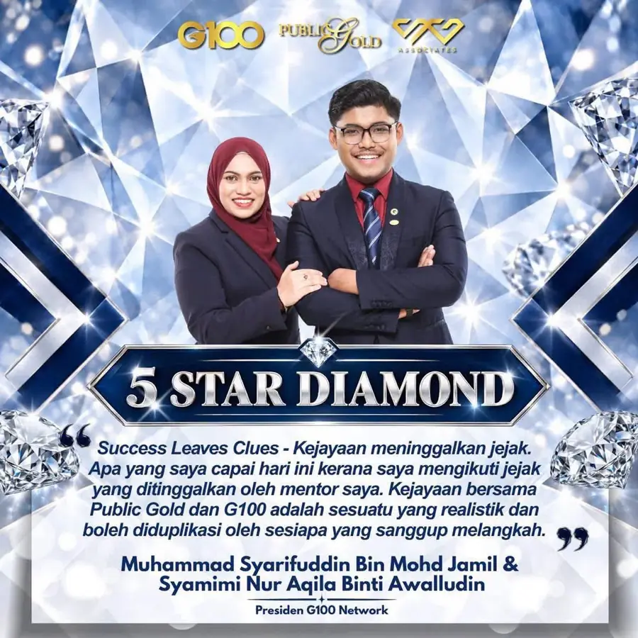

Diamond Day

# Diamond Day: Lihat Kejayaan Untuk Cipta Kejayaan

*"Mereka semua bermula dari bawah."*
{: .lead }

**Taufik Bin Musa** · 1 November 2026 · 6 min baca
{: .byline }

{ .step-img width="900" height="886" }

Setiap orang yang berjaya pasti ada cerita di sebalik kejayaan mereka.

Ada yang bermula sebagai mahasiswa. Ada yang datang daripada bidang profesional. Ada juga yang membina bisnes sambil meneruskan kerjaya masing-masing.

Tetapi satu persamaan yang menarik, mereka semua bermula dari bawah.

Pada **7 November 2026** ini, Public Gold akan meraikan kejayaan para achiever dalam majlis Diamond Day. Kalau nak tahu kenapa saya sendiri jemput anda, baca [kisah saya dan jemputan ke Diamond Day](runner-up-trimble-hackathon-dan-diamond-day.md).

Antara yang bakal diraikan ialah tiga individu yang mencipta sejarah tersendiri dalam Public Gold.

## 1. Dari mahasiswa, kini The Youngest Diamond pada usia 27 tahun

{ .step-img width="900" height="900" loading="lazy" }

Tuan Azam Amiri mula menunjukkan bakat kepimpinan sejak masih bergelar mahasiswa apabila memegang jawatan sebagai Presiden 5G Associates.

Beliau turut menerima pengiktirafan **Leadership Growth Champion** daripada Founder Public Gold, Dato' Seri Louis Ng, selepas berjaya melahirkan 12 orang Founder Master Dealer (FMD) dalam tempoh hanya satu tahun.

Hari ini, beliau berjaya membina rangkaian lebih 140,000 orang dan mencipta sejarah sebagai **The Youngest Diamond** dalam Public Gold.

## 2. Doktor berjiwa usahawan, First Diamond in G100

{ .step-img width="900" height="900" loading="lazy" }

Dr. Syafiq merupakan graduan perubatan dari Bandung, Indonesia.

Sebelum menyertai Public Gold, beliau sudah mengendalikan pelbagai jenis perniagaan.

Namun, segalanya berubah apabila beliau menemui "Big Why" dalam bisnes Public Gold.

Dengan kepimpinan dan usaha membina pasukan, beliau berjaya melahirkan 6 orang Founder Master Dealer (FMD) dan menerima anugerah **Leadership Champion Growth**.

Beliau kini turut memegang amanah sebagai Chief Operating Officer (COO) Global, Head of G100 Indonesia dan ahli Diamond Advisory Council.

Lebih membanggakan, beliau mencipta sejarah sebagai **The First Diamond in G100**.

## 3. Dari mahasiswa di Australia, kini seorang Diamond dalam Public Gold

{ .step-img width="900" height="900" loading="lazy" }

Berasal daripada keluarga sederhana, Tuan Syarif Jamil memulakan perjalanan bisnes Public Gold ketika masih bergelar mahasiswa di University of Wollongong, Australia.

Di sebalik kesibukan belajar dan melakukan pelbagai kerja sambilan, beliau tetap mengambil peluang membina perniagaan.

Hari ini, pada usia awal 30-an, beliau telah dilantik sebagai Presiden G100 Network dan berjaya mencapai pangkat Diamond dalam Public Gold.

Tiga individu. Tiga latar belakang berbeza. Tetapi satu persamaan: mereka berani bermula dan konsisten membina kejayaan.

## Ramai lagi achiever yang akan diraikan

Bukan itu sahaja. Ramai lagi achiever yang akan diraikan!

Selain tiga Diamond ini, Diamond Day turut meraikan barisan achiever 4 Star Ruby, 3 Star Pearl dan 3 Star Jade bagi tahun kewangan 2025/26 (swipe untuk lihat).

Mereka datang daripada pelbagai latar belakang dan bidang pekerjaan.

Ada yang bermula sebagai pekerja makan gaji. Ada yang doktor. Ada yang profesional. Ada juga yang membina bisnes sambil menguruskan keluarga.

Setiap seorang mempunyai kisah perjalanan yang tersendiri.

### 4 Star Ruby

<section class="gallery gallery-poster" data-autoplay="off" aria-label="Achiever 4 Star Ruby">

<figure class="gallery-slide"></figure>
<figure class="gallery-slide"></figure>
<figure class="gallery-slide"></figure>

<button class="gallery-nav prev" type="button" aria-label="Poster sebelum">&#8249;</button>
<button class="gallery-nav next" type="button" aria-label="Poster seterusnya">&#8250;</button>

</section>

### 3 Star Pearl

<section class="gallery gallery-poster" data-autoplay="off" aria-label="Achiever 3 Star Pearl">

<figure class="gallery-slide"></figure>
<figure class="gallery-slide"></figure>
<figure class="gallery-slide"></figure>
<figure class="gallery-slide"></figure>
<figure class="gallery-slide"></figure>
<figure class="gallery-slide"></figure>
<figure class="gallery-slide"></figure>

<button class="gallery-nav prev" type="button" aria-label="Poster sebelum">&#8249;</button>
<button class="gallery-nav next" type="button" aria-label="Poster seterusnya">&#8250;</button>

</section>

### 3 Star Jade

<section class="gallery gallery-poster" data-autoplay="off" aria-label="Achiever 3 Star Jade">

<figure class="gallery-slide"></figure>
<figure class="gallery-slide"></figure>

<button class="gallery-nav prev" type="button" aria-label="Poster sebelum">&#8249;</button>
<button class="gallery-nav next" type="button" aria-label="Poster seterusnya">&#8250;</button>

</section>

## Kenapa kita patut hadir Diamond Day?

Sebab kadang-kadang, untuk mencipta kejayaan, kita perlu melihat sendiri bagaimana orang lain membinanya.

- Kita boleh belajar daripada pengalaman mereka.
- Kita boleh memahami cara mereka membina kepimpinan.
- Kita boleh melihat bagaimana mereka membangunkan pasukan.
- Dan paling penting, kita boleh mendapat perspektif baharu tentang potensi diri sendiri.

Pesan guru saya, Tn Mohd Zulkifli Shafie:

> Setiap tahap dalam hidup memerlukan diri kita yang baru.

Kalau kita mahu mencapai sesuatu yang lebih besar, kita perlu terus belajar daripada orang yang sudah melalui perjalanan tersebut.

Jangan hanya melihat kejayaan orang lain dan mengaguminya.

Datang, dengar sendiri kisah mereka. Belajar daripada pengalaman mereka. Kemudian gunakan ilmu itu untuk membina perjalanan kita sendiri.

## Butiran Diamond Day 2026

!!! note "Butiran majlis"
    - 📅 **Sabtu, 7 November 2026**, 2:00 petang hingga 6:00 petang
    - 📍 Kuala Lumpur Convention Centre, Level 3, Grand Ballroom 1 & 2
    - 🎟️ **RM30 seorang**, tiket boleh dibeli terus melalui [PGMall (Online Shopping By Public Gold)](https://pgmall.my/r/rGHPnSJIxU1){ target="_blank" }
    - ℹ️ Maklumat lanjut di [www.publicgold.com.my](https://www.publicgold.com.my){ target="_blank" } dan [g100.my/diamond](https://g100.my/diamond/){ target="_blank" }

Dengan hanya RM30, kita berpeluang mendengar sendiri perkongsian daripada individu yang sudah membuktikan pencapaian mereka.

Jangan lepaskan peluang ini. Ada soalan sebelum beli tiket? [PM saya di WhatsApp](https://api.whatsapp.com/send/?phone=60132740711&text=Boleh+guide+saya+simpan+emas+Public+Gold&type=phone_number&app_absent=0).

Lihat kejayaan untuk cipta kejayaan, Insya-Allah.

Jumpa kita di Diamond Day pada 7 November nanti!

### Jumpa di Diamond Day

Dapatkan tiket RM30 sebelum 7 November, atau WhatsApp saya kalau nak tanya apa-apa dulu.

[Beli Tiket RM30 →](https://pgmall.my/r/rGHPnSJIxU1){ .md-button .btn-gold target="_blank" }
[💬 WhatsApp](https://api.whatsapp.com/send/?phone=60132740711&text=Boleh+guide+saya+simpan+emas+Public+Gold&type=phone_number&app_absent=0){ .md-button .btn-wa target="_blank" }
[✈️ Telegram](https://t.me/taufikpg_emas){ .md-button .btn-tg }
[📘 E-Book](https://pg2u.my/app/ebook/taufikmusa){ .md-button .btn-ebook }

<!-- baca-juga -->
## Baca juga

- [Runner-up Trimble Hackathon '26 dan Jemputan ke Diamond Day 7 November](runner-up-trimble-hackathon-dan-diamond-day.md)
- [Apa Itu Akaun GAP (Gold Accumulation Program) Public Gold](apa-itu-akaun-gap-gold-accumulation-program-public-gold.md)
- [9 Soalan Lazim Sebelum Buka Akaun Emas GAP Public Gold](9-soalan-lazim-sebelum-buka-akaun-emas-gap.md)

<!-- /baca-juga -->

#### Taufik Bin Musa
Dealer Public Gold · PG00359605 · G100 Network

Saya dealer dan committee di G100 Network, rangkaian dealer terbesar di Malaysia yang membimbing lebih 1.2 juta penyimpan emas. Saya bantu anda bina aset emas melalui Akaun GAP, terus dengan Public Gold.

`Mula RM100` `Tiada komitmen` `Boleh tukar emas fizikal` `Patuh syariah` `Tiada caj dealer`

Semua urus niaga dibuat terus bersama Public Gold, syarikat emas terbesar Malaysia sejak 2008. Tugas Dealer hanya menjadi pemudahcara urusniaga dan berkongsi ilmu emas yang praktikal, InsyaAllah.

[Jemput juga ke Website Rasmi Dealer G100 saya di pg2u.my/taufikmusa ↗](https://pg2u.my/taufikmusa){ target="_blank" }

{ width="640" height="959" loading="lazy" }

