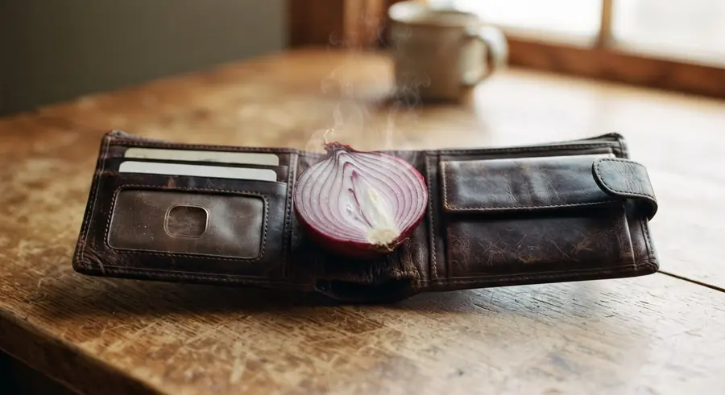

Matlamat Simpanan

# Dompet Macam Bawang, Setiap Kali Dibuka Buat Kita Menangis

*"My wallet is like an onion. Every time I open it, it makes me cry."*
{: .lead }

**Taufik Bin Musa** · 10 November 2026 · 4 min baca
{: .byline }

{ .step-img width="900" height="491" }

Saya tersenyum sendiri bila terbaca ayat ini di media sosial, tetapi bila renung semula, memang ada benarnya.

> "My wallet is like an onion. Every time I open it, it makes me cry."

Ramai antara kita pelik kenapa simpanan susah betul nak naik walaupun kita jarang beli barang mewah yang beribu-ribu ringgit.

Rupa-rupanya, duit kita bukan hilang sekali gus dalam jumlah yang besar.

Tetapi bocor sedikit demi sedikit tanpa kita sedar.

## Bocor sedikit demi sedikit

Bocor RM15 untuk segelas air manis setiap petang.

Bocor RM25 untuk caj penghantaran makanan bila malas keluar.

Bocor RM30 untuk langganan aplikasi yang jarang dibuka.

Bocor RM20 untuk barang kecil di kedai serbaneka masa isi minyak.

Bocor RM40 untuk beli benda comel yang sebenarnya tak guna pun di rumah.

Setiap satu nampak kecil dan murah. Cuma bila dikumpulkan selama 30 hari, jumlahnya boleh mencecah ratusan malah ribuan ringgit sebulan. Baca juga [kenapa duit cepat habis sejak guna QR dan e-wallet](kenapa-duit-cepat-habis-sejak-guna-qr-ewallet.md).

## Penyata bank hujung bulan

Pernah tak kita alami situasi macam ni?

Bila semak penyata bank pada hujung bulan, tiada satu pun perbelanjaan yang nampak melampau.

Semuanya transaksi RM10, RM15, RM20 dan RM30.

Tetapi gabungan transaksi-transaksi kecil itulah yang sebenarnya mengeringkan akaun kita secara senyap.

Masalahnya, otak kita sering memandang ringan pada nilai duit yang kecil apabila ia berada dalam bentuk tunai.

Kita selalu berbisik dalam hati, 'Alah, baru RM20, takkan jatuh miskin pun.'

Malangnya, sikap memandang ringan pada jumlah kecil inilah yang menghalang kita daripada membina simpanan.

## Terbalikkan kuasa "sedikit-sedikit"

Sebab itu, satu perkara yang saya belajar ialah kuasa 'sedikit-sedikit' ini sebenarnya boleh diterbalikkan untuk membina harta.

Jika kebocoran kecil boleh menghabiskan gaji kita, maka simpanan kecil yang konsisten juga boleh membina aset yang besar.

Kalau kita nak mula membina simpanan dalam bentuk emas, [akaun GAP Public Gold](apa-itu-akaun-gap-gold-accumulation-program-public-gold.md) boleh menjadi salah satu pilihan.

Kita boleh mula [serendah RM100](https://publicgold.com.my/index.php?route=account/register&intro_pgcode=PG00359605&is_dealer=1) dan kumpul emas sedikit demi sedikit mengikut kemampuan.

Daripada membiarkan duit kecil habis tanpa jejak, kita boleh alihkan sebahagiannya menjadi pecahan gram emas.

Lama-kelamaan, gram emas yang dikumpul sedikit demi sedikit itu akan bertambah menjadi jumlah yang mengejutkan kita sendiri.

## Tak salah menikmati keselesaan kecil

Tak salah sesekali nak minum kopi sedap atau pesan makanan terus ke rumah.

Kita bekerja penat setiap hari dan berhak menikmati keselesaan kecil dalam hidup.

Cuma jangan sampai kebocoran kecil setiap hari menghakis peluang kita untuk mempunyai simpanan kecemasan yang kukuh.

> Air yang menitis perlahan-lahan pun boleh memenuhkan tempayan.

Begitu juga dengan simpanan emas. Walaupun bermula dengan nilai yang kecil, ia tetap jauh lebih baik daripada membiarkan dompet kita terus menangis setiap hujung bulan.

Kawal kebocoran kecil hari ini, supaya kita dapat melihat hasil simpanan yang besar pada masa hadapan.

Tahniah kepada anda yang membaca sampai ke penghujung.

Semoga perkongsian ini memberi manfaat dan sedikit inspirasi buat kita semua.

Kalau anda berminat nak tahu bagaimana nak mula menyimpan emas, ada panduan dan info percuma di [website saya](https://pg2u.my/taufikmusa). Baca dulu [9 soalan lazim sebelum buka akaun GAP](9-soalan-lazim-sebelum-buka-akaun-emas-gap.md), atau [PM saya di WhatsApp](https://api.whatsapp.com/send/?phone=60132740711&text=Boleh+guide+saya+simpan+emas+Public+Gold&type=phone_number&app_absent=0) kalau nak saya terangkan dan guide secara personal.

Tak perlu terburu-buru. Faham dulu, kemudian buat keputusan.

### Tutup Kebocoran Kecil, Mula Simpan Hari Ini

Daftar percuma dan mula serendah RM100 ikut kemampuan, atau WhatsApp saya untuk bimbingan percuma.

[Daftar Percuma →](https://publicgold.com.my/index.php?route=account/register&intro_pgcode=PG00359605&is_dealer=1){ .md-button .btn-gold target="_blank" }
[💬 WhatsApp](https://api.whatsapp.com/send/?phone=60132740711&text=Boleh+guide+saya+simpan+emas+Public+Gold&type=phone_number&app_absent=0){ .md-button .btn-wa target="_blank" }
[✈️ Telegram](https://t.me/taufikpg_emas){ .md-button .btn-tg }
[📘 E-Book](https://pg2u.my/app/ebook/taufikmusa){ .md-button .btn-ebook }

<!-- baca-juga -->
## Baca juga

- [Perspective Matters, Perkara Yang Sama Boleh Nampak Sangat Berbeza](perspective-matters-perkara-sama-tafsiran-berbeza.md)
- [Bila Semak Akaun Simpanan, Rupanya Kita Menyimpan Kenangan, Bukan Duit](menyimpan-kenangan-bukan-duit.md)
- [Bukan Nak Dream Job, Tapi Nak Kerja Yang Tak Muncul Dalam Mimpi](bukan-nak-dream-job-tapi-kerja-tak-muncul-dalam-mimpi.md)

<!-- /baca-juga -->

#### Taufik Bin Musa
Dealer Public Gold · PG00359605 · G100 Network

Saya dealer dan committee di G100 Network, rangkaian dealer terbesar di Malaysia yang membimbing lebih 1.2 juta penyimpan emas. Saya bantu anda bina aset emas melalui Akaun GAP, terus dengan Public Gold.

`Mula RM100` `Tiada komitmen` `Boleh tukar emas fizikal` `Patuh syariah` `Tiada caj dealer`

Semua urus niaga dibuat terus bersama Public Gold, syarikat emas terbesar Malaysia sejak 2008. Tugas Dealer hanya menjadi pemudahcara urusniaga dan berkongsi ilmu emas yang praktikal, InsyaAllah.

[Jemput juga ke Website Rasmi Dealer G100 saya di pg2u.my/taufikmusa ↗](https://pg2u.my/taufikmusa){ target="_blank" }

{ width="640" height="959" loading="lazy" }

