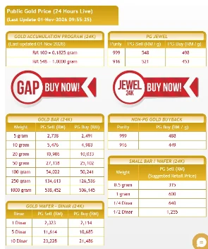

Harga Emas

# Harga Emas Dah RM548 Segram, Apa Pula Alasan Kita?

*"Dulu kita tunggu harga macam ni. Sekarang dah sampai, apa pula alasan kita?"*
{: .lead }

**Taufik Bin Musa** · 1 November 2026 · 4 min baca
{: .byline }

{ .step-img width="900" height="1200" }

Cuba kita ingat semula.

Beberapa bulan lalu, ketika harga emas berada pada RM700 lebih segram, ramai yang berharap harga akan turun. Baca [harga emas pernah cecah RM764](harga-emas-pernah-cecah-rm764-kini-rm571-segram.md) kalau nak ingat balik situasi masa tu.

Ada yang kata nak tunggu RM600.

Ada yang tunggu RM550.

Hari ini, harga emas sudah berada sekitar **RM548 segram**.

{ width="295" height="353" loading="lazy" style="max-width:100%;height:auto;display:block;margin:1rem auto" }

Tetapi persoalannya, adakah kita sudah mula membeli?

Atau kita masih tunggu harga RM500 pula?

Kalau harga turun RM500 nanti, mungkin kita akan tunggu RM450.

Kalau turun RM450, mungkin kita tunggu RM400.

Sampai bila?

## Bukan harga yang jadi masalah

Sebenarnya, masalah kita kadang-kadang bukan harga emas terlalu mahal.

Tetapi kita terlalu sibuk mencari harga yang paling sempurna sehingga terlupa untuk membina simpanan. Baca juga [siapa tahu bila harga emas paling rendah](siapa-tahu-bila-harga-emas-paling-rendah.md).

Saya bukan kata kita perlu beli emas tanpa berfikir. Kita tetap kena ada ilmu, faham risiko dan beli mengikut kemampuan.

Cuma jangan sampai keinginan mendapatkan harga paling rendah menyebabkan kita langsung tidak mempunyai simpanan emas.

## Mula secara berperingkat

Pesan guru emas saya, Tn Mohd Zulkifli Shafie, jangan tunggu harga murah baru nak mula menyimpan.

Kalau ada lebihan wang dan memang sudah ada matlamat untuk menyimpan emas, mulakan secara berperingkat.

Tak perlu terus beli banyak.

Sedikit demi sedikit pun tidak mengapa. Yang penting, gram emas kita mula bertambah. Boleh mula melalui [Akaun Emas GAP Public Gold](https://publicgold.com.my/index.php?route=account/register&intro_pgcode=PG00359605&is_dealer=1), dan baca dulu [9 soalan lazim sebelum buka akaun GAP](9-soalan-lazim-sebelum-buka-akaun-emas-gap.md) atau [PM saya di WhatsApp](https://api.whatsapp.com/send/?phone=60132740711&text=Boleh+guide+saya+simpan+emas+Public+Gold&type=phone_number&app_absent=0) kalau nak bertanya.

## Membina aset untuk masa hadapan

Sebab akhirnya, kita bukan berlumba dengan orang lain untuk mendapatkan harga paling murah.

Kita sedang membina satu aset untuk masa hadapan.

> Harga RM548 hari ini mungkin nampak mahal bagi sesetengah orang. Tetapi 5 tahun akan datang, mungkin kita akan teringat dan berkata, kalaulah dulu aku mula menyimpan.

Dulu ragu kini tahu.

Jom simpan emas.

Moga perkongsian ini bermanfaat.

### Harga Dah Sampai, Mula Ikut Kemampuan

Daftar percuma dan mula serendah RM100 ikut kemampuan, atau WhatsApp saya untuk bimbingan percuma.

[Daftar Percuma →](https://publicgold.com.my/index.php?route=account/register&intro_pgcode=PG00359605&is_dealer=1){ .md-button .btn-gold target="_blank" }
[💬 WhatsApp](https://api.whatsapp.com/send/?phone=60132740711&text=Boleh+guide+saya+simpan+emas+Public+Gold&type=phone_number&app_absent=0){ .md-button .btn-wa target="_blank" }
[✈️ Telegram](https://t.me/taufikpg_emas){ .md-button .btn-tg }
[📘 E-Book](https://pg2u.my/app/ebook/taufikmusa){ .md-button .btn-ebook }

#### Taufik Bin Musa
Dealer Public Gold · PG00359605 · G100 Network

Saya dealer dan committee di G100 Network, rangkaian dealer terbesar di Malaysia yang membimbing lebih 1.2 juta penyimpan emas. Saya bantu anda bina aset emas melalui Akaun GAP, terus dengan Public Gold.

`Mula RM100` `Tiada komitmen` `Boleh tukar emas fizikal` `Patuh syariah` `Tiada caj dealer`

Semua urus niaga dibuat terus bersama Public Gold, syarikat emas terbesar Malaysia sejak 2008. Tugas Dealer hanya menjadi pemudahcara urusniaga dan berkongsi ilmu emas yang praktikal, InsyaAllah.

[Jemput juga ke Website Rasmi Dealer G100 saya di pg2u.my/taufikmusa ↗](https://pg2u.my/taufikmusa){ target="_blank" }

{ width="640" height="959" loading="lazy" }

