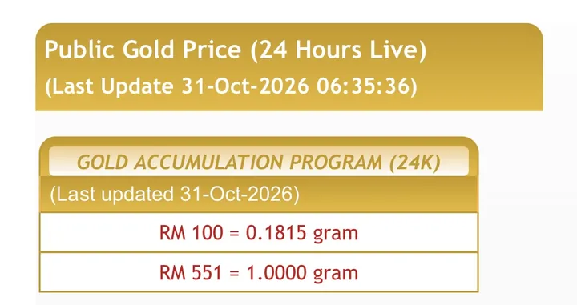

Harga Emas

# Harga Emas Turun RM17, Tapi Ada Satu Perkara Yang Ramai Orang Terlepas Pandang

*"Kita sebenarnya sedang mengumpul emas, atau sedang mengejar keuntungan daripada pergerakan harga?"*
{: .lead }

**Taufik Bin Musa** · 31 Oktober 2026 · 4 min baca
{: .byline }

{ .step-img width="900" height="1125" }

Semalam, 30 Oktober 2026, harga emas GAP berada pada **RM568 segram**.

Hari ini, 31 Oktober 2026, harganya turun kepada **RM551 segram**.

Penurunan sebanyak RM17 dalam masa sehari.

{ .step-img width="720" height="381" loading="lazy" }

Kalau nak baca versi lain tentang penurunan hari ini, ada [harga emas turun RM17 dalam sehari](harga-emas-turun-rm17-dalam-sehari.md).

## Dua jenis reaksi

Bila harga emas jatuh, biasanya kita akan dengar dua jenis reaksi.

Ada yang mula risau.

Ada pula yang mula tertanya-tanya, betul ke keputusan mereka menyimpan emas selama ini?

Tetapi bagi saya, penurunan harga seperti ini sebenarnya membuka satu persoalan yang lebih penting.

## Mengumpul emas atau mengejar keuntungan?

Kita sebenarnya sedang **mengumpul emas**, atau sedang **mengejar keuntungan** daripada pergerakan harga?

Dua perkara ini nampak sama, tetapi cara fikirnya sangat berbeza.

Orang yang mengejar keuntungan sentiasa memikirkan bila masa terbaik untuk membeli dan bila masa terbaik untuk menjual.

Tetapi orang yang membina simpanan emas melihat perkara yang lebih besar.

Berapa gram yang sudah berjaya dikumpulkan?

Berapa banyak lagi yang perlu dikumpulkan untuk mencapai matlamat kewangan?

Dan berapa lama tempoh yang kita berikan kepada simpanan tersebut?

Pesan guru saya, Tn Mohd Zulkifli Shafie:

> "Jangan bazirkan emosi memantau graf harga emas setiap 20 minit. Yang penting, gram emas bertambah setiap bulan."

## Macam membina rumah

Benda ni buat saya teringat kepada proses membina sebuah rumah.

Adakah kita akan berhenti membina hanya kerana harga batu bata turun?

Atau kita akan mengambil peluang membeli bahan binaan apabila harganya lebih rendah, selagi bajet mengizinkan?

Begitulah juga dengan simpanan emas.

Kita tak perlu terlalu terikat dengan pergerakan harga harian sehingga terlupa tujuan asal kita menyimpan.

## Tapi jangan salah faham

Namun, jangan pula salah faham.

Harga emas masih boleh turun lebih rendah. Tiada siapa boleh menjamin bila ia akan naik semula.

Sebab itu kita perlu **menggunakan duit lebihan**, mempunyai **matlamat yang jelas** dan menyimpan untuk **tempoh yang bersesuaian**.

Jangan jadikan harga emas sebagai penentu emosi kita. Jadikan matlamat kewangan sebagai panduan tindakan kita.

Sebab akhirnya, orang yang berjaya membina simpanan bukan semestinya orang yang paling pandai meneka harga.

> Tetapi orang yang tahu apa yang mahu dicapai dan cukup disiplin untuk terus melangkah.

Kalau nak mula dengan [Akaun Emas GAP Public Gold](https://publicgold.com.my/index.php?route=account/register&intro_pgcode=PG00359605&is_dealer=1), baca dulu [9 soalan lazim sebelum buka akaun GAP](9-soalan-lazim-sebelum-buka-akaun-emas-gap.md), atau [PM saya di WhatsApp](https://api.whatsapp.com/send/?phone=60132740711&text=Boleh+guide+saya+simpan+emas+Public+Gold&type=phone_number&app_absent=0) kalau nak bertanya.

Dulu ragu kini tahu.

Jom simpan emas.

Moga perkongsian ini bermanfaat.

### Jangan Kejar Harga, Mula Kumpul Gram

Daftar percuma dan mula serendah RM100 ikut kemampuan, atau WhatsApp saya untuk bimbingan percuma.

[Daftar Percuma →](https://publicgold.com.my/index.php?route=account/register&intro_pgcode=PG00359605&is_dealer=1){ .md-button .btn-gold target="_blank" }
[💬 WhatsApp](https://api.whatsapp.com/send/?phone=60132740711&text=Boleh+guide+saya+simpan+emas+Public+Gold&type=phone_number&app_absent=0){ .md-button .btn-wa target="_blank" }
[✈️ Telegram](https://t.me/taufikpg_emas){ .md-button .btn-tg }
[📘 E-Book](https://pg2u.my/app/ebook/taufikmusa){ .md-button .btn-ebook }

#### Taufik Bin Musa
Dealer Public Gold · PG00359605 · G100 Network

Saya dealer dan committee di G100 Network, rangkaian dealer terbesar di Malaysia yang membimbing lebih 1.2 juta penyimpan emas. Saya bantu anda bina aset emas melalui Akaun GAP, terus dengan Public Gold.

`Mula RM100` `Tiada komitmen` `Boleh tukar emas fizikal` `Patuh syariah` `Tiada caj dealer`

Semua urus niaga dibuat terus bersama Public Gold, syarikat emas terbesar Malaysia sejak 2008. Tugas Dealer hanya menjadi pemudahcara urusniaga dan berkongsi ilmu emas yang praktikal, InsyaAllah.

[Jemput juga ke Website Rasmi Dealer G100 saya di pg2u.my/taufikmusa ↗](https://pg2u.my/taufikmusa){ target="_blank" }

{ width="640" height="959" loading="lazy" }

