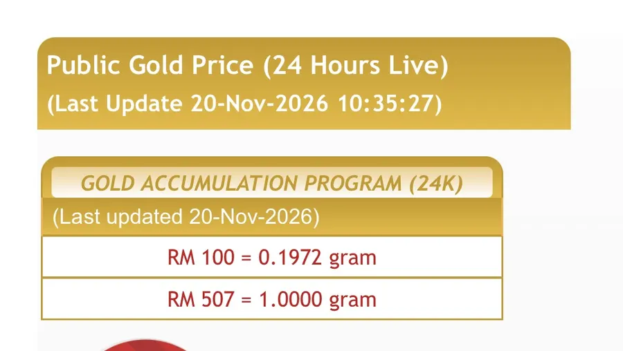

Harga Emas

# Harga Emas Turun RM507 Segram, Penyimpan Emas Tak Perlu Panik

*"Harga emas turun lagi. Ada orang yang takut, ada pula yang sedang tersenyum."*
{: .lead }

**Taufik Bin Musa** · 20 November 2026 · 5 min baca
{: .byline }

{ .step-img width="900" height="508" }

**Harga emas turun lagi! RM507 segram. Ini mungkin antara harga terendah tahun ini. Tapi peliknya, ada orang yang takut. Ada pula yang sedang tersenyum!**

Bayangkan kita sedang mengumpul duit untuk membeli sebuah rumah.

Setiap bulan kita asingkan RM500 untuk mencapai matlamat tersebut.

Tiba-tiba, harga bahan binaan turun.

Adakah kita akan kecewa?

Sudah tentu tidak.

Kita mungkin akan tersenyum kerana dengan bajet yang sama, kita berpeluang mendapatkan lebih banyak bahan binaan.

Begitulah juga dengan orang yang menyimpan emas.

Apabila harga emas turun, kita sebenarnya berpeluang mendapatkan lebih banyak gram dengan jumlah wang yang sama.

Contohnya, berdasarkan harga GAP Public Gold pada 20 November 2026:

- RM100 = 0.1972 gram emas.
- RM507 = 1 gram emas.

Mungkin ada yang melihat harga ini lalu berkata:

> "Rugi orang yang beli masa harga mahal!"

Tetapi cuba kita lihat daripada perspektif seorang penyimpan emas.

Ada 5 perkara yang kita kena faham apabila harga emas turun.

## 1. Jangan keliru antara penyimpan emas dengan pelabur emas

Pelabur emas mungkin sibuk mencari harga paling rendah untuk mendapatkan keuntungan apabila menjual semula.

Tetapi penyimpan emas mempunyai matlamat berbeza.

Mereka mahu mengumpul gram sebanyak mungkin untuk kegunaan masa hadapan.

Sebab itu, apabila harga turun, mereka tidak semestinya panik.

Mereka melihatnya sebagai peluang menambah koleksi gram.

## 2. Gunakan strategi DCA (Dollar Cost Averaging)

Jangan habiskan semua duit simpanan semata-mata kerana harga sedang turun.

Sebaliknya, tetapkan bajet bulanan. Contohnya RM100, RM300 atau RM500 setiap bulan.

Ada bulan harga tinggi, kita dapat gram sedikit.

Ada bulan harga rendah, kita dapat gram lebih banyak.

Lama-kelamaan, kita membina purata harga belian daripada beberapa peringkat harga.

Inilah kelebihan disiplin berbanding cuba meneka bila harga paling murah. Baca lebih lanjut dalam [Harga Emas Turun RM18 Segram, Masa Penyimpan DCA](harga-emas-turun-rm18-segram-strategi-dca.md).

## 3. Jangan tunggu harga paling rendah

Pesan guru emas saya, Tn Mohd Zulkifli Shafie:

> "Harga emas naik kita beli, harga emas turun kita beli lebih banyak!"

Masalahnya, tiada siapa tahu dengan tepat di mana harga paling bawah.

Hari ini kita rasa RM507 sudah murah.

Esok mungkin RM490.

Tetapi mungkin juga minggu depan harganya kembali naik.

Kalau terlalu sibuk menunggu harga paling sempurna, akhirnya kita mungkin langsung tak mula menyimpan.

## 4. Simpan emas mesti ada MATLAMAT

Jangan kumpul emas sekadar nak tengok berapa gram dalam akaun.

Tetapkan sesuatu yang kita mahu capai. Contohnya:

- Kumpul 10 gram sebagai simpanan pertama.
- Kumpul 50 gram untuk dana keluarga.
- Kumpul 100 gram sebagai persediaan masa depan.
- Kumpul emas untuk dana pendidikan anak.
- Kumpul emas sebagai persediaan persaraan.

Apabila ada matlamat, kita tidak mudah terganggu dengan turun naik harga harian.

Kita tahu kenapa kita bermula dan ke mana kita sedang menuju. Lihat juga [5 Langkah Matlamat Simpan Emas](5-langkah-matlamat-simpan-emas-supaya-gaji-tak-bocor.md).

## 5. Jangan lupa tujuan akhir kita menyimpan emas

Emas bukan untuk disimpan selama-lamanya tanpa tujuan.

Satu hari nanti, apabila gram yang dikumpul sudah mencukupi, kita boleh mempertimbangkan untuk mencairkannya bagi mencapai matlamat kewangan.

Contohnya membeli tanah, membina rumah sewa, melangsaikan hutang atau membiayai pendidikan anak.

Itulah yang lebih penting.

Bukan sekadar berapa tinggi harga emas naik, tetapi apa yang berjaya kita bina hasil daripada disiplin menyimpan selama bertahun-tahun.

## Kesimpulannya

Jangan terlalu gembira apabila harga emas naik.

Jangan terlalu sedih apabila harga emas turun.

Kalau kita seorang penyimpan emas, perkara paling penting ialah berapa gram yang berjaya kita kumpulkan setiap bulan dan berapa dekat kita dengan matlamat kewangan sendiri.

Orang yang sibuk mengejar harga paling rendah belum tentu berjaya mengumpul emas paling banyak.

Kadang-kadang, orang yang menang ialah orang yang paling konsisten.

Sebab itu saya suka satu analogi daripada guru saya: perlumbaan kura-kura dan arnab.

Arnab mungkin lebih laju, tetapi kura-kura yang tidak berhenti akhirnya sampai ke garisan penamat.

**Jangan sibuk meneka harga emas. Sibukkan diri membina tabungan.**

Bagi yang nak mula, [Akaun Emas GAP Public Gold](https://publicgold.com.my/index.php?route=account/register&intro_pgcode=PG00359605&is_dealer=1){ target="_blank" } membolehkan kita menabung [serendah RM100](https://publicgold.com.my/index.php?route=account/register&intro_pgcode=PG00359605&is_dealer=1){ target="_blank" } mengikut harga emas semasa. Lihat [cara daftar akaun GAP](cara-daftar-public-gold-gap-2026.md) langkah demi langkah, atau [WhatsApp saya](https://api.whatsapp.com/send/?phone=60132740711&text=Boleh+guide+saya+simpan+emas+Public+Gold&type=phone_number&app_absent=0){ target="_blank" } kalau nak dibimbing.

Tak perlu tunggu ada duit besar.

Mulakan dengan kemampuan sendiri dan bina disiplin sedikit demi sedikit.

**Dulu ragu kini tahu, jom simpan emas!**

Moga perkongsian ini bermanfaat.

### Mula Menabung Emas Serendah RM100

Daftar percuma dan mula serendah RM100 ikut kemampuan, atau WhatsApp saya untuk bimbingan percuma.

[Daftar Percuma →](https://publicgold.com.my/index.php?route=account/register&intro_pgcode=PG00359605&is_dealer=1){ .md-button .btn-gold target="_blank" }
[💬 WhatsApp](https://api.whatsapp.com/send/?phone=60132740711&text=Boleh+guide+saya+simpan+emas+Public+Gold&type=phone_number&app_absent=0){ .md-button .btn-wa target="_blank" }
[✈️ Telegram](https://t.me/taufikpg_emas){ .md-button .btn-tg }
[📘 E-Book](https://pg2u.my/app/ebook/taufikmusa){ .md-button .btn-ebook }

<!-- baca-juga -->
## Baca juga

- [Harga Emas Antara Termurah Sepanjang 2026, Promosi 1KG Bullion Bar Percuma 5g](harga-emas-antara-termurah-2026-promosi-1kg-bullion-bar.md)
- [Harga Emas Turun Kepada RM542 Segram, Masa Fikir Semula Strategi Simpanan](harga-emas-turun-rm542-segram-fikir-semula-strategi.md)
- [Graf Harga Emas Setahun Nampak Merah, Tapi Graf Lima Tahun Menunjukkan Perkara Berbeza](graf-harga-emas-setahun-vs-lima-tahun.md)

<!-- /baca-juga -->

#### Taufik Bin Musa
Dealer Public Gold · PG00359605 · G100 Network

Saya dealer dan committee di G100 Network, rangkaian dealer terbesar di Malaysia yang membimbing lebih 1.2 juta penyimpan emas. Saya bantu anda bina aset emas melalui Akaun GAP, terus dengan Public Gold.

`Mula RM100` `Tiada komitmen` `Boleh tukar emas fizikal` `Patuh syariah` `Tiada caj dealer`

Semua urus niaga dibuat terus bersama Public Gold, syarikat emas terbesar Malaysia sejak 2008. Tugas Dealer hanya menjadi pemudahcara urusniaga dan berkongsi ilmu emas yang praktikal, InsyaAllah.

[Jemput juga ke Website Rasmi Dealer G100 saya di pg2u.my/taufikmusa ↗](https://pg2u.my/taufikmusa){ target="_blank" }

{ width="640" height="959" loading="lazy" }

