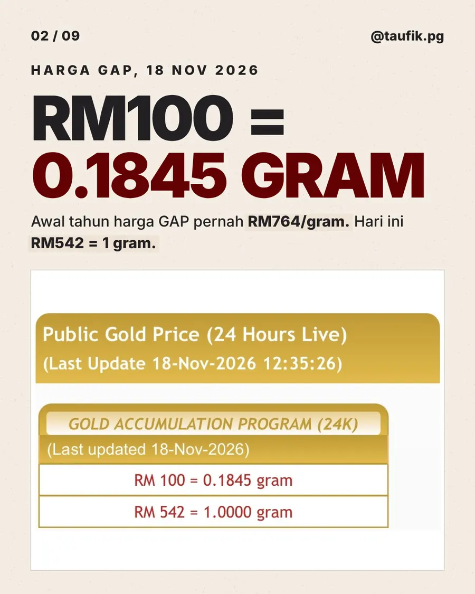

Harga Emas

# Harga Emas Turun Kepada RM542 Segram, Masa Fikir Semula Strategi Simpanan

*"Fokus kita bukan berapa tinggi harga emas hari ini, tetapi berapa banyak gram yang berjaya dikumpul."*
{: .lead }

**Taufik Bin Musa** · 18 November 2026 · 5 min baca
{: .byline }

{ .step-img width="900" height="1125" }

**Harga emas Public Gold turun kepada RM542/gram! Tapi ini sebenarnya masa yang baik untuk kita fikir semula strategi simpanan emas.**

Cuba tengok dua graf harga emas ini.

## Graf pertama: setahun

Sumber graf: goldprice.org, paparan 17 November 2026.

Graf pertama menunjukkan pergerakan harga emas sepanjang setahun.

Ada masa harga naik tinggi. Ada masa harga jatuh agak ketara.

Kalau kita tengok pergerakan setahun sahaja, memang mudah emosi. Hari ini seronok tengok harga naik, esok risau bila harga turun.

## Graf kedua: lima tahun

Sumber graf: goldprice.org, paparan 17 November 2026.

Tetapi cuba tengok graf kedua.

Graf harga emas untuk tempoh lima tahun.

Walaupun ada turun naik sepanjang perjalanan, harga emas mencatatkan kenaikan sekitar 107% dalam tempoh tersebut berdasarkan graf yang dikongsikan. Baca juga [graf harga emas setahun nampak merah, tapi graf lima tahun menunjukkan perkara berbeza](graf-harga-emas-setahun-vs-lima-tahun.md).

Apa pengajaran yang kita boleh ambil?

**Tempoh simpanan kita sangat penting.**

Sebab itu, saya selalu tekankan bahawa emas bukan tempat untuk menyimpan duit yang kita perlukan bulan depan.

## Duit mana yang sesuai ditukar kepada emas?

Jadi, duit mana yang sesuai kita tukarkan kepada emas?

Saya cadangkan kita fikirkan tiga kategori ini.

**1. Duit lebihan selepas komitmen bulanan.**

Selepas bayar rumah, kereta, bil, belanja dapur dan keperluan keluarga, kalau ada lebihan, asingkan sebahagian untuk simpanan jangka panjang.

Jangan tunggu duit berbaki banyak baru nak menyimpan.

**2. Duit untuk matlamat lebih dua tahun.**

Contohnya dana pendidikan anak, persediaan persaraan, modal membeli tanah atau persediaan menunaikan haji.

Kalau matlamat kita masih jauh, kita ada masa untuk mengumpul gram emas sedikit demi sedikit.

Lebih panjang tempoh kita merancang, lebih banyak ruang untuk kita membina simpanan. Baca juga [apa yang boleh kita buat dengan 10 gram hingga 1 kilogram emas](apa-boleh-buat-dengan-10-gram-hingga-1-kilogram-emas.md).

**3. Duit yang kita selalu gagal simpan dalam akaun bank.**

Kadang-kadang bukan kita tak mampu menyimpan.

Tetapi setiap kali duit ada dalam akaun, ada sahaja benda yang kita rasa nak beli.

Apabila sebahagian duit ditukarkan kepada emas, kita lebih terdorong untuk menyimpannya bagi mencapai matlamat yang telah ditetapkan.

**Tetapi jangan gunakan duit kecemasan atau duit yang kita perlukan dalam masa terdekat.**

Pastikan dahulu kita ada simpanan tunai yang mudah dicairkan.

## Bagaimana nak menyimpan secara konsisten?

Di sinilah GAP Auto-Debit Public Gold boleh membantu.

Kita tetapkan jumlah yang mampu disimpan setiap bulan.

Contohnya RM100, RM200 atau RM500.

Setiap bulan, wang tersebut akan ditukarkan kepada gram emas secara automatik. Baca juga [12 tips simpan emas daripada Mahaguru Syukor Hashim](12-tips-simpan-emas-mahaguru-syukor-hashim.md).

Inilah konsep Dollar Cost Averaging (DCA).

Apabila harga rendah, jumlah wang yang sama mendapat lebih banyak gram.

Apabila harga tinggi, jumlah gram yang diperoleh menjadi lebih sedikit.

Kita tak perlu habiskan masa meneka harga paling rendah.

Tak perlu emosi setiap kali tengok graf merah atau hijau.

> Fokus kita bukan berapa tinggi harga emas hari ini. Fokus kita ialah berapa banyak gram yang berjaya dikumpul untuk mencapai matlamat.

Pesan guru emas saya, Tn Mohd Zulkifli Shafie:

> Jangan bazirkan emosi memantau graf harga emas setiap 20 minit. Yang penting, gram emas bertambah setiap bulan.

Ingat, kalau kita ada matlamat 50 gram, fokus kumpul 50 gram.

Kalau matlamat 100 gram, bina disiplin untuk sampai ke 100 gram.

Bukan sehari dua.

Beri masa dua tahun, lima tahun atau lebih, mengikut kemampuan dan matlamat kita.

Jangan jadikan emas sebagai tempat mengejar harga. Jadikan emas sebagai alat untuk mendisiplinkan simpanan dan mencapai matlamat kewangan.

## Harga GAP hari ini

Harga GAP Public Gold pada 18 November 2026 ialah **RM542/gram.**

Harga di atas ialah paparan 18 November 2026 dan berubah dari semasa ke semasa.

Dengan [RM100](https://publicgold.com.my/index.php?route=account/register&intro_pgcode=PG00359605&is_dealer=1), kita sudah boleh mula mengumpul kira-kira 0.1845 gram.

Nak belajar bagaimana nak mula menyimpan melalui [GAP](apa-itu-akaun-gap-gold-accumulation-program-public-gold.md) dan aktifkan Auto-Debit?

Baca dulu [9 soalan lazim sebelum buka akaun GAP](9-soalan-lazim-sebelum-buka-akaun-emas-gap.md), atau [PM saya di WhatsApp](https://api.whatsapp.com/send/?phone=60132740711&text=Boleh+guide+saya+simpan+emas+Public+Gold&type=phone_number&app_absent=0). Saya bantu terangkan dari A sampai Z.

Moga perkongsian ini bermanfaat.

### Mula Auto-Debit, Tambah Gram Setiap Bulan

Daftar percuma dan mula serendah RM100 ikut kemampuan, atau WhatsApp saya untuk bimbingan percuma.

[Daftar Percuma →](https://publicgold.com.my/index.php?route=account/register&intro_pgcode=PG00359605&is_dealer=1){ .md-button .btn-gold target="_blank" }
[💬 WhatsApp](https://api.whatsapp.com/send/?phone=60132740711&text=Boleh+guide+saya+simpan+emas+Public+Gold&type=phone_number&app_absent=0){ .md-button .btn-wa target="_blank" }
[✈️ Telegram](https://t.me/taufikpg_emas){ .md-button .btn-tg }
[📘 E-Book](https://pg2u.my/app/ebook/taufikmusa){ .md-button .btn-ebook }

<!-- baca-juga -->
## Baca juga

- [Graf Harga Emas Setahun Nampak Merah, Tapi Graf Lima Tahun Menunjukkan Perkara Berbeza](graf-harga-emas-setahun-vs-lima-tahun.md)
- [Harga Emas Turun RM18 Segram Dalam Sehari, Masa Yang Dinantikan Penyimpan DCA](harga-emas-turun-rm18-segram-strategi-dca.md)
- [Harga Emas Naik 17 Kali Ganda Dalam 26 Tahun, Tapi Apa Yang Berlaku Kepada Nilai Duit Kita?](harga-emas-naik-17-kali-ganda-26-tahun-nilai-duit.md)

<!-- /baca-juga -->

#### Taufik Bin Musa
Dealer Public Gold · PG00359605 · G100 Network

Saya dealer dan committee di G100 Network, rangkaian dealer terbesar di Malaysia yang membimbing lebih 1.2 juta penyimpan emas. Saya bantu anda bina aset emas melalui Akaun GAP, terus dengan Public Gold.

`Mula RM100` `Tiada komitmen` `Boleh tukar emas fizikal` `Patuh syariah` `Tiada caj dealer`

Semua urus niaga dibuat terus bersama Public Gold, syarikat emas terbesar Malaysia sejak 2008. Tugas Dealer hanya menjadi pemudahcara urusniaga dan berkongsi ilmu emas yang praktikal, InsyaAllah.

[Jemput juga ke Website Rasmi Dealer G100 saya di pg2u.my/taufikmusa ↗](https://pg2u.my/taufikmusa){ target="_blank" }

{ width="640" height="959" loading="lazy" }

