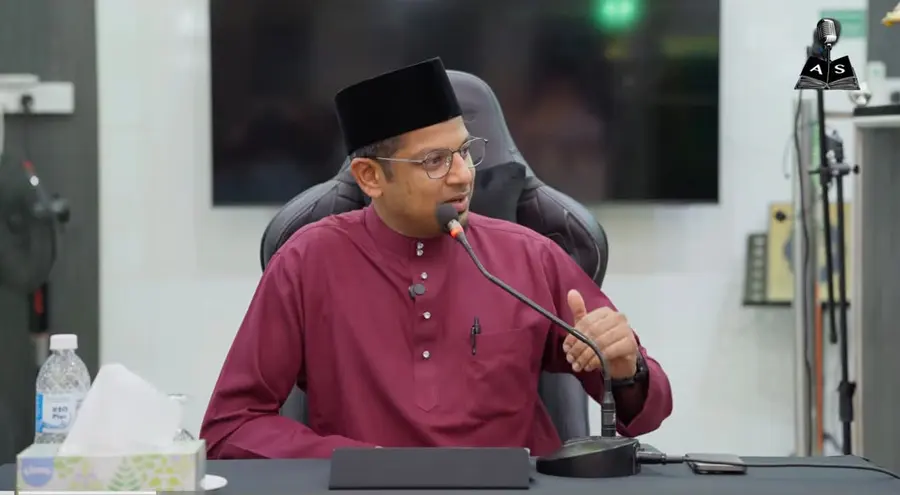

Ibrah

# Jangan Jadikan Dunia Ukuran Kasih Sayang Allah

*"Boleh jadi, apa yang kita anggap kesenangan itu sebenarnya ujian."*
{: .lead }

**Taufik Bin Musa** · 22 November 2026 · 3 min baca
{: .byline }

{ .step-img width="900" height="495" }

**Jangan jadikan dunia sebagai ukuran kasih sayang Tuhan.**

Saya tertarik dengan satu perkongsian daripada Ustaz Azlan tentang bagaimana kita kadang-kadang tersilap mengukur kasih sayang Allah berdasarkan kesenangan hidup seseorang.

Benda ni buat saya terfikir. Sebab kita hidup dalam dunia yang sangat materialistik. Sampai kadang-kadang kita sendiri tak sedar bahawa kita sedang mengukur kasih sayang Allah melalui perkara dunia.

## Bila tengok orang senang, kita fikir Allah sayang

Bila tengok orang hidup senang, kita fikir Tuhan sayang dia. Dapat kerja bagus, berjaya sambung belajar, bisnes berkembang, semuanya kita anggap sebagai tanda Allah sayangkan dia.

Sebaliknya, bila seseorang hidup susah, kita mula fikir mungkin Allah tak sayang dia.

## Bila amalan dikaitkan dengan ganjaran material

Sebab itu juga kadang-kadang kita terlalu mengaitkan amalan agama dengan ganjaran materialistik.

Contohnya, solat Duha. Ada yang mengajar dan mempromosikan solat Duha dengan menjanjikan sales akan bertambah, pelanggan akan semakin ramai dan bisnes akan lebih murah rezeki.

Lalu seseorang itu pun mula solat Duha dengan harapan begitu.

Tapi bila sales masih tak bertambah, pelanggan masih tak datang, dia mula tertanya-tanya.

> "Kenapa Allah tak makbulkan doa aku? Kenapa macam Allah tak sayang aku?"

Sedangkan kita sebenarnya sudah tersilap meletakkan ukuran kasih sayang Allah pada perkara material.

## Lihat kehidupan para nabi

Cuba kita lihat kehidupan para nabi.

Nabi Ibrahim AS pernah dicampakkan ke dalam api. Baginda juga berdepan penolakan daripada bapanya sendiri sehingga terpaksa meninggalkan tempat asalnya.

Adakah itu bermakna Allah tidak sayangkan Nabi Ibrahim?

Sudah tentu tidak.

Begitu juga ramai nabi lain yang diuji dengan kesusahan, kehilangan, penolakan dan penderitaan yang jauh lebih berat daripada apa yang kita lalui hari ini.

Jadi, jangan terlalu cepat menganggap Allah meninggalkan kita hanya kerana perkara dunia yang kita minta belum diberikan.

Jangan sampai kita mengukur kasih sayang Allah berdasarkan berapa banyak duit yang kita ada, sejauh mana bisnes kita berkembang atau berapa banyak impian dunia yang berjaya kita capai.

Kerana boleh jadi, apa yang kita anggap sebagai kesenangan itu sebenarnya ujian. Dan apa yang kita anggap sebagai kesusahan itu juga satu bentuk kasih sayang dan didikan daripada Allah.

Menarik untuk kita sama-sama renungkan dan belajar.

**Jangan jadikan dunia sebagai ukuran kasih sayang Tuhan.**

<!-- baca-juga -->
## Baca juga

- [Salamun Alaikum Bima Sabartum, Ucapan Malaikat Kepada Penghuni Syurga](salamun-alaikum-bima-sabartum-ucapan-malaikat-penghuni-syurga.md)
- [Ringkasan Al-Quran Dalam 2 Minit, Empat Tema Utama Yang Perlu Kita Fahami](ringkasan-al-quran-dalam-2-minit-empat-tema-utama.md)
- [Kisah Mus’ab bin Umayr: Pengorbanan Yang Menyentuh Hati](kisah-musab-bin-umayr-pengorbanan-yang-menyentuh-hati.md)

<!-- /baca-juga -->

#### Taufik Bin Musa
Dealer Public Gold · PG00359605 · G100 Network

Saya dealer dan committee di G100 Network, rangkaian dealer terbesar di Malaysia yang membimbing lebih 1.2 juta penyimpan emas. Saya bantu anda bina aset emas melalui Akaun GAP, terus dengan Public Gold.

`Mula RM100` `Tiada komitmen` `Boleh tukar emas fizikal` `Patuh syariah` `Tiada caj dealer`

Semua urus niaga dibuat terus bersama Public Gold, syarikat emas terbesar Malaysia sejak 2008. Tugas Dealer hanya menjadi pemudahcara urusniaga dan berkongsi ilmu emas yang praktikal, InsyaAllah.

[Jemput juga ke Website Rasmi Dealer G100 saya di pg2u.my/taufikmusa ↗](https://pg2u.my/taufikmusa){ target="_blank" }

{ width="640" height="959" loading="lazy" }

