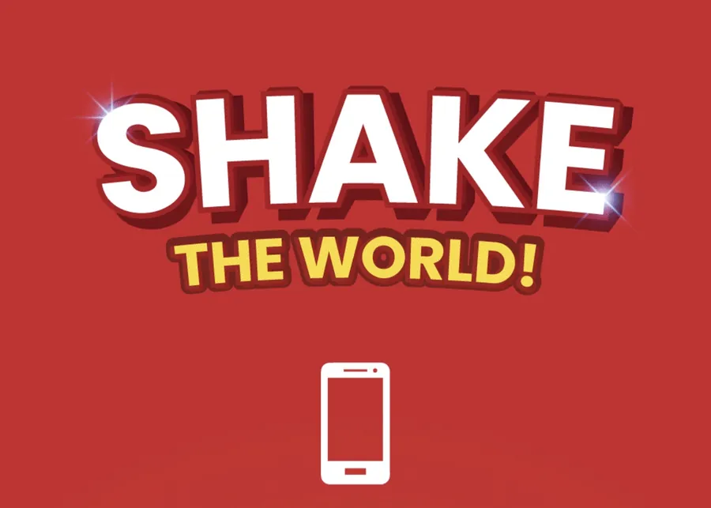

Bisnes

# Kenapa Saya Galakkan Berbelanja Di PGMall?

*"Kita bukan sekadar boleh membeli. Kita juga boleh menjana pulangan daripada aktiviti shopping."*
{: .lead }

**Taufik Bin Musa** · 15 November 2026 · 4 min baca
{: .byline }

{ .step-img width="900" height="643" }

Ramai antara kita setiap bulan memang berbelanja.

- Beli barang dapur.
- Beli pakaian.
- Beli barang keperluan rumah.
- Beli produk kesihatan.
- Beli buku dan macam-macam lagi.

Semua itu memang kita akan buat.

Persoalannya, kenapa tidak manfaatkan perbelanjaan tersebut melalui platform yang turut menawarkan program cashback dan referral?

Salah satu platform yang menarik untuk kita kenali ialah PGMall (Public Gold Mall).

Apa yang menarik tentang PGMall?

Saya kongsikan 5 perkara.

## 1. Macam-macam barang boleh dibeli

PGMall ialah platform e-commerce tempatan yang menawarkan pelbagai kategori produk.

Daripada elektronik, fesyen, barangan rumah, makanan, kecantikan, kesihatan, buku hinggalah barangan keperluan harian.

Konsepnya lebih kurang seperti marketplace yang kita biasa gunakan.

Jadi, bukan beli emas sahaja. Kita boleh gunakan untuk shopping pelbagai keperluan.

## 2. Konsep ConsuMerchant

Ini antara perkara yang menarik!

ConsuMerchant ialah gabungan perkataan Consumer dan Merchant.

Maksudnya, kita bukan sekadar menjadi pengguna atau pembeli.

Kita juga berpeluang menjadi sebahagian daripada ekosistem perniagaan PGMall.

Kita membeli barang seperti biasa, kemudian berkongsi platform ini dengan orang lain.

## 3. Ada program cashback

Melalui konsep ConsuMerchant, PGMall menyediakan program ganjaran cashback.

Antaranya melalui pembelian sendiri dan referral.

Maksudnya, apabila kita berkongsi referral link dan orang lain mendaftar serta membuat pembelian melalui rujukan tersebut, kita berpeluang menerima ganjaran cashback **mengikut kelayakan dan terma program.**

Bukan setakat kita seorang yang membeli.

Kita juga boleh berkongsi manfaat dengan orang lain. Kadar dan kelayakan cashback boleh berubah, jadi rujuk terma dan syarat rasmi PGMall untuk maklumat terkini.

## 4. Peluang menjana pendapatan melalui referral

Inilah konsep **SHOP, SHARE & EARN.**

- **SHOP**: Kita sendiri membeli dan menggunakan produk di PGMall.
- **SHARE**: Kita berkongsi pengalaman dan referral link dengan kawan-kawan serta keluarga.
- **EARN**: Kita berpeluang mendapat cashback daripada aktiviti pembelian yang layak melalui sistem referral.

Lebih menarik, konsep ini membuka peluang kepada pengguna untuk mengembangkan rangkaian pelanggan tanpa perlu menjadi penjual produk sendiri. Baca juga [5 cara tukar side income menjadi kekayaan jangka panjang](5-cara-tukar-side-income-jadi-kekayaan.md).

## 5. Boleh beli produk Public Gold juga

Dalam PGMall, kita turut boleh mendapatkan produk daripada jenama dalam ekosistem Public Gold seperti [PG Jewel](cara-miliki-barang-kemas-pg-jewel-akaun-gap.md) dan produk berkaitan emas.

Jadi, satu platform yang menghubungkan aktiviti membeli-belah dengan ekosistem perniagaan Public Gold.

## Belanja dengan bijak

Sebenarnya, ada satu perkara yang saya suka tentang konsep ini.

Kita tidak perlu mencipta keperluan untuk berbelanja semata-mata mahu mendapatkan ganjaran.

Kita memang sudah ada keperluan untuk membeli barang.

Jadi, kenapa tidak belajar memanfaatkan platform yang menawarkan nilai tambah kepada aktiviti perbelanjaan kita?

Cuma satu pesanan.

**Jangan membeli barang yang kita tidak perlukan semata-mata kerana mengejar cashback.**

Berbelanjalah dengan bijak. Manfaatkan ganjaran jika ada.

Kalau boleh, biarlah setiap ringgit yang kita keluarkan memberikan nilai yang lebih baik kepada kita. Baca juga [kenapa duit cepat habis sejak guna QR dan e-wallet](kenapa-duit-cepat-habis-sejak-guna-qr-ewallet.md).

## Nak mula kenali PGMall?

Saya juga nak kongsikan satu buku untuk kita yang mahu belajar tentang ilmu emas dan pengurusan kewangan dan boleh dapatkan di PGMall.

Ilmu itu penting sebelum kita mula membina simpanan emas. Baca dulu [apa itu akaun GAP](apa-itu-akaun-gap-gold-accumulation-program-public-gold.md) dan [9 soalan lazim sebelum buka akaun GAP](9-soalan-lazim-sebelum-buka-akaun-emas-gap.md), atau [PM saya di WhatsApp](https://api.whatsapp.com/send/?phone=60132740711&text=Boleh+guide+saya+simpan+emas+Public+Gold&type=phone_number&app_absent=0).

Boleh dapatkan buku ini melalui PGMall di sini:

<a class="md-button md-button--primary" href="https://www.pgmall.my/r/rGHPb7HJUM1" target="_blank" rel="noopener">Dapatkan buku di PGMall</a>

Moga perkongsian ini bermanfaat.

### Belanja Bijak, Simpan Emas Dengan Ilmu

Daftar percuma dan mula serendah RM100 ikut kemampuan, atau WhatsApp saya untuk bimbingan percuma.

[Daftar Percuma →](https://publicgold.com.my/index.php?route=account/register&intro_pgcode=PG00359605&is_dealer=1){ .md-button .btn-gold target="_blank" }
[💬 WhatsApp](https://api.whatsapp.com/send/?phone=60132740711&text=Boleh+guide+saya+simpan+emas+Public+Gold&type=phone_number&app_absent=0){ .md-button .btn-wa target="_blank" }
[✈️ Telegram](https://t.me/taufikpg_emas){ .md-button .btn-tg }
[📘 E-Book](https://pg2u.my/app/ebook/taufikmusa){ .md-button .btn-ebook }

<!-- baca-juga -->
## Baca juga

- [Latihan 100 Kali Ditolak, Cara Menukar Kegagalan Menjadi Kejayaan](latihan-100-rejection-tukar-kegagalan-jadi-kejayaan.md)
- [Jangan Cepat Beri Diskaun!](jangan-cepat-beri-diskaun.md)
- [Orang Sanggup Bayar Mahal Untuk 3 Benda Sahaja](orang-sanggup-bayar-mahal-untuk-3-benda.md)

<!-- /baca-juga -->

#### Taufik Bin Musa
Dealer Public Gold · PG00359605 · G100 Network

Saya dealer dan committee di G100 Network, rangkaian dealer terbesar di Malaysia yang membimbing lebih 1.2 juta penyimpan emas. Saya bantu anda bina aset emas melalui Akaun GAP, terus dengan Public Gold.

`Mula RM100` `Tiada komitmen` `Boleh tukar emas fizikal` `Patuh syariah` `Tiada caj dealer`

Semua urus niaga dibuat terus bersama Public Gold, syarikat emas terbesar Malaysia sejak 2008. Tugas Dealer hanya menjadi pemudahcara urusniaga dan berkongsi ilmu emas yang praktikal, InsyaAllah.

[Jemput juga ke Website Rasmi Dealer G100 saya di pg2u.my/taufikmusa ↗](https://pg2u.my/taufikmusa){ target="_blank" }

{ width="640" height="959" loading="lazy" }

