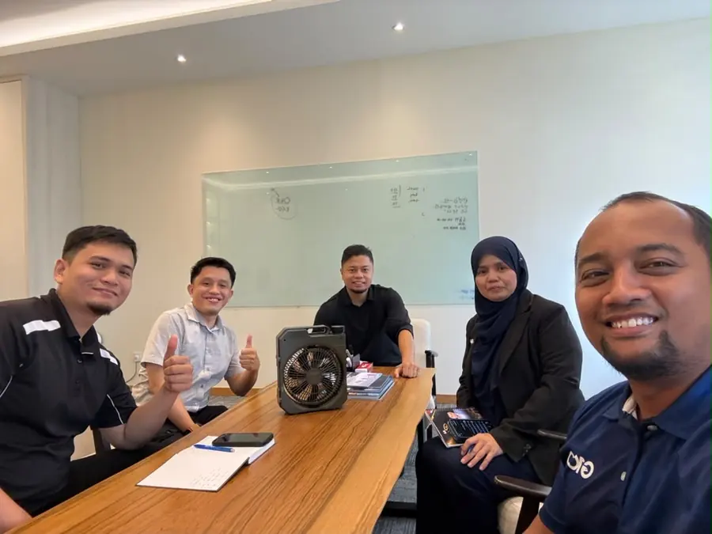

Bisnes

# Latihan 100 Kali Ditolak, Cara Menukar Kegagalan Menjadi Kejayaan

*"Sebelum kita mendapat satu YES, kita perlu belajar menerima banyak NO terlebih dahulu."*
{: .lead }

**Taufik Bin Musa** · 8 November 2026 · 5 min baca
{: .byline }

Pernah tak kita takut nak mencuba sesuatu kerana bimbang orang akan menolak?

Takut nak offer produk sebab risau orang tak berminat.

Takut nak buat sales sebab takut kena reject.

Takut nak mulakan bisnes sebab terbayang macam-macam perkara yang mungkin tak menjadi.

Hakikatnya, kadang-kadang bukan kegagalan yang menghalang kita daripada berjaya. Tetapi ketakutan terhadap kegagalan itu sendiri.

## Latihan "100 Rejection"

Saya terbaca satu perkongsian daripada guru saya, Tn Mohd Zulkifli Shafie, tentang satu latihan yang diberikan oleh mentornya ketika beliau baru belajar berniaga sekitar tahun 2003 hingga 2005.

Nama latihan itu ialah **"100 Rejection"**.

Caranya cukup mudah.

Mentornya memberikan sehelai kertas A4 yang mempunyai nombor daripada 1 hingga 100.

Tugas beliau ialah mencari 100 orang yang menolak tawaran produk yang dijualnya.

Setiap kali ada orang menolak, beliau perlu tandakan satu nombor pada kertas tersebut.

Nampak mudah, tetapi sebenarnya latihan ini menguji mental dan emosi seseorang.

Bagi orang yang biasa mendapat keputusan akademik yang baik, kegagalan selalunya dianggap sesuatu yang perlu dielakkan.

Silap menjawab soalan dianggap gagal.

Tidak mendapat apa yang diharapkan dianggap kecewa.

Sebab itu, apabila mula berniaga dan berhadapan dengan rejection, kita mudah rasa down.

## Apa yang berlaku selepas 50 penolakan

Tetapi sesuatu yang menarik berlaku selepas beliau menjalani latihan tersebut.

Pada mulanya, setiap rejection terasa seperti satu kegagalan.

Namun apabila sudah menerima kira-kira 50 penolakan, sesuatu berubah.

Beliau mula menjadi kebal.

Rejection bukan lagi sesuatu yang menakutkan. Ia sudah menjadi sebahagian daripada proses untuk mencapai kejayaan.

Lebih menarik, beliau mula melihat kegagalan daripada perspektif yang berbeza.

Kalau kita tak mencuba, peluang untuk berjaya memang kosong.

Tetapi kalau kita mencuba, sekurang-kurangnya ada peluang untuk berjaya.

Kalau orang pertama menolak, kita cuba orang kedua.

Kalau orang kedua menolak, kita pergi kepada orang ketiga.

Begitulah seterusnya.

Sebab kita tak tahu siapa yang akhirnya akan berkata YES.

## Dalam kehidupan pun sama

Benda ini buat saya terfikir tentang satu perkara.

Dalam kehidupan pun sebenarnya sama.

Kita selalu terlalu cepat menganggap sesuatu usaha itu gagal hanya kerana hasilnya tidak seperti yang kita harapkan.

Sedangkan mungkin kita sebenarnya sedang belajar sesuatu yang belum kita kuasai.

Kita belum berjaya mendapatkan pelanggan pertama. Tetapi kita sedang belajar cara berkomunikasi.

Kita belum berjaya mencapai sasaran. Tetapi kita sedang mengenal pasti kelemahan sendiri.

Kita belum berjaya mendapatkan peluang yang diinginkan. Tetapi kita sedang membina pengalaman untuk peluang seterusnya.

Masalahnya, ramai antara kita berhenti terlalu awal.

Kita baru kena reject beberapa kali, terus rasa tak sesuai berniaga.

Baru gagal sekali, terus rasa diri tak cukup bagus.

Baru tersilap langkah, terus hilang keyakinan untuk mencuba lagi.

Sedangkan mungkin kita cuma perlukan lebih banyak pengalaman.

Kadangkala, kejayaan bukan milik orang yang paling hebat. Tetapi milik orang yang sanggup bertahan lebih lama dalam proses pembelajaran.

{ .step-img width="900" height="675" }

## Apabila orang kata NO, jawab NEXT

Saya suka satu prinsip yang dikongsikan dalam artikel tersebut.

Apabila orang berkata NO, jawab sahaja **NEXT** dalam hati.

Bukan marah. Bukan kecewa. Bukan juga menyalahkan orang yang menolak.

Teruskan sahaja kepada peluang seterusnya.

Akhirnya, latihan 100 Rejection ini mengajar satu perkara yang cukup besar.

Kita tidak boleh mengawal sama ada orang akan menerima atau menolak tawaran kita.

Tetapi kita boleh mengawal berapa banyak usaha yang sanggup kita lakukan.

Dan mungkin perkara paling penting yang perlu kita ubah ialah cara kita melihat kegagalan.

Tidak semua perkara yang tidak menjadi itu bermaksud kita gagal.

Ada perkara yang tidak menjadi kerana kita belum cukup bersedia.

Ada perkara yang tidak menjadi kerana kita masih perlu belajar.

Dan ada perkara yang tidak menjadi kerana ia sedang membawa kita ke arah yang lebih baik.

Selagi kita tidak melakukan sesuatu yang salah, jangan terlalu cepat menghukum diri sendiri hanya kerana belum berjaya.

> Jangan jadikan rejection sebagai alasan untuk berhenti. Jadikan ia sebahagian daripada proses untuk menjadi lebih baik.

Sebab kadang-kadang, sebelum kita mendapat satu YES, kita perlu belajar menerima banyak NO terlebih dahulu.

Baca juga [Jangan Cepat Beri Diskaun](jangan-cepat-beri-diskaun.md) kalau anda sedang belajar mempertahankan nilai bila berurusan dengan pelanggan. Ada soalan tentang simpanan emas atau nak berbual tentang perjalanan bisnes anda? [PM saya di WhatsApp](https://api.whatsapp.com/send/?phone=60132740711&text=Boleh+guide+saya+simpan+emas+Public+Gold&type=phone_number&app_absent=0).

### Teruskan Melangkah, Satu NEXT Pada Satu Masa

Daftar percuma dan mula serendah RM100 ikut kemampuan, atau WhatsApp saya untuk bimbingan percuma.

[Daftar Percuma →](https://publicgold.com.my/index.php?route=account/register&intro_pgcode=PG00359605&is_dealer=1){ .md-button .btn-gold target="_blank" }
[💬 WhatsApp](https://api.whatsapp.com/send/?phone=60132740711&text=Boleh+guide+saya+simpan+emas+Public+Gold&type=phone_number&app_absent=0){ .md-button .btn-wa target="_blank" }
[✈️ Telegram](https://t.me/taufikpg_emas){ .md-button .btn-tg }
[📘 E-Book](https://pg2u.my/app/ebook/taufikmusa){ .md-button .btn-ebook }

<!-- baca-juga -->
## Baca juga

- [Jangan Cepat Beri Diskaun!](jangan-cepat-beri-diskaun.md)
- [Orang Sanggup Bayar Mahal Untuk 3 Benda Sahaja](orang-sanggup-bayar-mahal-untuk-3-benda.md)
- [Apa Itu Akaun GAP (Gold Accumulation Program) Public Gold](apa-itu-akaun-gap-gold-accumulation-program-public-gold.md)

<!-- /baca-juga -->

#### Taufik Bin Musa
Dealer Public Gold · PG00359605 · G100 Network

Saya dealer dan committee di G100 Network, rangkaian dealer terbesar di Malaysia yang membimbing lebih 1.2 juta penyimpan emas. Saya bantu anda bina aset emas melalui Akaun GAP, terus dengan Public Gold.

`Mula RM100` `Tiada komitmen` `Boleh tukar emas fizikal` `Patuh syariah` `Tiada caj dealer`

Semua urus niaga dibuat terus bersama Public Gold, syarikat emas terbesar Malaysia sejak 2008. Tugas Dealer hanya menjadi pemudahcara urusniaga dan berkongsi ilmu emas yang praktikal, InsyaAllah.

[Jemput juga ke Website Rasmi Dealer G100 saya di pg2u.my/taufikmusa ↗](https://pg2u.my/taufikmusa){ target="_blank" }

{ width="640" height="959" loading="lazy" }

