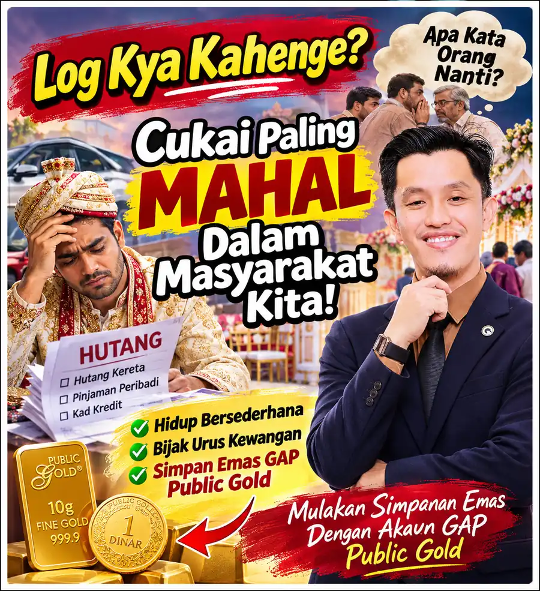

Matlamat Simpanan

# Log Kya Kahenge? Cukai Paling Mahal Dalam Masyarakat Kita

*"Mulut manusia tidak akan pernah puas. Tetapi simpanan yang kita bina secara senyap akan menyelamatkan kita."*
{: .lead }

**Taufik Bin Musa** · 11 November 2026 · 5 min baca
{: .byline }

{ .step-img width="900" height="985" }

Saya terbaca satu ungkapan satire yang sangat terkenal dalam masyarakat di India iaitu tiga perkataan Hindi: 'Log Kya Kahenge?', yang bermaksud 'Apa Kata Orang Nanti?'.

> "The most expensive tax in Indian society isn't income tax. It's 'Log Kya Kahenge' (What will people say?), spending money we don't have just so neighbors and relatives don't gossip!"
>
> Satira Sosial & Kewangan India

Maksudnya lebih kurang begini.

Di India (dan sebenarnya sangat mirip dengan budaya masyarakat kita juga), ramai orang membuat keputusan kewangan yang besar bukan mengikut kemampuan poket sendiri.

Sebaliknya, mereka berbelanja besar kerana takutkan satu perkara: takut apa pula kata jiran tetangga, saudara-mara dan rakan pejabat sekiranya mereka nampak hidup bersederhana!

## Bayangkan situasi ini

Seorang pekerja muda baru sahaja mendapat pekerjaan tetap dan sepatutnya mula mengumpul simpanan kecemasan.

Tetapi kerana risau 'Log Kya Kahenge' (apa kata orang kampung kalau balik naik kereta kecil), dia pun mengikat diri dengan hutang kereta mewah selama sembilan tahun.

Apabila hendak mengadakan majlis perkahwinan atau sambutan keluarga, walaupun tabungan tidak mencukupi, dia sanggup membuat pinjaman peribadi berpuluh ribu ringgit semata-mata takut orang mengata majlisnya nampak sederhana. Baca juga [5 sebab rancang simpanan kahwin 3 tahun lebih awal](5-sebab-rancang-simpanan-kahwin-3-tahun-awal.md).

Begitu juga apabila membeli pakaian, perabot rumah dan telefon pintar, semuanya diukur mengikut standard mata orang sekeliling!

Tetapi bahagian yang paling ironi ialah: apabila majlis sudah tamat dan dia terpaksa mengikat perut membayar hutang seorang diri setiap hujung bulan, 'orang-orang yang dia jaga hati tadi' langsung tidak datang menghulurkan walau seratus ringgit pun untuk membantunya! Baca juga [5 langkah selamatkan diri daripada jerat hutang kad kredit](5-langkah-selamatkan-diri-jerat-hutang-kad-kredit.md).

## Cukai mulut manusia

Lama-kelamaan, apabila kita renung sindiran 'Log Kya Kahenge' ini, kita mula tertanya-tanya.

Sampai bilakah kita mahu membayar 'cukai mulut manusia' dengan mengorbankan masa depan kewangan keluarga kita sendiri?

Bukan bermaksud kita tidak perlu menghormati tetamu atau menjaga hubungan baik dengan masyarakat.

Meraikan majlis mengikut kemampuan dan berbuat baik kepada jiran adalah amalan yang sangat terpuji.

Tetapi membiarkan ketakutan terhadap komen orang luar mengawal buku bank kita adalah punca utama mengapa ramai orang bekerja keras puluhan tahun tetapi masih tiada simpanan.

Mulut manusia tidak akan pernah puas walau apa pun yang kita lakukan; tetapi simpanan yang kita bina secara senyap pasti akan menyelamatkan kita pada waktu kecemasan.

Sebab itu, berhentilah risau tentang 'apa kata orang', dan mulakanlah risau tentang 'apa baki simpanan kita pada hari tua nanti'.

## Bina kubu kewangan secara senyap

Dalam masa yang sama, kita juga perlu fikir tentang masa depan kewangan kita.

> Kekayaan yang sebenar ialah apa yang tersimpan kukuh untuk melindungi keluarga, bukannya apa yang dipamerkan untuk menutup mulut jiran.

Cuba asingkan sedikit daripada pendapatan setiap bulan untuk membina simpanan.

Salah satu cara yang boleh kita pertimbangkan ialah menyimpan emas melalui [akaun GAP Public Gold](apa-itu-akaun-gap-gold-accumulation-program-public-gold.md).

Tak perlu tunggu ada duit banyak. Kita boleh mula [serendah RM100](https://publicgold.com.my/index.php?route=account/register&intro_pgcode=PG00359605&is_dealer=1) dan kumpul gram demi gram mengikut kemampuan.

Biar sedikit, asalkan konsisten.

Matlamatnya bukan sekadar mengumpul emas, tetapi membina kubu kewangan peribadi secara senyap supaya kita hidup tenang di atas kaki sendiri.

Kerana akhirnya, apabila kita diuji dengan kesempitan wang, simpanan emas kitalah yang akan membantu kita, bukannya pujian orang ramai.

Semoga kita diberikan kekuatan untuk hidup bersederhana dan bijak mengutamakan masa depan keluarga.

Tanpa mudah goyah apabila mendengar bisikan di sekeliling yang berkata:

> "We must upgrade to a bigger car this year. Otherwise, Log Kya Kahenge (what will the relatives say)?"

Tahniah kepada anda yang membaca sampai ke penghujung.

Semoga perkongsian ini memberi manfaat dan sedikit inspirasi buat kita semua.

Kalau anda berminat nak tahu bagaimana nak mula menyimpan emas, ada panduan dan info percuma di [website saya](https://pg2u.my/taufikmusa). Baca dulu [9 soalan lazim sebelum buka akaun GAP](9-soalan-lazim-sebelum-buka-akaun-emas-gap.md), atau [PM saya di WhatsApp](https://api.whatsapp.com/send/?phone=60132740711&text=Boleh+guide+saya+simpan+emas+Public+Gold&type=phone_number&app_absent=0) kalau nak saya terangkan dan guide secara personal.

Tak perlu terburu-buru. Faham dulu, kemudian buat keputusan.

### Bina Kubu Kewangan Secara Senyap

Daftar percuma dan mula serendah RM100 ikut kemampuan, atau WhatsApp saya untuk bimbingan percuma.

[Daftar Percuma →](https://publicgold.com.my/index.php?route=account/register&intro_pgcode=PG00359605&is_dealer=1){ .md-button .btn-gold target="_blank" }
[💬 WhatsApp](https://api.whatsapp.com/send/?phone=60132740711&text=Boleh+guide+saya+simpan+emas+Public+Gold&type=phone_number&app_absent=0){ .md-button .btn-wa target="_blank" }
[✈️ Telegram](https://t.me/taufikpg_emas){ .md-button .btn-tg }
[📘 E-Book](https://pg2u.my/app/ebook/taufikmusa){ .md-button .btn-ebook }

#### Taufik Bin Musa
Dealer Public Gold · PG00359605 · G100 Network

Saya dealer dan committee di G100 Network, rangkaian dealer terbesar di Malaysia yang membimbing lebih 1.2 juta penyimpan emas. Saya bantu anda bina aset emas melalui Akaun GAP, terus dengan Public Gold.

`Mula RM100` `Tiada komitmen` `Boleh tukar emas fizikal` `Patuh syariah` `Tiada caj dealer`

Semua urus niaga dibuat terus bersama Public Gold, syarikat emas terbesar Malaysia sejak 2008. Tugas Dealer hanya menjadi pemudahcara urusniaga dan berkongsi ilmu emas yang praktikal, InsyaAllah.

[Jemput juga ke Website Rasmi Dealer G100 saya di pg2u.my/taufikmusa ↗](https://pg2u.my/taufikmusa){ target="_blank" }

{ width="640" height="959" loading="lazy" }

