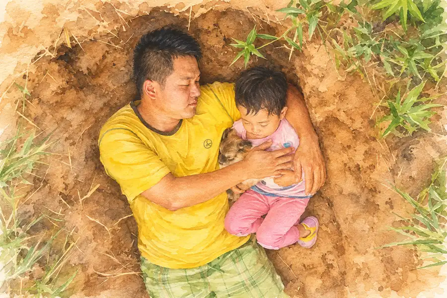

Matlamat Simpanan

# Lubang Yang Digali Ayah Untuk Anaknya, Sembilan Tahun Kemudian Jadi Taman Bunga Matahari

*"Gambar ini pernah meruntun hati jutaan orang. Tapi apa yang berlaku kepada kanak-kanak perempuan ini sebenarnya?"*
{: .lead }

**Taufik Bin Musa** · 3 November 2026 · 6 min baca
{: .byline }

{ .step-img width="900" height="600" }

Pada tahun 2017, tersebar beberapa keping gambar seorang lelaki sedang berbaring di dalam sebuah lubang tanah bersama anak perempuannya yang berusia dua tahun.

Sekali pandang, nampak macam seorang ayah sedang menemani anaknya bermain di kawasan tanah lapang.

Tetapi hakikatnya jauh lebih menyedihkan.

Lelaki itu sebenarnya sedang berbaring di dalam kubur yang digalinya sendiri untuk anak kesayangannya.

Gambar tersebut mengundang pelbagai persoalan.

Kenapa seorang ayah sanggup menggali kubur untuk anaknya yang masih kecil?

Dan yang paling ramai tertanya-tanya, apa sebenarnya yang berlaku kepada kanak-kanak itu selepas sembilan tahun?

## 1. Neijiang, Sichuan, tahun 2017

Di Neijiang, wilayah Sichuan, China, seorang bapa bernama Zhang Liyong sedang berdepan ujian yang sangat berat.

Anak perempuannya, Zhang Xinlei, baru berusia dua bulan apabila disahkan menghidap penyakit beta thalassemia yang serius.

Penyakit ini merupakan gangguan darah keturunan yang menyebabkan tubuh tidak dapat menghasilkan hemoglobin secara normal.

Akibatnya, Xinlei memerlukan pemindahan darah secara berkala untuk terus hidup.

Ketika kanak-kanak lain seusianya sedang belajar berjalan dan bercakap, Xinlei pula terpaksa menghabiskan sebahagian besar masanya di hospital.

Doktor memaklumkan bahawa dia mungkin memerlukan pemindahan darah sepanjang hayat.

## 2. Kos rawatan yang menghabiskan segalanya

Ayahnya bekerja di sebuah kilang kaca dengan pendapatan hanya 2,500 yuan sebulan.

Dalam tempoh dua tahun, kos rawatan Xinlei sudah melebihi 140,000 yuan.

Segala simpanan keluarga habis digunakan.

Malah, selepas penduduk kampung bergotong-royong mengumpulkan sumbangan, wang tersebut masih belum mencukupi.

Dalam masa yang sama, ibu Xinlei sedang mengandung anak kedua.

Mereka berharap darah tali pusat bayi yang bakal dilahirkan nanti mungkin mempunyai kesesuaian untuk digunakan dalam rawatan pemindahan sel stem bagi menyelamatkan kakaknya.

Tetapi rawatan tersebut memerlukan kos yang sangat besar.

Keluarga ini sudah meminjam wang daripada hampir semua orang yang mereka kenal.

## 3. Lubang di tanah pertanian

Dalam keadaan terdesak, ayah Xinlei mula membawa anaknya ke sebuah lubang yang digalinya berhampiran tanah pertanian keluarga mereka.

Setiap hari, dia akan berbaring di dalam lubang itu bersama anaknya.

Mereka melihat langit bersama-sama. Kadangkala, anjing peliharaan keluarga turut menemani mereka.

Bagi Xinlei yang masih kecil, tempat itu mungkin sekadar tempat untuk bermain dan berehat bersama ayah.

Dia tidak tahu apa sebenarnya tujuan lubang tersebut.

Tetapi ayahnya tahu.

Dia sedar mungkin suatu hari nanti anak kesayangannya terpaksa pergi buat selama-lamanya.

Jika perkara itu benar-benar berlaku, dia mahu Xinlei tidak terlalu takut.

Sekurang-kurangnya, tempat itu sudah biasa baginya. Tempat yang pernah menjadi ruang untuk dia berbaring dan menikmati masa bersama ayahnya.

> Bayangkan perasaan seorang bapa yang terpaksa memikirkan perkara sebegini ketika anaknya baru berusia dua tahun.

## 4. Gambar yang menggerakkan hati ramai orang

Apabila gambar-gambar tersebut tersebar di internet pada tahun 2017, masyarakat memberikan pelbagai reaksi.

Ada yang menangis melihat keadaan keluarga itu dan mendesak pihak berkuasa supaya segera membantu.

Ada juga yang mengkritik tindakan si bapa kerana dianggap melanggar pantang larang budaya dan mempersoalkan tindakannya membawa anak ke tempat tersebut.

Namun, satu perkara yang tidak dapat dinafikan ialah gambar itu berjaya membuka mata ramai orang tentang penderitaan keluarga tersebut.

Sumbangan mula diterima daripada orang ramai di seluruh China.

Pihak kerajaan tempatan turut campur tangan dan menanggung sebahagian besar kos rawatan Xinlei.

Menurut laporan, seorang ahli perniagaan tempatan juga tampil memberikan bantuan kewangan secara senyap untuk rawatan keluarga itu.

Pada Ogos 2017, adik perempuan Xinlei akhirnya dilahirkan.

Darah tali pusat bayi tersebut disimpan dengan harapan ia dapat digunakan untuk membantu rawatan kakaknya.

Dan akhirnya, peluang yang mereka nantikan tiba.

Xinlei menjalani pembedahan pemindahan sel stem darah tali pusat yang mengambil masa kira-kira lapan jam.

Bagi pesakit yang menghidap thalassemia serius, pemindahan sel stem merupakan antara rawatan utama yang berpotensi menyembuhkan penyakit tersebut.

Selepas melalui proses pemulihan yang panjang dan sukar, keputusan ujian darah Xinlei akhirnya menunjukkan perkembangan yang sangat baik.

Bacaan darahnya kembali normal.

Kanak-kanak yang sebelum ini terpaksa menjalani pemindahan darah setiap bulan kini tidak lagi memerlukannya.

## 5. Sembilan tahun kemudian

Pada Ogos tahun ini, kisah Xinlei kembali mendapat perhatian selepas South China Morning Post memetik laporan susulan mengenai perkembangan keluarganya.

Hari ini, Xinlei sudah bersekolah rendah.

Dia suka melukis, menari dan menunjukkan prestasi akademik yang baik.

Menurut ibunya, setiap pemeriksaan kesihatan yang dijalani Xinlei juga menunjukkan keputusan yang memberangsangkan.

Tetapi ada satu perkara lagi yang cukup menarik.

Apa sudah jadi dengan lubang yang pernah digali oleh ayahnya itu?

Rupa-rupanya, lubang tersebut tidak pernah digunakan sebagai kubur.

Sebaliknya, keluarga mereka akhirnya menimbus semula lubang itu dengan tanah. Kemudian, mereka menanam bunga matahari di seluruh kawasan tersebut.

Ibunya memberikan nama tempat itu sebagai "Xinlei's Magical Garden". **Taman Ajaib Xinlei.**

Tempat yang suatu ketika dahulu disediakan untuk sebuah perpisahan yang menyedihkan, kini bertukar menjadi taman yang penuh dengan kehidupan.

Setiap musim panas, bunga-bunga matahari akan berkembang mekar di situ.

## 6. Bila ujian datang tanpa amaran

Kadangkala, kita tidak dapat membayangkan betapa beratnya ujian yang terpaksa ditanggung oleh sesebuah keluarga.

Keluarga Xinlei ditolong oleh kebaikan orang yang langsung tidak mereka kenal. Itu rezeki yang tidak semua orang dapat.

Tetapi satu perkara yang kita boleh belajar: ujian besar jarang datang bila kita sudah bersedia. Simpanan keluarga ini habis dalam masa dua tahun sahaja.

Kita tak tahu apa yang menanti. Yang kita boleh buat ialah menyediakan sedikit ruang bernafas untuk keluarga sendiri, sedikit demi sedikit, selagi masih mampu.

Kalau belum tahu nak mula dari mana, boleh mulakan simpanan emas melalui [akaun GAP Public Gold](apa-itu-akaun-gap-gold-accumulation-program-public-gold.md) [serendah RM100](https://publicgold.com.my/index.php?route=account/register&intro_pgcode=PG00359605&is_dealer=1). Baca dulu [9 soalan lazim sebelum buka akaun GAP](9-soalan-lazim-sebelum-buka-akaun-emas-gap.md), atau [PM saya di WhatsApp](https://api.whatsapp.com/send/?phone=60132740711&text=Boleh+guide+saya+simpan+emas+Public+Gold&type=phone_number&app_absent=0) kalau nak saya bimbing. Baca juga [bila nak mula simpan emas, jangan tunggu kereta terbang](bila-nak-mula-simpan-emas-jangan-tunggu-kereta-terbang.md).

Seorang ayah pernah menggali lubang kerana menyangka itulah tempat terakhir untuk anaknya.

Tetapi hari ini, lubang itu sudah menjadi taman bunga.

> Di sebalik keputusasaan, masih ada ruang untuk berharap. Dan kadangkala, pertolongan daripada orang yang langsung tidak kita kenali boleh mengubah seluruh perjalanan hidup seseorang.

Semoga Xinlei terus membesar dengan sihat dan bahagia.

### Siapkan Simpanan Sebelum Ujian Datang

Daftar percuma dan mula serendah RM100 ikut kemampuan, atau WhatsApp saya untuk bimbingan percuma.

[Daftar Percuma →](https://publicgold.com.my/index.php?route=account/register&intro_pgcode=PG00359605&is_dealer=1){ .md-button .btn-gold target="_blank" }
[💬 WhatsApp](https://api.whatsapp.com/send/?phone=60132740711&text=Boleh+guide+saya+simpan+emas+Public+Gold&type=phone_number&app_absent=0){ .md-button .btn-wa target="_blank" }
[✈️ Telegram](https://t.me/taufikpg_emas){ .md-button .btn-tg }
[📘 E-Book](https://pg2u.my/app/ebook/taufikmusa){ .md-button .btn-ebook }

<!-- baca-juga -->
## Baca juga

- [Skateboarding Bermula Daripada Peluncur Ombak Yang Bosan Menunggu Ombak Laut](skateboarding-bermula-peluncur-ombak-bosan-tunggu-ombak.md)
- [5 Cara Bantu Keluarga Tanpa Mengorbankan Masa Depan Sendiri](5-cara-bantu-keluarga-tanpa-korbankan-masa-depan.md)
- [Nak Jadi Kaki Travel? Boleh! Tapi Jangan Sampai Poket Kembali Kosong](nak-jadi-kaki-travel-jangan-poket-kosong.md)

<!-- /baca-juga -->

#### Taufik Bin Musa
Dealer Public Gold · PG00359605 · G100 Network

Saya dealer dan committee di G100 Network, rangkaian dealer terbesar di Malaysia yang membimbing lebih 1.2 juta penyimpan emas. Saya bantu anda bina aset emas melalui Akaun GAP, terus dengan Public Gold.

`Mula RM100` `Tiada komitmen` `Boleh tukar emas fizikal` `Patuh syariah` `Tiada caj dealer`

Semua urus niaga dibuat terus bersama Public Gold, syarikat emas terbesar Malaysia sejak 2008. Tugas Dealer hanya menjadi pemudahcara urusniaga dan berkongsi ilmu emas yang praktikal, InsyaAllah.

[Jemput juga ke Website Rasmi Dealer G100 saya di pg2u.my/taufikmusa ↗](https://pg2u.my/taufikmusa){ target="_blank" }

{ width="640" height="959" loading="lazy" }

