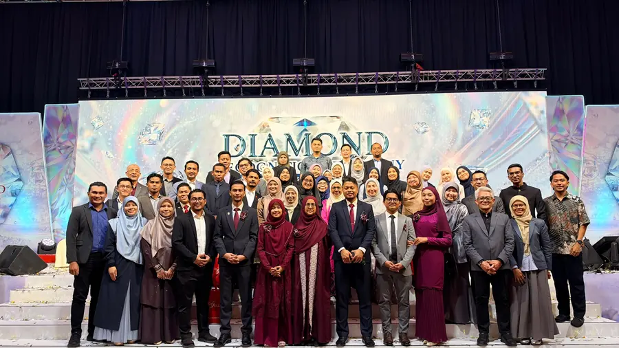

Matlamat Simpanan

# Yang Paling Menakutkan Tentang Menjadi Semakin Tua Bukanlah Usia Kita

*"Yang menakutkan bukan usia kita. Tetapi apabila lima tahun lagi, kita masih berada di tempat yang sama."*
{: .lead }

**Taufik Bin Musa** · 7 November 2026 · 4 min baca
{: .byline }

Saya terbaca satu posting di Facebook yang membawa maksud lebih kurang begini.

> "The scariest part of getting older isn't your age. It's being the same person five years from now."

Maksudnya, perkara paling menakutkan tentang semakin berusia bukanlah angka umur kita.

Tetapi apabila lima tahun berlalu, kehidupan kita masih tidak banyak berubah.

Kerjaya masih di takuk lama.

Kewangan masih begitu.

Hutang masih belum selesai.

Impian yang sama masih tersimpan dalam kepala.

## Kenapa kita berhenti scroll?

Sejujurnya, mesej macam ini bukanlah sesuatu yang baharu.

Kita mungkin dah jumpa beratus-ratus posting dengan maksud yang hampir sama.

Tetapi kenapa masih ada orang yang berhenti scroll apabila terbaca ayat seperti ini?

Mungkin sebab ayat itu terasa seperti sedang bercakap dengan diri sendiri.

Ada orang baca lalu terfikir, "Aku tak nak hidup aku macam ni lima tahun lagi. Aku kena buat sesuatu."

Ada juga yang baca sepintas lalu, senyum sedikit dan terus scroll macam biasa.

Tetapi saya tertarik dengan satu perkara.

Bagaimana kalau sebenarnya kita berhenti scroll kerana ada sesuatu dalam kehidupan kita yang sedang meminta perhatian?

Mungkin ada impian yang dah lama kita tangguhkan.

Nak selesaikan hutang, tetapi masih belum bermula.

Nak bina simpanan, tetapi setiap bulan duit habis begitu sahaja.

Nak tambah ilmu dan kemahiran, tetapi asyik menunggu masa yang sesuai.

Nak ubah kehidupan keluarga, tetapi tindakan masih sama seperti tahun-tahun sebelumnya.

Kita sebenarnya tahu apa yang perlu diperbaiki.

Cuma kita belum benar-benar mengambil langkah pertama.

## Diri yang baru untuk setiap tahap

Ada satu pesan yang selalu saya pegang daripada guru saya, Tn Mohd Zulkifli Shafie:

> Setiap tahap dalam hidup kita memerlukan diri kita yang baru.

Kalau kita mahukan hasil yang berbeza, kita tak boleh terus mengulangi cara hidup yang sama.

Kita perlu ubah cara berfikir.

Tambah ilmu.

Perbaiki tindakan.

Dan bina rutin yang membawa kita semakin dekat dengan matlamat.

## Satu tindakan kecil, konsisten

Tak semestinya perubahan besar perlu bermula hari ini.

Kadangkala, cukup dengan satu tindakan kecil yang kita lakukan secara konsisten.

Mula menyimpan walaupun sedikit. Kalau nak mulakan dengan emas, [akaun GAP Public Gold](apa-itu-akaun-gap-gold-accumulation-program-public-gold.md) boleh dibuka [serendah RM100](https://publicgold.com.my/index.php?route=account/register&intro_pgcode=PG00359605&is_dealer=1).

Mula belajar walaupun hanya dua puluh minit sehari.

Mula mengurangkan hutang.

Mula membina aset.

Yang penting, jangan biarkan masa berlalu tanpa ada kemajuan dalam kehidupan kita. Baca dulu [9 soalan lazim sebelum buka akaun GAP](9-soalan-lazim-sebelum-buka-akaun-emas-gap.md), atau [PM saya di WhatsApp](https://api.whatsapp.com/send/?phone=60132740711&text=Boleh+guide+saya+simpan+emas+Public+Gold&type=phone_number&app_absent=0) kalau nak mula tapi tak tahu dari mana.

Sebab lima tahun akan datang tetap akan tiba.

Persoalannya, apabila hari itu sampai nanti...

Adakah kita akan berterima kasih kepada diri kita hari ini kerana sudah mula berubah?

Atau menyesal kerana masih mengulangi alasan yang sama?

> Fikir-fikirkan.

{ .step-img width="900" height="506" }

Moga perkongsian ini bermanfaat.

### Mulakan Langkah Pertama Hari Ini

Daftar percuma dan mula serendah RM100 ikut kemampuan, atau WhatsApp saya untuk bimbingan percuma.

[Daftar Percuma →](https://publicgold.com.my/index.php?route=account/register&intro_pgcode=PG00359605&is_dealer=1){ .md-button .btn-gold target="_blank" }
[💬 WhatsApp](https://api.whatsapp.com/send/?phone=60132740711&text=Boleh+guide+saya+simpan+emas+Public+Gold&type=phone_number&app_absent=0){ .md-button .btn-wa target="_blank" }
[✈️ Telegram](https://t.me/taufikpg_emas){ .md-button .btn-tg }
[📘 E-Book](https://pg2u.my/app/ebook/taufikmusa){ .md-button .btn-ebook }

<!-- baca-juga -->
## Baca juga

- [5 Cara Selamatkan Poket Bila Gaji Tak Naik, Tapi Harga Barang Makin Meningkat](5-cara-selamatkan-poket-gaji-tak-naik-harga-barang-naik.md)
- [1,271 Pekerja Canva Terkesan, Apa Yang Boleh Kita Belajar?](1271-pekerja-canva-terkesan-apa-boleh-belajar.md)
- [Lubang Yang Digali Ayah Untuk Anaknya, Sembilan Tahun Kemudian Jadi Taman Bunga Matahari](lubang-yang-digali-ayah-jadi-taman-bunga-matahari-xinlei.md)

<!-- /baca-juga -->

#### Taufik Bin Musa
Dealer Public Gold · PG00359605 · G100 Network

Saya dealer dan committee di G100 Network, rangkaian dealer terbesar di Malaysia yang membimbing lebih 1.2 juta penyimpan emas. Saya bantu anda bina aset emas melalui Akaun GAP, terus dengan Public Gold.

`Mula RM100` `Tiada komitmen` `Boleh tukar emas fizikal` `Patuh syariah` `Tiada caj dealer`

Semua urus niaga dibuat terus bersama Public Gold, syarikat emas terbesar Malaysia sejak 2008. Tugas Dealer hanya menjadi pemudahcara urusniaga dan berkongsi ilmu emas yang praktikal, InsyaAllah.

[Jemput juga ke Website Rasmi Dealer G100 saya di pg2u.my/taufikmusa ↗](https://pg2u.my/taufikmusa){ target="_blank" }

{ width="640" height="959" loading="lazy" }

