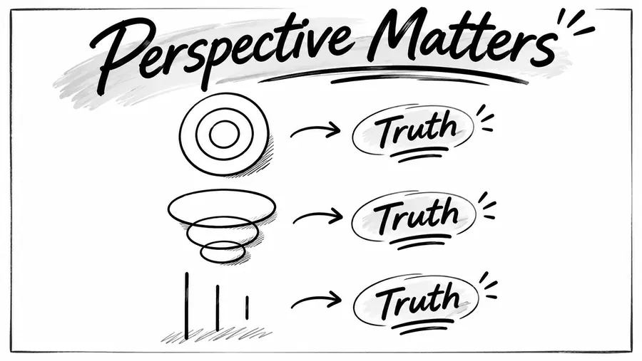

Matlamat Simpanan

# Perspective Matters, Perkara Yang Sama Boleh Nampak Sangat Berbeza

*"Sometimes, it's not about what we see. It's about how we see it."*
{: .lead }

**Taufik Bin Musa** · 10 November 2026 · 4 min baca
{: .byline }

{ .step-img width="900" height="507" }

Kadang-kadang, kita melihat sesuatu perkara yang sama, tetapi tafsiran kita boleh jadi sangat berbeza.

## Satu gambar, tiga tafsiran

Cuba lihat gambar di atas.

Ada tiga lukisan yang berbeza. Satu nampak seperti bulatan, satu lagi seperti beberapa bentuk oval yang bertindih, manakala satu lagi hanya kelihatan seperti garisan menegak.

Tetapi ketiga-tiganya mewakili perkara yang sama.

**Truth.**

Kebenaran itu tidak berubah. Cuma cara kita melihat dan memahami sesuatu perkara yang berbeza.

## Dalam kehidupan seharian

Benda ni sebenarnya banyak berlaku dalam kehidupan seharian kita.

Apabila berdepan dengan masalah, ada orang melihatnya sebagai satu kegagalan. Ada pula yang melihatnya sebagai satu pengalaman untuk belajar.

Apabila melihat orang lain berjaya, ada yang rasa tercabar. Ada pula yang menjadikannya sebagai inspirasi.

Apabila harga sesuatu barang meningkat, ada yang nampak sebagai beban. Tetapi ada juga yang melihatnya sebagai peluang untuk membuat persediaan lebih awal.

Situasi yang sama. Tetapi perspektif yang berbeza.

## Dalam simpanan emas

Begitu juga apabila kita bercakap tentang simpanan emas.

Apabila harga emas naik, ada orang melihatnya sebagai sesuatu yang semakin mahal. Mereka rasa sudah terlambat untuk mula membeli.

Tetapi ada juga yang melihat kenaikan harga emas sebagai satu peringatan tentang kepentingan menjaga nilai kekayaan yang mereka kumpulkan.

Apabila harga emas turun pula, ada yang mula risau kerana takut mengalami kerugian.

Tetapi bagi mereka yang menyimpan emas untuk jangka masa panjang, penurunan harga mungkin dilihat sebagai peluang untuk menambah gram simpanan. Baca juga [bila nak berhenti menyesal pasal harga emas](bila-nak-berhenti-menyesal-pasal-harga-emas.md) dan [siapa tahu bila harga emas paling rendah](siapa-tahu-bila-harga-emas-paling-rendah.md).

Sebenarnya, di sinilah pentingnya kita faham tujuan kita menyimpan emas.

Kalau kita melihat emas semata-mata sebagai instrumen untuk mendapatkan keuntungan dalam masa singkat, memang setiap pergerakan harga akan mempengaruhi emosi kita.

Hari ini harga naik, kita gembira. Esok harga turun, kita mula risau.

Tetapi kalau kita melihat emas sebagai salah satu cara untuk mempelbagaikan simpanan dan mengekalkan sebahagian nilai kekayaan dalam jangka masa panjang, perspektif kita mungkin akan berbeza.

Kita bukan sekadar melihat berapa harga emas hari ini.

Kita juga melihat berapa gram yang berjaya kita kumpulkan untuk masa depan.

Sebab itu, melalui [akaun GAP Public Gold](apa-itu-akaun-gap-gold-accumulation-program-public-gold.md), kita boleh mula membina simpanan emas sedikit demi sedikit, [serendah RM100](https://publicgold.com.my/index.php?route=account/register&intro_pgcode=PG00359605&is_dealer=1).

Tak perlu tunggu ada duit yang banyak. Yang penting, mula dengan kemampuan sendiri dan bina tabiat menyimpan secara konsisten. Baca dulu [9 soalan lazim sebelum buka akaun GAP](9-soalan-lazim-sebelum-buka-akaun-emas-gap.md), atau [PM saya di WhatsApp](https://api.whatsapp.com/send/?phone=60132740711&text=Boleh+guide+saya+simpan+emas+Public+Gold&type=phone_number&app_absent=0).

**Emas bukan instrumen yang menjamin keuntungan. Harganya tetap turun naik.** Tetapi dengan memahami fungsi dan risiko emas, kita boleh membuat keputusan yang lebih baik.

## Akhirnya

Akhirnya, mungkin persoalannya bukan sekadar sama ada harga emas sekarang mahal atau murah.

Tetapi bagaimana kita melihat kepentingan membina simpanan untuk masa depan?

> Sometimes, it's not about what we see. It's about how we see it.

**Perspective matters.**

### Ubah Perspektif, Mula Menyimpan

Daftar percuma dan mula serendah RM100 ikut kemampuan, atau WhatsApp saya untuk bimbingan percuma.

[Daftar Percuma →](https://publicgold.com.my/index.php?route=account/register&intro_pgcode=PG00359605&is_dealer=1){ .md-button .btn-gold target="_blank" }
[💬 WhatsApp](https://api.whatsapp.com/send/?phone=60132740711&text=Boleh+guide+saya+simpan+emas+Public+Gold&type=phone_number&app_absent=0){ .md-button .btn-wa target="_blank" }
[✈️ Telegram](https://t.me/taufikpg_emas){ .md-button .btn-tg }
[📘 E-Book](https://pg2u.my/app/ebook/taufikmusa){ .md-button .btn-ebook }

#### Taufik Bin Musa
Dealer Public Gold · PG00359605 · G100 Network

Saya dealer dan committee di G100 Network, rangkaian dealer terbesar di Malaysia yang membimbing lebih 1.2 juta penyimpan emas. Saya bantu anda bina aset emas melalui Akaun GAP, terus dengan Public Gold.

`Mula RM100` `Tiada komitmen` `Boleh tukar emas fizikal` `Patuh syariah` `Tiada caj dealer`

Semua urus niaga dibuat terus bersama Public Gold, syarikat emas terbesar Malaysia sejak 2008. Tugas Dealer hanya menjadi pemudahcara urusniaga dan berkongsi ilmu emas yang praktikal, InsyaAllah.

[Jemput juga ke Website Rasmi Dealer G100 saya di pg2u.my/taufikmusa ↗](https://pg2u.my/taufikmusa){ target="_blank" }

{ width="640" height="959" loading="lazy" }

