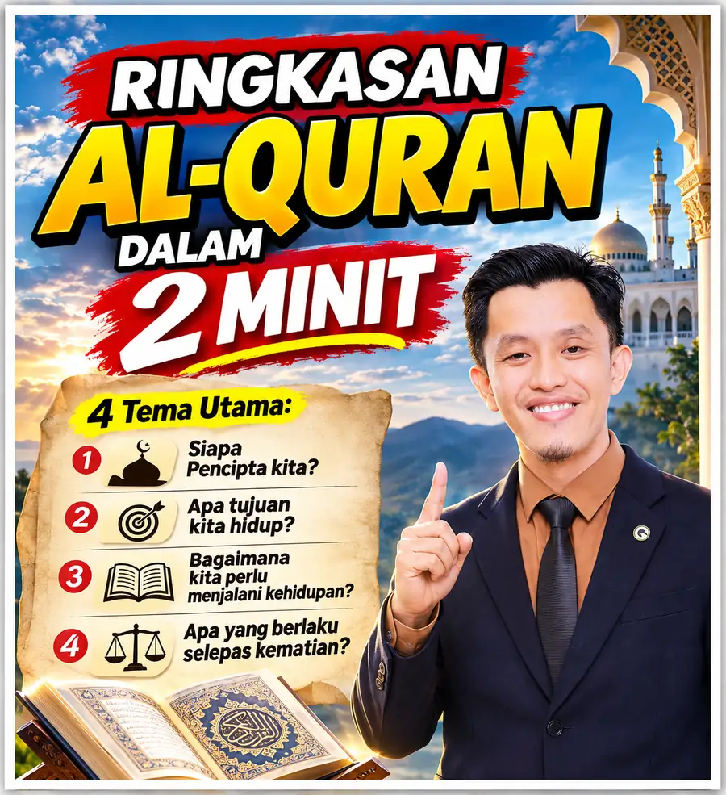

Ibrah

# Ringkasan Al-Quran Dalam 2 Minit, Empat Tema Utama Yang Perlu Kita Fahami

*"Dunia ini bukanlah destinasi terakhir kita."*
{: .lead }

**Taufik Bin Musa** · 11 November 2026 · 4 min baca
{: .byline }

{ .step-img width="900" height="985" }

**Kalau kita diminta meringkaskan seluruh Al-Quran dalam masa dua minit, apa agaknya perkara paling penting yang perlu kita fahami?**

Saya tertarik dengan satu perkongsian daripada seorang penceramah yang diminta untuk merumuskan keseluruhan isi kandungan Al-Quran dalam masa dua minit.

Jawapan beliau cukup menarik.

Menurut beliau, secara ringkasnya terdapat empat tema utama yang menjadi asas kepada kandungan Al-Quran.

## 1. Siapa sebenarnya Pencipta kita?

Al-Quran menjelaskan bahawa Allah adalah satu-satunya Tuhan yang menciptakan seluruh alam. Hanya Dia yang layak disembah dan kepada-Nya kita perlu mengabdikan diri.

Inilah asas paling utama dalam kehidupan seorang manusia, iaitu mengenal Pencipta dan meletakkan keimanan kepada-Nya.

## 2. Apakah tujuan sebenar kita hidup di dunia?

Adakah kita dilahirkan semata-mata untuk mendapatkan segulung ijazah, mengejar kejayaan dalam kerjaya, memiliki rumah besar atau membina keluarga yang bahagia?

Semua itu mungkin sebahagian daripada perjalanan hidup kita. Tetapi Al-Quran menjelaskan bahawa tujuan utama penciptaan manusia dan jin adalah untuk beribadah kepada Allah.

Perkara ini disebut dalam Surah Az-Zariyat, ayat 56.

Menariknya, ibadah bukan sekadar solat lima waktu, berpuasa atau membaca Al-Quran.

Membantu ibu bapa juga ibadah. Mendidik orang lain juga ibadah. Memberi makan kepada orang yang memerlukan juga ibadah.

Selagi dilakukan dengan niat yang betul dan mengikut panduan Allah, perkara biasa dalam kehidupan pun boleh menjadi satu bentuk ibadah.

## 3. Bagaimana manusia perlu menjalani kehidupan?

Al-Quran memberikan panduan bagaimana manusia perlu menjalani kehidupan.

Di dalamnya terdapat perintah dan larangan, serta panduan untuk menyelesaikan pelbagai masalah manusia dan masyarakat.

Daripada isu kezaliman, pembunuhan, bunuh diri, perpecahan keluarga, perkauman sehinggalah penyalahgunaan bahan memabukkan.

Al-Quran bukan sekadar mengajar kita tentang kepercayaan, tetapi turut memberikan panduan tentang bagaimana membina kehidupan dan masyarakat yang lebih baik.

## 4. Apa yang berlaku selepas kematian?

Al-Quran sentiasa mengingatkan kita tentang kehidupan selepas kematian.

Dunia ini bukanlah destinasi terakhir kita.

Anggaplah kehidupan di dunia ini seperti sebuah tempat persediaan sebelum kita menghadapi kehidupan yang kekal di akhirat.

Sebab itu kita perlu mempunyai kepercayaan yang benar, menyembah Tuhan yang benar, melakukan kebaikan dan berusaha menjadi manusia yang lebih baik.

Kerana setiap perbuatan kita akan dipertanggungjawabkan.

## Empat persoalan paling asas

Itulah empat tema besar yang dirumuskan oleh penceramah tersebut.

Bila difikirkan semula, empat perkara ini sebenarnya menjawab empat persoalan paling asas dalam kehidupan manusia:

- Siapa yang menciptakan kita?
- Kenapa kita diciptakan?
- Bagaimana kita perlu menjalani kehidupan?
- Dan ke mana kita akan pergi selepas kematian?

Kadang-kadang kita terlalu sibuk mencari jawapan kepada pelbagai persoalan kehidupan, sedangkan Al-Quran sudah menyediakan panduan untuk persoalan-persoalan yang paling asas ini.

> Persoalannya, sejauh mana kita benar-benar memahami dan menghayati panduan tersebut?

<!-- baca-juga -->
## Baca juga

- [Kisah Mus’ab bin Umayr: Pengorbanan Yang Menyentuh Hati](kisah-musab-bin-umayr-pengorbanan-yang-menyentuh-hati.md)
- [Apa Itu Akaun GAP (Gold Accumulation Program) Public Gold](apa-itu-akaun-gap-gold-accumulation-program-public-gold.md)
- [9 Soalan Lazim Sebelum Buka Akaun Emas GAP Public Gold](9-soalan-lazim-sebelum-buka-akaun-emas-gap.md)

<!-- /baca-juga -->

#### Taufik Bin Musa
Dealer Public Gold · PG00359605 · G100 Network

Saya dealer dan committee di G100 Network, rangkaian dealer terbesar di Malaysia yang membimbing lebih 1.2 juta penyimpan emas. Saya bantu anda bina aset emas melalui Akaun GAP, terus dengan Public Gold.

`Mula RM100` `Tiada komitmen` `Boleh tukar emas fizikal` `Patuh syariah` `Tiada caj dealer`

Semua urus niaga dibuat terus bersama Public Gold, syarikat emas terbesar Malaysia sejak 2008. Tugas Dealer hanya menjadi pemudahcara urusniaga dan berkongsi ilmu emas yang praktikal, InsyaAllah.

[Jemput juga ke Website Rasmi Dealer G100 saya di pg2u.my/taufikmusa ↗](https://pg2u.my/taufikmusa){ target="_blank" }

{ width="640" height="959" loading="lazy" }

