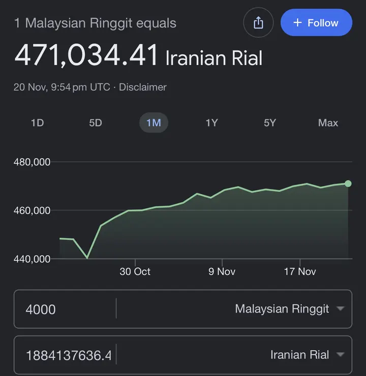

Matlamat Simpanan

# RM4,000 Sama Dengan 1.88 Bilion Rial Iran, Tapi Kita Bukan Bilionair

*"Jangan sampai kita hanya kaya dengan angka, sedangkan nilai kekayaan kita semakin mengecil."*
{: .lead }

**Taufik Bin Musa** · 22 November 2026 · 4 min baca
{: .byline }

{ .step-img width="720" height="740" }

**RM4,000 duit kita bersamaan lebih 1.88 bilion Rial Iran! Bayangkan betapa besarnya angka ini!**

Tengok kadar pertukaran mata wang ini.

Berdasarkan paparan Google pada 20 November, satu Ringgit Malaysia bersamaan kira-kira 471,034 Rial Iran.

Kalau kita tukarkan duit:

- RM1 = 471,034 Rial
- RM10 = 4.71 juta Rial
- RM100 = 47.1 juta Rial
- RM1,000 = 471 juta Rial
- **RM4,000 = 1.88 bilion Rial!**

Bayangkan, dengan hanya RM4,000, kita sudah boleh memegang wang bernilai lebih 1.88 bilion dalam mata wang Iran.

Tetapi adakah itu bermakna kita sudah menjadi bilionair di Iran?

Sudah tentu tidak.

Sebab banyaknya angka dalam akaun tidak semestinya bermakna seseorang itu kaya.

## Nilai duit bukan pada angka

Inilah satu perkara yang menarik untuk kita fikirkan.

Nilai sebenar duit bukan terletak pada berapa banyak angka yang kita ada, tetapi pada apa yang mampu kita beli dengan duit tersebut.

Apabila nilai mata wang sesebuah negara merosot dengan teruk, rakyatnya terpaksa berhadapan dengan kenaikan harga barang dan kehilangan kuasa beli.

Duit yang dahulu cukup untuk membeli pelbagai keperluan, mungkin hari ini hanya mampu membeli sebahagian kecil daripadanya.

Bayangkan kita bekerja berpuluh-puluh tahun untuk mengumpul kekayaan.

Simpan duit hasil titik peluh sendiri.

Kumpul sedikit demi sedikit untuk masa depan keluarga.

Tetapi nilai wang yang kita simpan semakin lama semakin terhakis.

Bukan semestinya sebab kita boros.

Bukan juga sebab kita gagal menguruskan kewangan.

Tetapi kerana nilai mata wang itu sendiri boleh berubah akibat keadaan ekonomi dan politik sesebuah negara.

## Pertahankan kuasa beli

Sebab itulah, dalam membina kekayaan, jangan hanya fikir bagaimana nak kumpul duit sebanyak mungkin.

Fikir juga bagaimana nak mempertahankan kuasa beli kekayaan yang kita sudah kumpul.

Pesan guru emas saya, Tn Mohd Zulkifli Shafie:

> "Duit bila nilainya jatuh, ia adalah kertas. Emas bila harganya jatuh, ia tetap emas."

Duit kertas memang penting untuk kegunaan harian.

Kita perlukan tunai untuk bayar bil, beli barang dan memenuhi keperluan keluarga.

Tetapi untuk simpanan jangka panjang, ada baiknya kita mempelbagaikan bentuk simpanan dengan memiliki aset sebenar seperti [emas](https://publicgold.com.my/index.php?route=account/register&intro_pgcode=PG00359605&is_dealer=1){ target="_blank" }. Lihat [apa itu akaun GAP](apa-itu-akaun-gap-gold-accumulation-program-public-gold.md) kalau anda baru nak kenal.

Emas bukan jaminan kita akan menjadi kaya. Harganya juga boleh turun naik.

Namun, emas mempunyai sejarah panjang sebagai penyimpan nilai dan boleh menjadi salah satu benteng untuk melindungi sebahagian kekayaan keluarga daripada risiko kejatuhan kuasa beli mata wang.

## Kesimpulannya

Akhirnya, jangan terlalu terpesona dengan angka dalam akaun bank.

Sebab yang lebih penting bukan berapa banyak duit yang kita ada.

Tetapi berapa banyak kuasa beli yang masih kita miliki.

**Kaya itu penting. Tetapi jangan sampai kita hanya kaya dengan angka, sedangkan nilai kekayaan kita semakin mengecil.**

### Lindungi Kuasa Beli Simpanan Anda

Daftar percuma dan mula serendah RM100 ikut kemampuan, atau WhatsApp saya untuk bimbingan percuma.

[Daftar Percuma →](https://publicgold.com.my/index.php?route=account/register&intro_pgcode=PG00359605&is_dealer=1){ .md-button .btn-gold target="_blank" }
[💬 WhatsApp](https://api.whatsapp.com/send/?phone=60132740711&text=Boleh+guide+saya+simpan+emas+Public+Gold&type=phone_number&app_absent=0){ .md-button .btn-wa target="_blank" }
[✈️ Telegram](https://t.me/taufikpg_emas){ .md-button .btn-tg }
[📘 E-Book](https://pg2u.my/app/ebook/taufikmusa){ .md-button .btn-ebook }

<!-- baca-juga -->
## Baca juga

- [Hari Lelaki Antarabangsa: Tanggungjawab Yang Wajib Direnungkan](hari-lelaki-antarabangsa-tanggungjawab-wajib-direnungkan.md)
- [Pencen 5 Tahun Dari Sekarang? Mustahil Ke?](pencen-5-tahun-dari-sekarang-mustahil-ke.md)
- [Bajet RM100,000 Simpan Emas? Faham 3 Pilihan Sebelum Beli](bajet-rm100000-simpan-emas-faham-3-pilihan.md)

<!-- /baca-juga -->

#### Taufik Bin Musa
Dealer Public Gold · PG00359605 · G100 Network

Saya dealer dan committee di G100 Network, rangkaian dealer terbesar di Malaysia yang membimbing lebih 1.2 juta penyimpan emas. Saya bantu anda bina aset emas melalui Akaun GAP, terus dengan Public Gold.

`Mula RM100` `Tiada komitmen` `Boleh tukar emas fizikal` `Patuh syariah` `Tiada caj dealer`

Semua urus niaga dibuat terus bersama Public Gold, syarikat emas terbesar Malaysia sejak 2008. Tugas Dealer hanya menjadi pemudahcara urusniaga dan berkongsi ilmu emas yang praktikal, InsyaAllah.

[Jemput juga ke Website Rasmi Dealer G100 saya di pg2u.my/taufikmusa ↗](https://pg2u.my/taufikmusa){ target="_blank" }

{ width="640" height="959" loading="lazy" }

