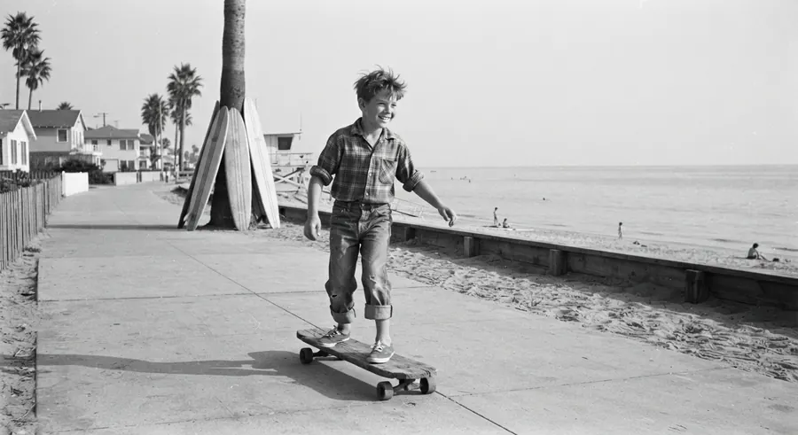

Matlamat Simpanan

# Skateboarding Bermula Daripada Peluncur Ombak Yang Bosan Menunggu Ombak Laut

*"Jangan tunggu ombak datang baru hendak meluncur."*
{: .lead }

**Taufik Bin Musa** · 2 November 2026 · 4 min baca
{: .byline }

{ .step-img width="900" height="491" }

Pernah terfikir kenapa wujudnya sukan skateboard?

Rupanya, sejarahnya bermula daripada sekumpulan peluncur ombak (surfers) yang bosan kerana laut tidak mempunyai ombak!

## California, tahun 1950-an

Kita undur ke tahun 1950-an di California, Amerika Syarikat.

Ketika itu, ada hari-hari tertentu laut terlalu tenang. Tiada ombak untuk diluncuri. Bagi golongan surfers, keadaan ini memang membosankan.

Mereka rindu untuk merasai sensasi meluncur di atas ombak.

Jadi, mereka mula mencari alternatif.

Ada yang mengambil kepingan papan kayu terpakai, kemudian memasang roda kasut roda (roller skate) di bahagian bawahnya.

Hasilnya, mereka boleh meluncur di atas jalan raya dan kaki lima.

Mereka menggelarnya sebagai **'Sidewalk Surfing'**.

Daripada sekadar mengisi masa ketika laut tidak berombak, aktiviti ini mula berkembang menjadi satu budaya tersendiri.

Mereka bereksperimen dengan pelbagai teknik, aksi imbangan dan gaya luncuran.

Akhirnya, apa yang bermula sebagai aktiviti kecil di jalanan berkembang menjadi sukan ekstrem yang dikenali di seluruh dunia.

Hari ini, skateboard bukan lagi sekadar permainan jalanan. Ia sudah menjadi sukan profesional dan dipertandingkan di Sukan Olimpik sejak Tokyo 2020.

Menariknya, semua ini bermula daripada satu masalah yang nampak begitu kecil.

> Tiada ombak. Jadi mereka cipta cara untuk terus meluncur.

## Tiga pengajaran daripada kisah ini

**Pertama, jangan tunggu keadaan sempurna untuk bermula.**

Kalau tiada ombak, mereka cari jalan lain untuk meluncur.

Begitu juga dalam kehidupan. Kita tak perlu tunggu semua perkara menjadi sempurna sebelum mula melakukan sesuatu.

**Kedua, masalah boleh menjadi titik permulaan kepada inovasi.**

Kadangkala, sesuatu yang hebat lahir daripada rasa tidak puas hati terhadap keadaan sedia ada.

Apa yang orang lain nampak sebagai masalah, mungkin sebenarnya peluang untuk kita mencipta sesuatu yang baharu.

**Ketiga, konsistensi lebih penting daripada keadaan sekeliling.**

Mereka tidak berhenti meluncur hanya kerana laut tidak berombak.

Mereka mencari alternatif supaya kemahiran dan minat itu terus berkembang.

## Dalam membina kewangan masa depan

Benda ni buat saya teringat tentang satu perkara dalam membina kewangan masa depan.

Ramai antara kita sebenarnya mahu mula menyimpan.

Tetapi sering kali kita meletakkan syarat.

Tunggu gaji naik. Tunggu hutang selesai. Tunggu ekonomi stabil. Tunggu ada duit lebih.

Akhirnya, bertahun-tahun berlalu tetapi simpanan masih belum bermula. Baca juga [bila nak mula simpan emas, jangan tunggu kereta terbang](bila-nak-mula-simpan-emas-jangan-tunggu-kereta-terbang.md).

Sebenarnya, kita tak perlu tunggu keadaan kewangan sempurna untuk mula menyimpan.

Mulakan dengan kemampuan yang ada.

Kalau belum mampu beli emas dalam jumlah yang besar, boleh mulakan simpanan emas melalui [GAP Public Gold](apa-itu-akaun-gap-gold-accumulation-program-public-gold.md) [serendah RM100](https://publicgold.com.my/index.php?route=account/register&intro_pgcode=PG00359605&is_dealer=1).

Kumpul sedikit demi sedikit mengikut kemampuan dan jadikan ia satu tabiat. Baca dulu [9 soalan lazim sebelum buka akaun GAP](9-soalan-lazim-sebelum-buka-akaun-emas-gap.md), atau [PM saya di WhatsApp](https://api.whatsapp.com/send/?phone=60132740711&text=Boleh+guide+saya+simpan+emas+Public+Gold&type=phone_number&app_absent=0).

Sebab dalam membina masa depan, yang penting bukan berapa besar kita bermula.

Tetapi berapa awal kita mengambil langkah pertama dan sejauh mana kita mampu istiqamah.

> Jangan tunggu ombak datang baru hendak meluncur. Kadangkala kita sendiri perlu mencipta jalan untuk terus bergerak.

Moga perkongsian ini bermanfaat.

### Jangan Tunggu Ombak, Mula Hari Ini

Daftar percuma dan mula serendah RM100 ikut kemampuan, atau WhatsApp saya untuk bimbingan percuma.

[Daftar Percuma →](https://publicgold.com.my/index.php?route=account/register&intro_pgcode=PG00359605&is_dealer=1){ .md-button .btn-gold target="_blank" }
[💬 WhatsApp](https://api.whatsapp.com/send/?phone=60132740711&text=Boleh+guide+saya+simpan+emas+Public+Gold&type=phone_number&app_absent=0){ .md-button .btn-wa target="_blank" }
[✈️ Telegram](https://t.me/taufikpg_emas){ .md-button .btn-tg }
[📘 E-Book](https://pg2u.my/app/ebook/taufikmusa){ .md-button .btn-ebook }

<!-- baca-juga -->
## Baca juga

- [5 Cara Bantu Keluarga Tanpa Mengorbankan Masa Depan Sendiri](5-cara-bantu-keluarga-tanpa-korbankan-masa-depan.md)
- [Nak Jadi Kaki Travel? Boleh! Tapi Jangan Sampai Poket Kembali Kosong](nak-jadi-kaki-travel-jangan-poket-kosong.md)
- [Emas Sentiasa Bernilai, Tapi Kenapa Masih Ramai Orang Tak Mula Menyimpan?](lima-jenis-manusia-simpanan-emas.md)

<!-- /baca-juga -->

#### Taufik Bin Musa
Dealer Public Gold · PG00359605 · G100 Network

Saya dealer dan committee di G100 Network, rangkaian dealer terbesar di Malaysia yang membimbing lebih 1.2 juta penyimpan emas. Saya bantu anda bina aset emas melalui Akaun GAP, terus dengan Public Gold.

`Mula RM100` `Tiada komitmen` `Boleh tukar emas fizikal` `Patuh syariah` `Tiada caj dealer`

Semua urus niaga dibuat terus bersama Public Gold, syarikat emas terbesar Malaysia sejak 2008. Tugas Dealer hanya menjadi pemudahcara urusniaga dan berkongsi ilmu emas yang praktikal, InsyaAllah.

[Jemput juga ke Website Rasmi Dealer G100 saya di pg2u.my/taufikmusa ↗](https://pg2u.my/taufikmusa){ target="_blank" }

{ width="640" height="959" loading="lazy" }

