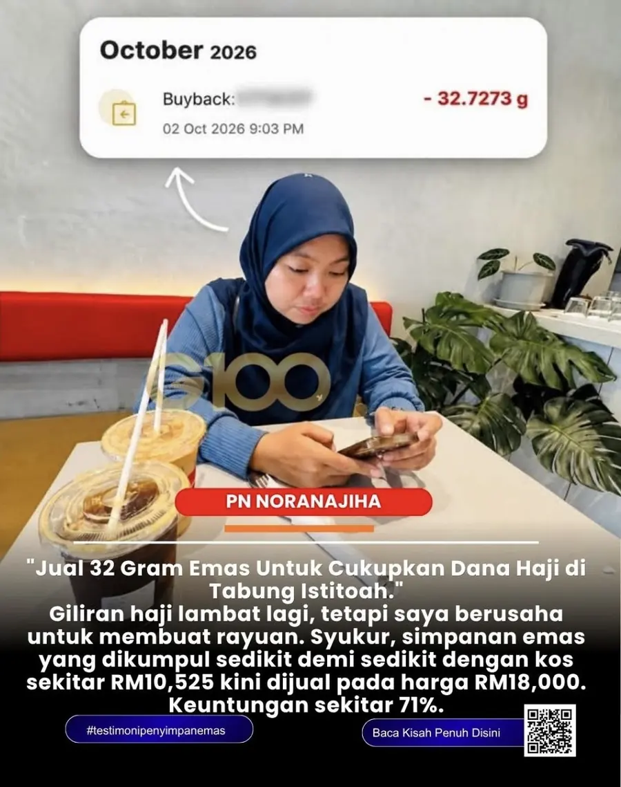

Testimoni

# Jual 32 Gram Emas Untuk Dana Haji: Kisah Puan NoraNajiha

*"Giliran haji lambat lagi, tetapi saya berusaha untuk membuat rayuan. Syukur, simpanan emas yang dikumpul sedikit demi sedikit kini dijual."*
{: .lead }

**Taufik Bin Musa** · 22 Oktober 2026 · 5 min baca
{: .byline }

{ .step-img width="900" height="1138" }

Kisah Puan NoraNajiha, seorang suri rumah, betul-betul buka mata kita. Beliau baru sahaja menjual lebih kurang **32 gram emas** dari [akaun GAP](https://publicgold.com.my/index.php?route=account/register&intro_pgcode=PG00359605&is_dealer=1){ target="_blank" } demi mencukupkan simpanan dalam **Tabung Istitoah** untuk buat rayuan haji tahun depan.

Pesan guru saya, Tn Mohd Zulkifli Shafie:

> "Harga emas tidak pernah dianggap murah pada mana-mana zaman. Jangan tunggu harga murah baru nak mula."

Simpanan emas yang beliau kumpul sedikit demi sedikit dengan kos purata sekitar **RM10,525** itu berjaya dijual semula kepada Public Gold pada harga sekitar **RM18,000**. Keuntungannya mencatat sekitar **71%**!

Ini 5 pesanan penting guru saya yang wajib kita faham.

## ✅ Pesanan #1: Emas sebagai alat capai matlamat

Emas bukan untuk disimpan secara membuta tuli selamanya.

Tukar emas hanya apabila kita mahu capai matlamat besar seperti pergi haji, beli aset hartanah, atau dana pendidikan anak-anak.

Puan NoraNajiha buktikan emas bantu mempercepatkan sasaran dana hajinya. Nak tahu cara tetapkan matlamat? Baca [5 langkah matlamat simpan emas](5-langkah-matlamat-simpan-emas-supaya-gaji-tak-bocor.md).

## ✅ Pesanan #2: Kuasa simpanan "paksa dan lupa"

Bagi seorang suri rumah, mungkin sukar untuk nampak simpanan berbelas ribu ringgit jika disimpan dalam bentuk wang kertas biasa.

Tetapi [Akaun GAP Public Gold](https://publicgold.com.my/index.php?route=account/register&intro_pgcode=PG00359605&is_dealer=1){ target="_blank" } memudahkan sesiapa sahaja menabung [serendah RM100](https://publicgold.com.my/index.php?route=account/register&intro_pgcode=PG00359605&is_dealer=1){ target="_blank" }.

Sedikit demi sedikit, akhirnya menjadi bukit.

## ✅ Pesanan #3: Formula rahsia dana haji

Kos haji makin mahal apabila dinilai dengan wang kertas akibat inflasi, tetapi kosnya makin murah jika dinilai dalam bentuk **gram emas**.

Fokus kumpul gram emas dari sekarang, bila sampai seru giliran kita, terus cairkan.

## ✅ Pesanan #4: Emas mematikan penyakit boros

Duit kertas mudah sangat bocor apabila kita nampak nombor yang banyak di dalam akaun bank.

Tetapi apabila wang itu ditukar menjadi emas, automatik "tangan gatal" nak berbelanja itu hilang kerana fitrah manusia sayang untuk menjual emas bagi tujuan remeh.

## ✅ Pesanan #5: Bisnes emas tambah pendapatan

Alang-alang kita menabung emas, eloklah kita ajak lebih ramai orang selamatkan duit mereka bersama Public Gold.

Kerja Dealer Public Gold bukan meminta orang menghabiskan duit, tetapi **mendidik orang menjadi lebih kaya**. Hasil komisen inilah yang dapat membantu kita menambah tabungan dengan lebih pantas.

Kesimpulannya, bukan emas itu sendiri yang menjadikan kita kaya, tetapi **ilmu tentang pengurusan wang dan disiplin kitalah penentu utamanya**.

Mahu mulakan tabungan emas serendah RM100 hari ini? [Daftar di sini](https://publicgold.com.my/index.php?route=account/register&intro_pgcode=PG00359605&is_dealer=1){ target="_blank" }, atau [WhatsApp saya](https://api.whatsapp.com/send/?phone=60132740711&text=Boleh+guide+saya+simpan+emas+Public+Gold&type=phone_number&app_absent=0){ target="_blank" } untuk saya bimbing anda secara percuma. Belum pasti caranya? Baca [cara daftar Public Gold GAP](cara-daftar-public-gold-gap-2026.md).

*Nota: Ini kisah peribadi seorang penyimpan. Keuntungan bergantung pada harga emas semasa dan tempoh simpanan, dan tidak dijamin sama untuk setiap orang.*

Moga perkongsian ini bermanfaat.

### Mulakan Tabungan Emas Anda Hari Ini

Daftar percuma dan mula dengan RM100, atau WhatsApp saya untuk bimbingan percuma.

[Daftar Percuma →](https://publicgold.com.my/index.php?route=account/register&intro_pgcode=PG00359605&is_dealer=1){ .md-button .btn-gold target="_blank" }
[💬 WhatsApp Taufik](https://api.whatsapp.com/send/?phone=60132740711&text=Boleh+guide+saya+simpan+emas+Public+Gold&type=phone_number&app_absent=0){ .md-button .btn-wa target="_blank" }
[✈️ Join Telegram](https://t.me/taufikpg_emas){ .md-button .btn-tg }
[📘 E-Book Percuma](https://pg2u.my/app/ebook/taufikmusa){ .md-button .btn-ebook }

#### Taufik Bin Musa
Dealer Public Gold · PG00359605 · G100 Network

Saya dealer dan committee di G100 Network, rangkaian dealer terbesar di Malaysia yang membimbing lebih 1.2 juta penyimpan emas. Saya bantu anda bina aset emas melalui Akaun GAP, terus dengan Public Gold.

`Mula RM100` `Tiada komitmen` `Boleh tukar emas fizikal` `Patuh syariah` `Tiada caj dealer`

Semua urus niaga dibuat terus bersama Public Gold, syarikat emas terbesar Malaysia sejak 2008. Tugas Dealer hanya menjadi pemudahcara urusniaga dan berkongsi ilmu emas yang praktikal, InsyaAllah.

[Jemput juga ke Website Rasmi Dealer G100 saya di pg2u.my/taufikmusa ↗](https://pg2u.my/taufikmusa){ target="_blank" }

{ width="640" height="959" loading="lazy" }

