

<a class="wa-card" href="https://api.whatsapp.com/send/?phone=60132740711&text=Boleh+guide+saya+simpan+emas+Public+Gold&type=phone_number&app_absent=0" target="_blank" rel="noopener">
  <svg viewBox="0 0 32 32" aria-hidden="true"><path fill="currentColor" d="M16 .6C7.5.6.6 7.5.6 16c0 2.8.7 5.4 2.1 7.8L.4 31.6l8-2.1c2.3 1.3 4.9 1.9 7.6 1.9h.1c8.5 0 15.4-6.9 15.4-15.4 0-4.1-1.6-8-4.5-10.9C24.1 2.2 20.2.6 16 .6zm0 28.2h-.1c-2.4 0-4.7-.6-6.8-1.9l-.5-.3-4.7 1.2 1.3-4.6-.3-.5c-1.4-2.2-2.1-4.7-2.1-7.3C2.7 9.2 8.7 3.3 16 3.3c3.5 0 6.8 1.4 9.3 3.8 2.5 2.5 3.8 5.8 3.8 9.3 0 7.3-5.9 13.2-13.1 13.2zm7.3-9.9c-.4-.2-2.4-1.2-2.7-1.3-.4-.1-.6-.2-.9.2-.3.4-1 1.3-1.2 1.5-.2.2-.4.3-.8.1-.4-.2-1.7-.6-3.2-2-1.2-1-2-2.4-2.2-2.8-.2-.4 0-.6.2-.8.2-.2.4-.4.6-.7.2-.2.3-.4.4-.7.1-.3 0-.5 0-.7-.1-.2-.9-2.1-1.2-2.9-.3-.8-.6-.7-.9-.7h-.7c-.3 0-.7.1-1 .5-.4.4-1.3 1.3-1.3 3.2 0 1.9 1.4 3.7 1.5 3.9.2.2 2.7 4.1 6.5 5.8.9.4 1.6.6 2.2.8.9.3 1.7.2 2.4.1.7-.1 2.4-1 2.7-1.9.3-.9.3-1.7.2-1.9-.1-.1-.3-.2-.7-.4z"/></svg>
  WhatsApp Taufik<strong>6013-2740711</strong><small>Tekan untuk chat, atau simpan nombor ini</small>
</a>

<a class="tg-card" href="https://t.me/taufikpg_emas">
  <svg viewBox="0 0 24 24" aria-hidden="true"><circle cx="12" cy="12" r="12" fill="#229ED9"/><path fill="#fff" transform="translate(4.4 4.5) scale(.62)" d="M9.78 18.65l.28-4.23 7.68-6.92c.34-.31-.07-.46-.52-.19L7.74 13.3 3.64 12c-.88-.25-.89-.86.2-1.3l15.97-6.16c.73-.33 1.43.18 1.15 1.3l-2.72 12.81c-.19.91-.74 1.13-1.5.71L12.6 16.3l-1.99 1.93c-.23.23-.42.42-.83.42z"/></svg>
  Telegram Channel<strong>Join Channel Taufik</strong><small>@TAUFIKPG_EMAS · update dan tips emas percuma</small>
</a>

Dealer Public Gold · PGCode PG00359605

Panduan dan content emas

# Simpan Emas Di Public Gold, Mudah Difahami, Untuk Semua

Panduan dan ilmu emas untuk anda yang nak mulakan simpanan emas di Public Gold.

MudahSelamatPatuh Syariah

[Mula: Cara Daftar GAP](artikel/cara-daftar-public-gold-gap-2026.md){ .md-button .md-button--primary }
[Lihat semua artikel](#artikel-terkini){ .md-button }

{ width="640" height="959" }

## Artikel Terkini

- [{ loading=lazy }](artikel/minat-simpan-emas-tapi-tak-jadi-beli.md)

    Daftar &amp; Mula

    **[Minat Simpan Emas, Tapi Tak Jadi Beli?](artikel/minat-simpan-emas-tapi-tak-jadi-beli.md)**

    Takut harga turun, rasa modal tak cukup atau belum faham akaun GAP? Faham dulu, rancang ikut kemampuan.

- [{ loading=lazy }](artikel/jangan-cepat-beri-diskaun.md)

    Bisnes

    **[Jangan Cepat Beri Diskaun!](artikel/jangan-cepat-beri-diskaun.md)**

    Pelanggan bayar bukan sekadar produk, mereka bayar nilai, ilmu dan servis. Pertahankan nilai anda.

- [{ loading=lazy }](artikel/kita-jaga-semua-orang-siapa-jaga-kita-nanti.md)

    Matlamat Simpanan

    **[Kita Jaga Semua Orang, Siapa Jaga Kita Nanti?](artikel/kita-jaga-semua-orang-siapa-jaga-kita-nanti.md)**

    Jangan tunggu tak mampu bekerja baru fikir tentang masa depan. Mula sikit-sikit dengan GAP serendah RM100.

- [{ loading=lazy }](artikel/orang-sanggup-bayar-mahal-untuk-3-benda.md)

    Bisnes

    **[Orang Sanggup Bayar Mahal Untuk 3 Benda Sahaja](artikel/orang-sanggup-bayar-mahal-untuk-3-benda.md)**

    Penyelesaian masalah, kemudahan dan pengalaman. Pelanggan bukan beli produk, mereka beli nilai.

- [{ loading=lazy }](artikel/ada-perpisahan-yang-kita-tak-sedar-itulah-kali-terakhir.md)

    Kehidupan

    **[Ada Perpisahan Yang Kita Tak Sedar Itulah Kali Terakhir.](artikel/ada-perpisahan-yang-kita-tak-sedar-itulah-kali-terakhir.md)**

    The Last Meeting Theory: kadang-kadang kita tak tahu pun pertemuan terakhir itu sudah berlaku.

- [{ loading=lazy }](artikel/kemewahan-bukan-bermaksud-kita-kaya.md)

    Matlamat Simpanan

    **[Kemewahan Bukan Bermaksud Kita Kaya](artikel/kemewahan-bukan-bermaksud-kita-kaya.md)**

    Kemewahan adalah apa yang kita belanjakan, kekayaan adalah apa yang kita simpan. 5 prinsip untuk mula.

- [{ loading=lazy }](artikel/berapa-lama-simpan-emas-untuk-nampak-untung.md)

    Matlamat Simpanan

    **[Berapa Lama Kita Kena Simpan Emas Untuk Nampak Untung?](artikel/berapa-lama-simpan-emas-untuk-nampak-untung.md)**

    Tabungan jangka panjang, faham spread, beri masa dan tetapkan matlamat. 5 perkara untuk expectation yang tepat.

- [{ loading=lazy }](artikel/beli-emas-dalam-telefon-selamat-ke.md)

    Asas GAP

    **[Beli Emas Dalam Telefon Ni Selamat Ke?](artikel/beli-emas-dalam-telefon-selamat-ke.md)**

    Bayar duit tapi emasnya tak nampak. 5 perkara untuk faham bagaimana akaun GAP Public Gold diuruskan.

- [{ loading=lazy }](artikel/harga-emas-pernah-cecah-rm764-kini-rm571-segram.md)

    Harga Emas

    **[Harga Emas Pernah Cecah RM764, Kini RM571 Segram: Panik Atau Tambah Simpanan?](artikel/harga-emas-pernah-cecah-rm764-kini-rm571-segram.md)**

    5 pesanan guru saya: penyimpan vs pelabur, matlamat, tempoh, DCA dan fokus pada gram.

- [{ loading=lazy }](artikel/kisah-musab-bin-umayr-pengorbanan-yang-menyentuh-hati.md)

    Ibrah

    **[Kisah Mus’ab bin Umayr: Pengorbanan Yang Menyentuh Hati](artikel/kisah-musab-bin-umayr-pengorbanan-yang-menyentuh-hati.md)**

    Pemuda paling bergaya di Makkah yang memilih iman. 3 perkara untuk direnungkan daripada perkongsian Ustaz Azlan Shah.

- [{ loading=lazy }](artikel/harga-emas-jatuh-rm16-segram-panik-atau-tambah-simpanan.md)

    Harga Emas

    **[Harga Emas Jatuh RM16 Segram Dalam Sehari: Panik Atau Tambah Simpanan?](artikel/harga-emas-jatuh-rm16-segram-panik-atau-tambah-simpanan.md)**

    Dari RM587 ke RM571 segram dalam sehari. 4 pesanan guru saya tentang cara melihat harga emas jatuh.

- [{ loading=lazy }](artikel/apa-itu-akaun-gap-gold-accumulation-program-public-gold.md)

    Asas GAP

    **[Apa Itu Akaun GAP (Gold Accumulation Program) Public Gold](artikel/apa-itu-akaun-gap-gold-accumulation-program-public-gold.md)**

    Takut simpan emas di rumah dan rasa modal belum cukup? 5 perkara tentang akaun GAP yang ramai belum tahu.

- [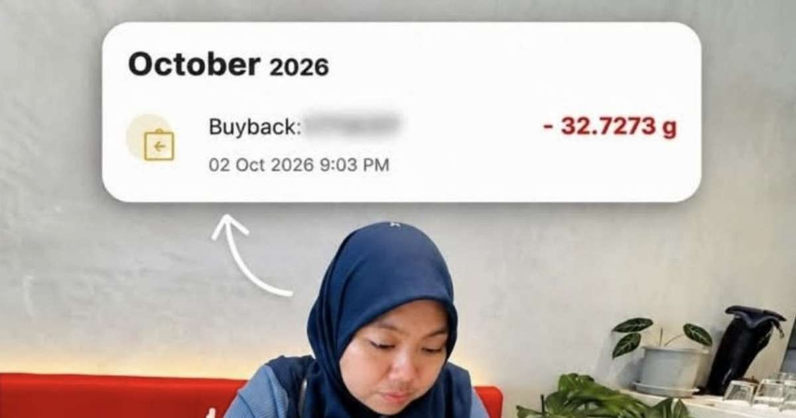{ loading=lazy }](artikel/testimoni-jual-32-gram-emas-dana-haji-noranajiha.md)

    Testimoni

    **[Jual 32 Gram Emas Untuk Dana Haji: Kisah Puan NoraNajiha](artikel/testimoni-jual-32-gram-emas-dana-haji-noranajiha.md)**

    Suri rumah kumpul emas sedikit demi sedikit, kini cukupkan Tabung Istitoah untuk rayuan haji.

- [{ loading=lazy }](artikel/5-langkah-matlamat-simpan-emas-supaya-gaji-tak-bocor.md)

    Matlamat Simpanan

    **[5 Langkah Matlamat Simpan Emas Supaya Gaji Tak Bocor Setiap Bulan](artikel/5-langkah-matlamat-simpan-emas-supaya-gaji-tak-bocor.md)**

    Gaji bocor bukan sebab gaji kecil, tapi tiada matlamat jelas. 5 langkah supaya duit kekal jadi harta.

- [{ loading=lazy }](artikel/9-soalan-lazim-sebelum-buka-akaun-emas-gap.md)

    Soalan Lazim

    **[9 Soalan Lazim Sebelum Buka Akaun Emas GAP Public Gold](artikel/9-soalan-lazim-sebelum-buka-akaun-emas-gap.md)**

    Modal, yuran, emas fizikal, syariah dan duit masuk akaun siapa. Baca nombor 6 elak scam.

- [{ loading=lazy }](artikel/5-sebab-content-creator-wajib-simpan-emas-fizikal.md)

    Untuk Content Creator

    **[5 Sebab Content Creator Wajib Simpan Emas Fizikal](artikel/5-sebab-content-creator-wajib-simpan-emas-fizikal.md)**

    Pendapatan ikut algoritma, gaya hidup dan populariti yang tak kekal. Kenapa emas fizikal penting.

- [{ loading=lazy }](artikel/step-by-step-buat-blog-guna-claude-code.md)

    Tutorial Beginner

    **[Step by Step Nak Buat Blog Guna Claude Code Untuk Beginner](artikel/step-by-step-buat-blog-guna-claude-code.md)**

    Dari beli domain hingga blog live, siap prompt yang boleh terus salin.

- [{ loading=lazy }](artikel/5-sebab-pasukan-keselamatan-perlukan-emas-fizikal.md)

    Untuk Pasukan Keselamatan

    **[5 Sebab Pasukan Keselamatan Perlukan Emas Fizikal](artikel/5-sebab-pasukan-keselamatan-perlukan-emas-fizikal.md)**

    Tugas berisiko tinggi, persaraan awal dan benteng kewangan keluarga. Kenapa emas fizikal penting.

- [{ loading=lazy }](artikel/runner-up-trimble-hackathon-dan-diamond-day.md)

    Diamond Day

    **[Runner-up Trimble Hackathon '26 dan Jemputan ke Diamond Day 7 November](artikel/runner-up-trimble-hackathon-dan-diamond-day.md)**

    Cerita kerja saya, pesan guru, dan jemputan ke Diamond Recognition Ceremony Public Gold.

- [{ loading=lazy }](artikel/bila-nak-mula-simpan-emas-jangan-tunggu-kereta-terbang.md)

    Mula Simpan

    **[Bila Agak Nak Mula Simpan Emas? 5 Sebab Jangan Tunggu Kereta Terbang](artikel/bila-nak-mula-simpan-emas-jangan-tunggu-kereta-terbang.md)**

    Tesla dah umum kereta terbang, tapi ramai masih tunggu harga emas turun. Kenapa bertangguh merugikan.

- [{ loading=lazy }](artikel/5-sebab-cikgu-golongan-paling-sesuai-simpan-emas.md)

    Untuk Cikgu

    **[5 Sebab Cikgu Golongan Paling Sesuai Simpan Emas](artikel/5-sebab-cikgu-golongan-paling-sesuai-simpan-emas.md)**

    Gaji tetap, pencen tidak kebal inflasi, dan cuti sekolah panjang. Kenapa cikgu mudah berjaya simpan emas.

- [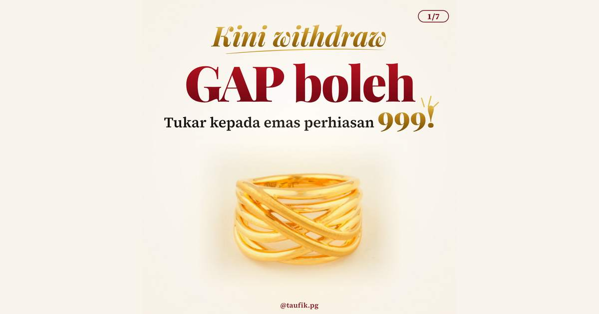{ loading=lazy }](artikel/cara-miliki-barang-kemas-pg-jewel-akaun-gap.md)

    PG Jewel

    **[Cara Miliki Barang Kemas di PG Jewel Melalui Akaun GAP Public Gold](artikel/cara-miliki-barang-kemas-pg-jewel-akaun-gap.md)**

    Baki gram GAP kini boleh ditebus jadi barang kemas 999. Ada contoh kiraan cincin RM1,663.

- [{ loading=lazy }](artikel/cara-daftar-public-gold-gap-2026.md)

    Asas

    **[Cara Daftar Public Gold GAP: 5 Langkah Mula Simpan Emas (2026)](artikel/cara-daftar-public-gold-gap-2026.md)**

    Daftar, install aplikasi, login dan buat belian pertama, semuanya 100% online.

<section class="tg-section" markdown>

Telegram Channel

## Join Channel Telegram Taufik

Update harga emas, tips simpanan dan info terkini Public Gold. Percuma, terus masuk dalam Telegram anda.

<a class="md-button btn-tg" href="https://t.me/taufikpg_emas">✈️ Join @TAUFIKPG_EMAS</a>

[{ width="560" height="747" loading="lazy" }](https://t.me/taufikpg_emas)

</section>

<section class="ebook-section" markdown>

E-Book Percuma

## 5 Minit Emas, Bernilai RM99

20 persoalan asas yang perlu anda tahu sebelum beli emas, tambah 5 soalan bonus. Dari ZERO, lengkap dengan tips penting dan rahsia yang jarang diceritakan.

<a class="md-button btn-ebook" href="https://pg2u.my/app/ebook/taufikmusa">📘 Muat Turun Percuma</a>

</section>

<section class="gallery" aria-label="Galeri emas fizikal Public Gold">

🥇 Emas Fizikal Public Gold

<h2 class="gallery-title">Dari Dinar Hingga Gold Bar</h2>

Semua emas fizikal Public Gold 999.9 (24 Karat), boleh dimiliki melalui <a href="https://publicgold.com.my/index.php?route=account/register&intro_pgcode=PG00359605&is_dealer=1" target="_blank" rel="noopener">akaun GAP</a>

<figure class="gallery-slide">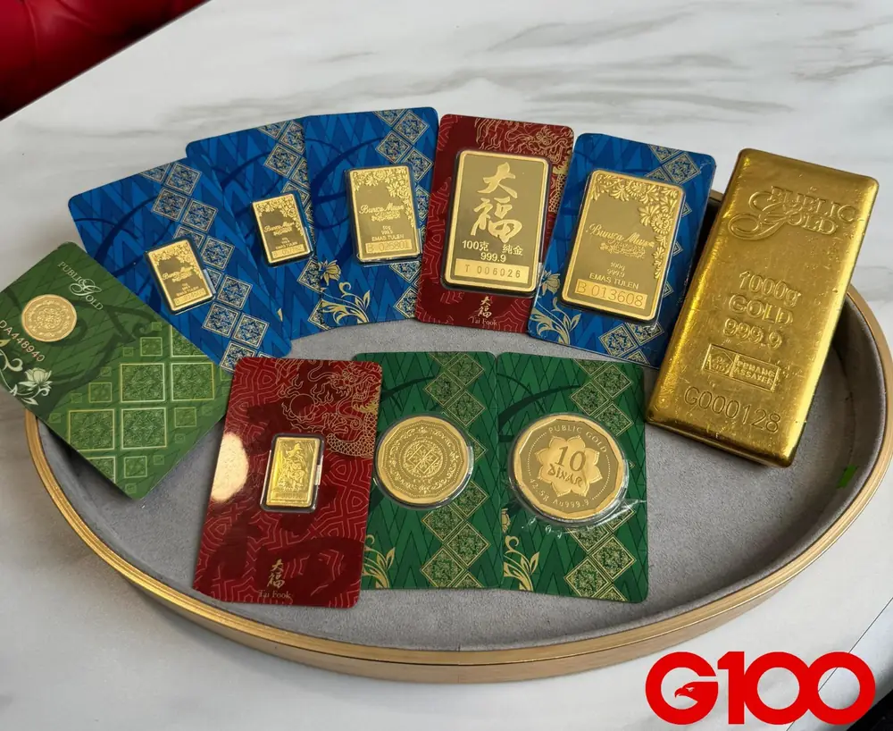<figcaption>Koleksi emas fizikal Public Gold · 999.9</figcaption></figure>
<figure class="gallery-slide"><figcaption>Gold Dinar 10 dan 5 Dinar · Au 999.9</figcaption></figure>
<figure class="gallery-slide">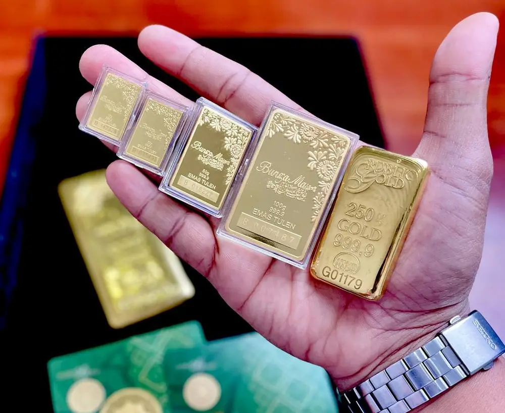<figcaption>Goldbar pelbagai saiz · 999.9 Emas Tulen</figcaption></figure>
<figure class="gallery-slide"><figcaption>Gold Dinar · Au 999.9</figcaption></figure>
<figure class="gallery-slide">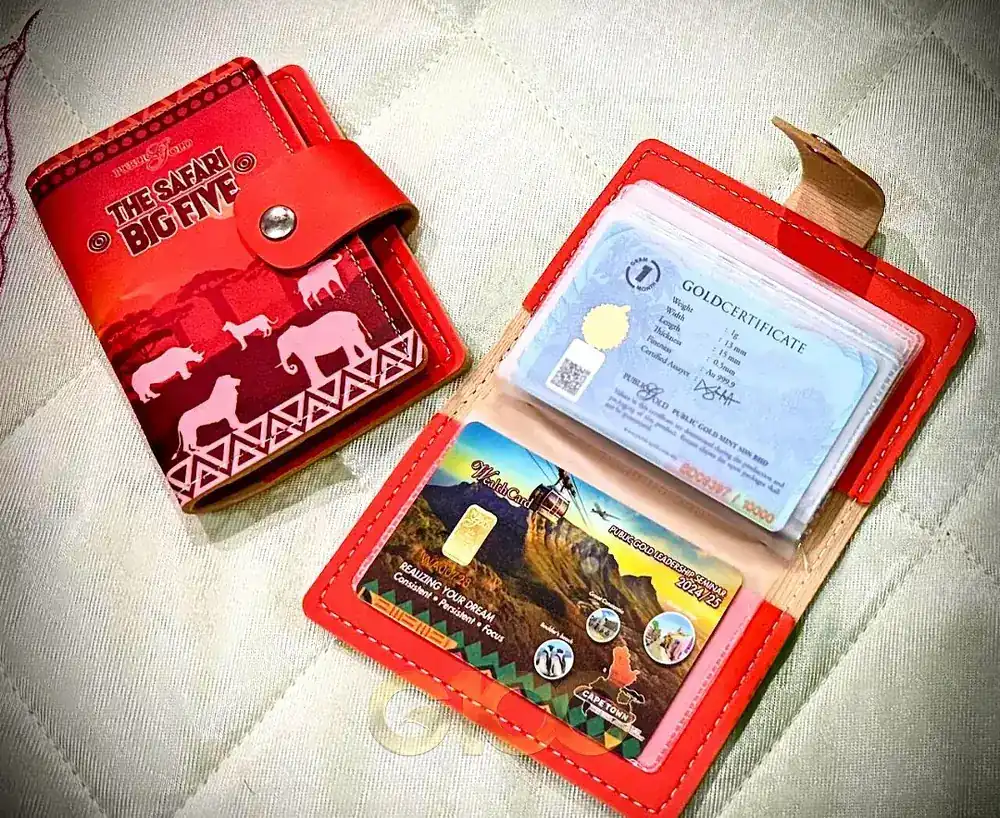<figcaption>Wealth Card dan Gold Certificate</figcaption></figure>
<figure class="gallery-slide"><figcaption>Gold Dinar dan Aplikasi Public Gold</figcaption></figure>
<figure class="gallery-slide"><figcaption>Goldbar 250 Gram · 999.9 Fine Gold</figcaption></figure>
<figure class="gallery-slide">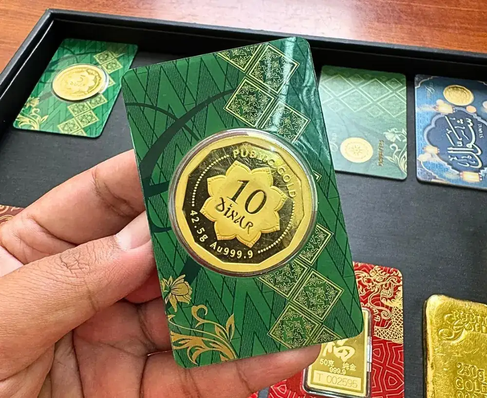<figcaption>Gold Dinar 10 Dinar · 42.5g Au 999.9</figcaption></figure>
<figure class="gallery-slide">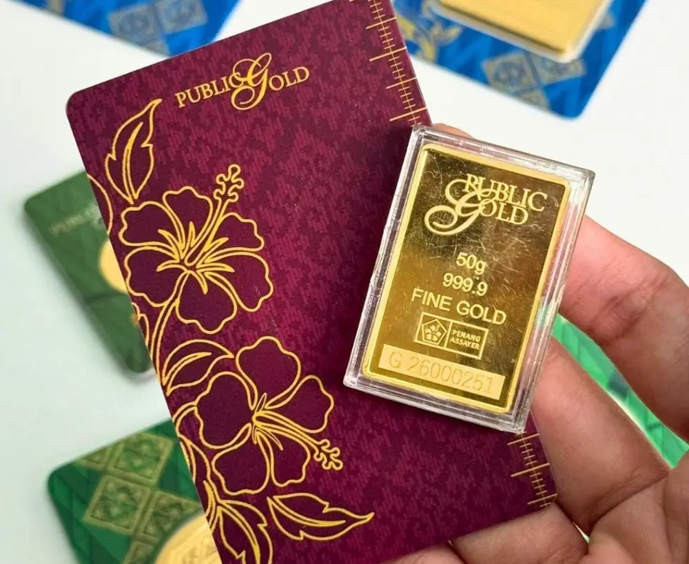<figcaption>Goldbar 50 Gram · 999.9 Fine Gold</figcaption></figure>
<figure class="gallery-slide">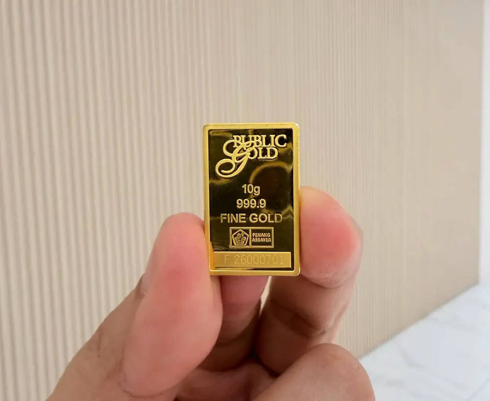<figcaption>Goldbar 10 Gram · 999.9 Fine Gold</figcaption></figure>
<figure class="gallery-slide">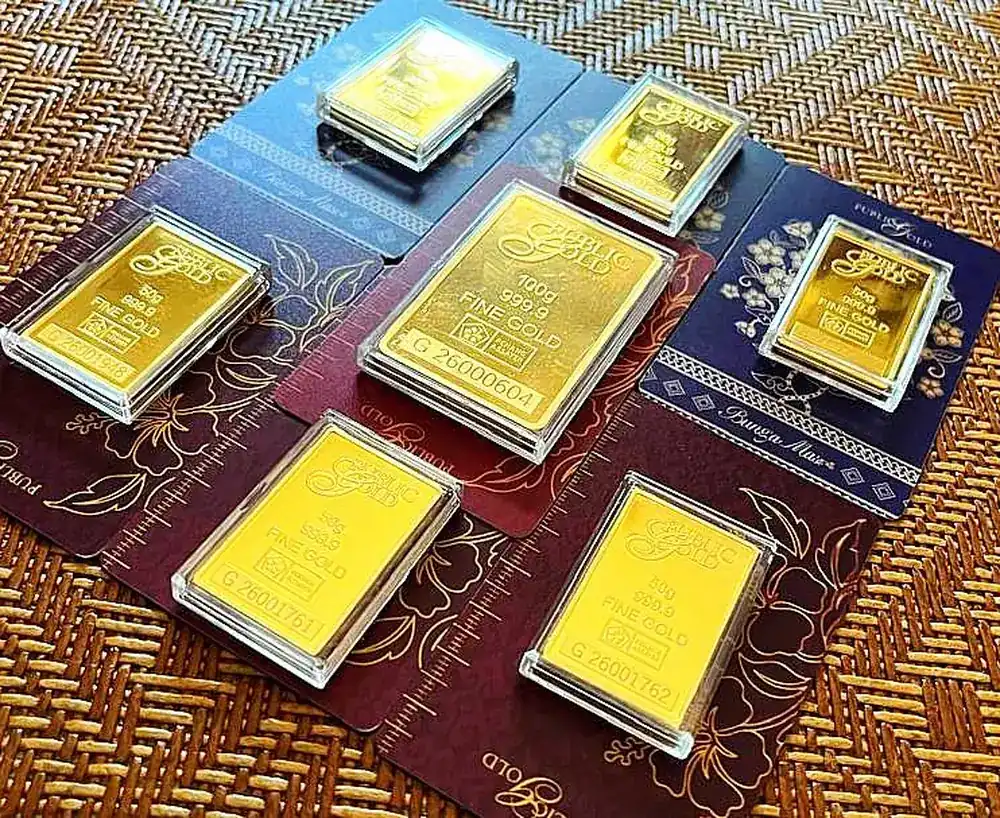<figcaption>Goldbar 50g dan 100g · 999.9 Fine Gold</figcaption></figure>
<figure class="gallery-slide">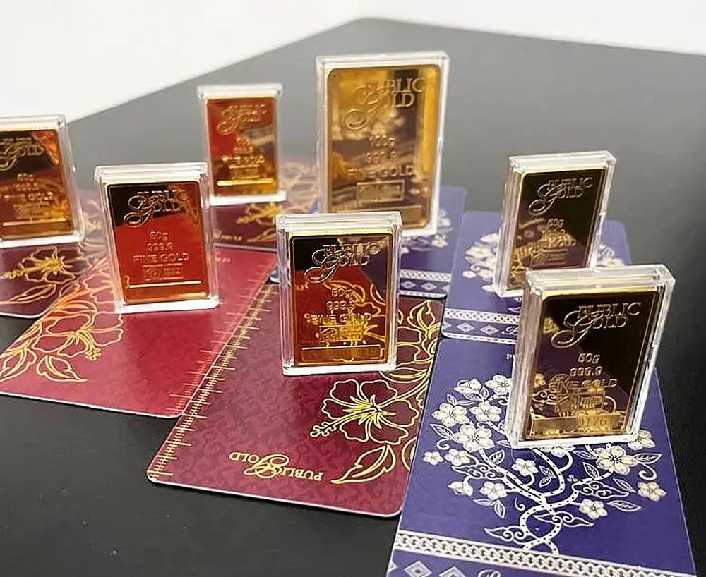<figcaption>Koleksi Goldbar · 999.9 Fine Gold</figcaption></figure>
<figure class="gallery-slide">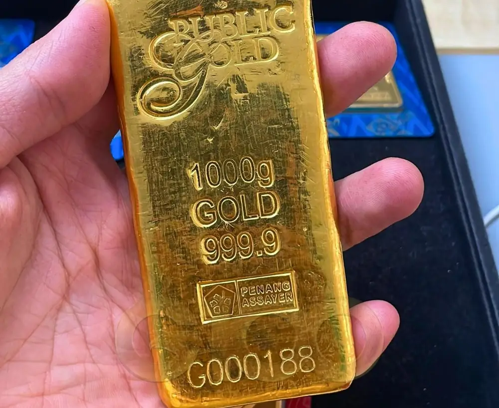<figcaption>Goldbar 1000 Gram (1kg) · 999.9</figcaption></figure>
<figure class="gallery-slide">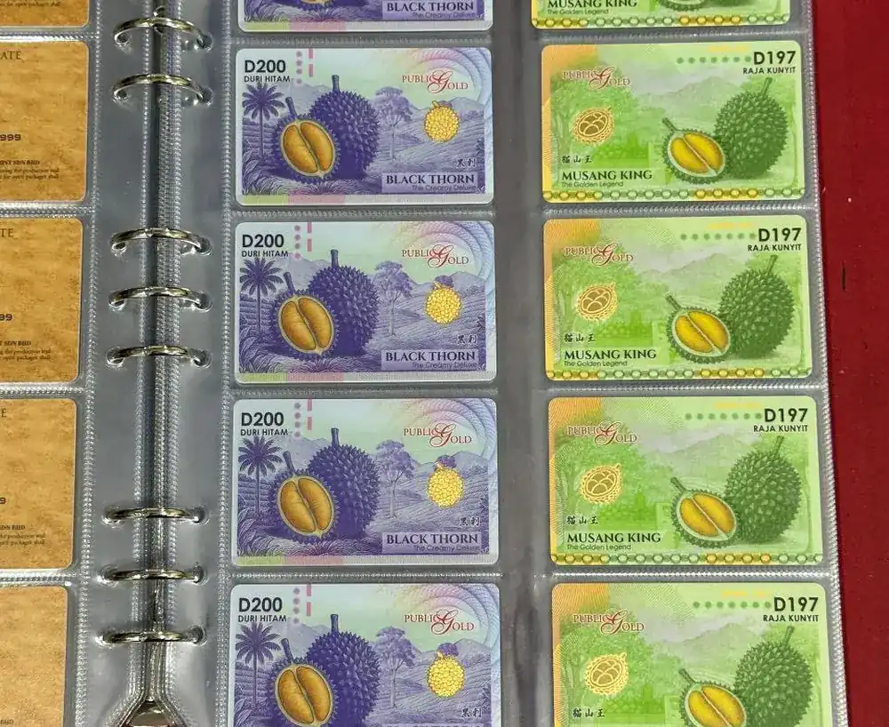<figcaption>Kad Emas Edisi Durian · Black Thorn dan Musang King</figcaption></figure>
<figure class="gallery-slide">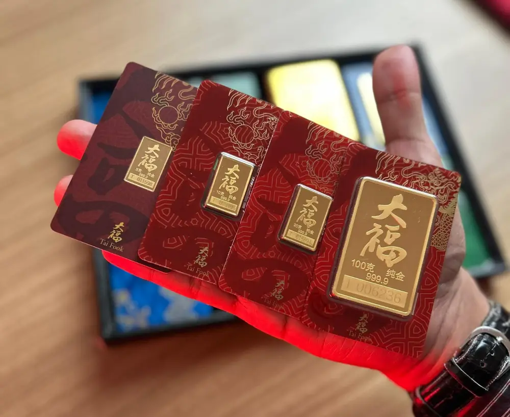<figcaption>Edisi Tai Fook · 5g, 10g, 20g dan 100g · 999.9</figcaption></figure>

<button class="gallery-nav prev" type="button" aria-label="Gambar sebelum">&#8249;</button>
<button class="gallery-nav next" type="button" aria-label="Gambar seterusnya">&#8250;</button>

</section>
